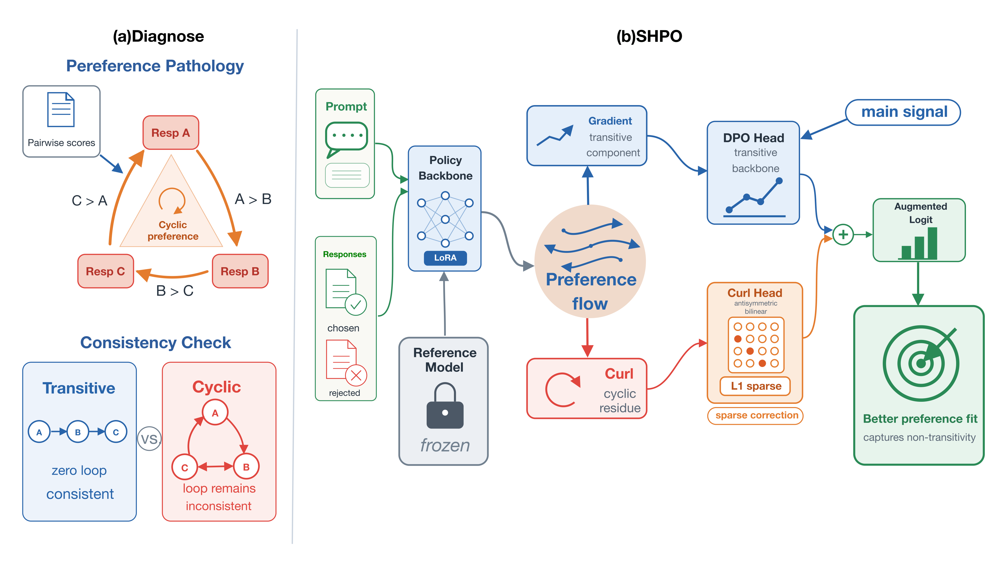
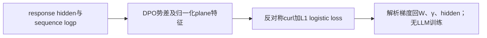

# Sparse Hodge Preference Optimization: Fine-Tuning Language Models toward Alignment beyond Transitive Preferences

[English](README-en.md)

> **L1核心机制组件，diagnostic only；不是完整LLM训练或能力验证。纯CPU，无CUDA宣传路径，不接Evolve晋级。** 完整实验成本过高，不复现（审查 DONE）；不自动重试。

## 论文信息

| 字段 | 内容 |
| --- | --- |
| 论文链接 | [arXiv:2611.30135v1](https://arxiv.org/abs/2611.30135v1)；[固定v1全文](https://arxiv.org/html/2611.30135v1) |
| 公司 / 作者机构 | 一作 **Yiming Liu**：**Jinan University**；Jinan University；Harbin Institute of Technology；Peking University |
| 首次公开日期 | **2026-11-23T06:44:15Z**；固定v1修订同首发；发现/审查2026-11-24，公告日期未独立确认，不写成今天首发 |
| 原作者开源代码 | 固定v1全文、Data Availability与所核作者入口未找到本篇已核实源码仓库；引用PEFT/Accelerate/AlpacaEval不算本方法源码发布。 |
| 本地 adapter / key | `shpo`；`adapter: null` |
| 本地复现代码 | `src/auto_research/post_training/shpo.py` |

## 原始论文总结

### 背景与主要改动

DPO把偏好写成response标量势之差，围绕三角形相加为零，不能表示A胜B、B胜C、C胜A的局部环。SHPO保留DPO项，再把response最后层hidden仅在response token上均值池化，经无bias W投影到2K维并归一化；每个二维plane的有向面积乘γ后相加，构造交换两回答即反号的残差。γ的L1惩罚使不活跃plane受压制；梯度同时流回W、γ和共享policy hidden，不是固定打分后重新排序。

<!-- paper-figure:start -->
### 原论文关键图

[](https://arxiv.org/html/2611.30135v1/full_figure.svg)

图片来自[原论文](https://arxiv.org/html/2611.30135v1/full_figure.svg)，已完整保留并视觉核对，无科学内容修改；版权归原作者所有。[出处与SHA256](assets/provenance.json)。图示是论文方法，不是本地训练或结果。
<!-- paper-figure:end -->



### 核心公式

$$
v=\frac{W^\top h}{\|W^\top h\|_2},\quad c_{ij}=\sum_{k=1}^K\gamma_k(v_{i,2k-1}v_{j,2k}-v_{i,2k}v_{j,2k-1}),\quad \ell_{ij}=\beta(\log\tfrac{\pi_i}{\pi_{ref,i}}-\log\tfrac{\pi_j}{\pi_{ref,j}})+\alpha c_{ij},\quad L=\operatorname{mean}\operatorname{softplus}(-\ell_{+-})+\lambda_{reg}\|\gamma\|_1.
$$

来源：§III-B Eq.3–5、§III-C Eq.6–8、§III-D。当投影为0时论文令v=0；本地在该非光滑点选择零反向导数、γ=0选择零L1次梯度，均标为本地边界约定而非上游实现。Remark3明确该参数head不一定等于固定图的正交Hodge curl投影；论文讨论harmonic-free比较结构，不能把head叫任意全局循环的精确分解器。α/γ可互相吸收，存在L1惩罚时尺度会改变有效正则强度。

### 论文离线与线上效果

三seed策略自身pair准确率accπ：HH-RLHF为SHPO 0.505±0.007、DPO 0.449±0.049；UltraFeedback为0.532±0.010对0.436±0.009。主指标accπ、reference校正acc_dpo与含curl的acc_dpo+c是三个口径，不能把辅助head分类得分当生成能力。作者另用GPT-4o评判生成；本地未调用judge，也不复现这些模型分数。未报告生产线上A/B。

### 与已有方法的关系

DPO的reference-relative log-ratio保持一维标量势，SHPO在同一logit上加可表示局部循环的反对称残差，并保留对shared hidden的训练梯度。引入更多pairwise容量不意味着生成时直接使用curl head，论文因此把accπ和acc_dpo+c分开报告；本地也不把有环的三点教学例当作真实偏好数据收益。

## 本地复现

### 数据协议与代码映射

纯CPU执行response-only mean pool、无bias d×2K投影与L2归一化、antisymmetric plane特征、DPO+curl logistic loss及gamma L1 subgradient；解析返回W/gamma/输入hidden/sequence logp梯度，hidden梯度未detach。zero projection的反向取0及gamma0处subgradient0是显式本地约定。无LLM/QLoRA/GPT judge或完整训练。

### 结果、负控与边界

```bash
PYTHONPATH=src python -c 'from auto_research.post_training.shpo import diagnostic; print(diagnostic(42))'
PYTHONPATH=src:scripts python -m pytest -q tests/test_nov24_post_training.py
```

针对性测试已实际执行CPU三种子公式与负控；本批统一冻结产物为[component-cpu-seeds42-44.json](metrics/component-cpu-seeds42-44.json)。多seed不升级机制诊断为能力比较，没有下载数据/权重、生成真实response、训练模型或调用judge。显式拒绝`device="cuda"`，不伪造GPU回执。有限差分与解析期望只验证当前函数合同，不为完整论文benchmark背书。

### 高成本完整实验

固定v1 §V-A/AppendixC TableS.7为Qwen2.5-7B QLoRA4-bit、512token、每数据集10000pair×3epoch、3数据集、主比较6方法×3seed，名义54训练run/162万pair presentations，另HPO/detach/MLP/超参扫参与GPT-4o评测。未报告统一GPU型号/墙钟时间；完整矩阵显著超本轮秒级CPU组件预算，不靠试跑估算，不下载模型数据或调用judge。

**成本过高，不复现（审查 DONE）**。可用资源是一张A100或A30，或本地Mac，不假设多卡/两台同时可用。CPU组件每seed预算不超过30秒；不为证明昂贵启动长探针，不进入自动实现或重试队列。
