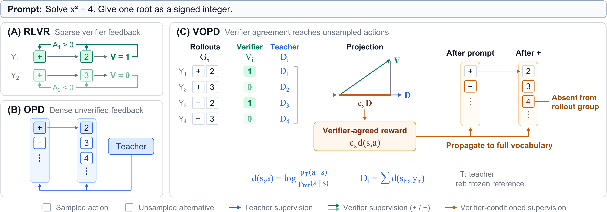
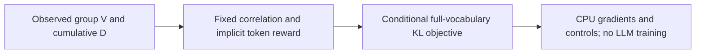

# Verifiable On-Policy Distillation

<!-- source-sha256: 98bf5e80f612ef8220c05d7dea14dfca9f80826bcb596f914d21c95033f4c9e2 -->

[简体中文](README.md)

> **L1 core-mechanism component, diagnostic only; not complete LLM training or capability evidence. CPU-only, without an advertised CUDA path or Evolve promotion.** Full experiments are high-cost and not reproduced (review DONE), without automatic retries.

## Paper information

| Field | Value |
| --- | --- |
| Paper | [arXiv:2611.30325v1](https://arxiv.org/abs/2611.30325v1); [fixed-v1 full text](https://arxiv.org/html/2611.30325v1) |
| Company / author institution | First author **Juntong Shi**, **Stanford University**. Author institutions: Stanford University, Google DeepMind. The first three authors are at Stanford; Minkai Xu is at Google DeepMind, verified against the author README. |
| Original publication | **2026-11-23T09:04:36Z**; v1 update equals original submission. Discovered/reviewed2026-11-24; announcement date not independently confirmed. Not a claim of first publication today. |
| Author source code | [Author repository](https://github.com/juntongshi48/VOPD). The author repository is verified at21c6c15b4c07cd433387b14956679a0f79b21c03, but only its README promises a future release. Method source is not released; repository existence is not runnable open source. |
| Local adapter / key | `vopd`; `adapter: null` |
| Local reproduction code | `src/auto_research/post_training/vopd.py` |

## Original paper summary

### Background and main changes

RLVR provides sparse sequence-outcome feedback on sampled responses. OPD supplies a full teacher distribution at visited prefixes but is not grounded in verified outcomes. VOPD sums teacher/reference log ratios per response, population-standardizes verifier and implicit rewards, and obtains their Pearson correlation by least-squares projection. Rescaling by the implicit-reward standard deviation restores reward scale. After an immediate-token approximation, it holds the observed group and prefix fixed and integrates a fresh hypothetical next-token action over the vocabulary. This transfers the teacher-representable direction of verifier preference, without verifying every alternative token.

<!-- paper-figure:start -->
### Original paper figure

[](https://arxiv.org/html/2611.30325v1/vopd_main_cropped.svg)

From the [fixed-v1 original SVG](https://arxiv.org/html/2611.30325v1/vopd_main_cropped.svg); the complete figure was preserved and visually checked without scientific modification. Copyright remains with its authors. [Source and SHA256](assets/provenance.json). This is the paper's method, not local training or results.
<!-- paper-figure:end -->



### Core equations

$$
D_i=\sum_t\log\frac{p_T(y_{it}\mid s_{it})}{p_{\mathrm{ref}}(y_{it}\mid s_{it})},\quad c_x=\frac1n\sum_i A_i^V A_i^D,\quad \ell= D_{KL}(p_\theta\Vert p_T)-\lambda c_x\sum_a p_\theta(a\mid s)\log\frac{p_T(a\mid s)}{p_{\mathrm{ref}}(a\mid s)}.
$$

Source: Section4, Eqs.6–18. Both advantages use population variance, so mean squared standardized D equals one. The group coefficient and prefix remain fixed during local backpropagation. Rao–Blackwellization removes only fresh-token sampling variance, not group/trajectory variance or the immediate-token approximation. The equivalent target is q proportional to p_T^(1+lambda*c) p_ref^(−lambda*c). Zero verifier variance uses a fixed0.25 extrapolation strength, not c=0 ordinary OPD. Varying verifier outcomes with zero teacher-reward variance are unspecified and explicitly rejected locally.

### Reported offline and online results

Across eight mathematics benchmarks, fixed-v1 macro averages are66.38 versus64.71 for VOPD versus OPD in4B same-size distillation, and53.32 versus50.88 for4B-to-1.7B distillation. VOPD is not best on every entry, including4B AMC23. These are authors' avg@n model results, not local validation. Paper experiments use student top-16 approximations; the local theoretical full-vocabulary finite kernel is not presented as that measured training path. No production online A/B is reported.

### Relation to existing methods

GKD separates the source of supervision states from the divergence choice. At student-visited states, VOPD additionally changes the target using verifier agreement with teacher/reference reward. Its lambda is extrapolation strength, not GKD's on-policy-data fraction; a frozen reference and group statistics are additional requirements. Neither the existing GKD candidate protocol nor these finite kernels establish large-model capability gains.

## Local reproduction

### Data protocol and code mapping

CPU-only code executes masked sums of sampled-token log ratios, population Pearson projection, the fixed0.25 zero-verifier-variance fallback, full-vocabulary loss and analytic logit gradients, and the conditional expectation over a fresh token. The loss receives a detached scalar coefficient. A zero teacher variance with varying verifier outcomes fails explicitly. No teacher/student model, rollout, answer verifier, training backend or benchmark runs; the unreleased top-16 implementation is not guessed.

### Results, controls and boundaries

```bash
PYTHONPATH=src python -c 'from auto_research.post_training.vopd import diagnostic; print(diagnostic(42))'
PYTHONPATH=src:scripts python -m pytest -q tests/test_nov24_post_training.py
```

Targeted tests actually executed CPU formula/control diagnostics for three seeds. The batch's frozen artifact is [component-cpu-seeds42-44.json](metrics/component-cpu-seeds42-44.json). Multiple seeds do not upgrade mechanism diagnostics into capability comparisons. No data/weight download, real response generation, model training or judge call is included. `device="cuda"` is explicitly rejected without fabricated GPU receipts. Finite differences and analytic expectations check function contracts, not the full paper benchmarks.

### High-cost full experiments

Section5.1/AppendixA uses eight A100s per run, a4B teacher,1.7B/4B student and frozen reference,140/160 steps with64 prompts and four responses each, up to12288 response tokens. This implies35840/40960 nominal rollout slots per configuration, before eight-benchmark repeated evaluation up to31744 tokens. Counts are configuration arithmetic, not local timing. The full matrix exceeds one A100/A30 or a Mac; no model/data download or training trial is launched.

**High cost: not reproduced (review DONE).** Available resources are one A100 or A30, or a local Mac, without assuming multiple GPUs or simultaneous hosts. CPU components have a30-second-per-seed cap. No long probe is launched to prove expense; no automatic implementation/retry queue.
