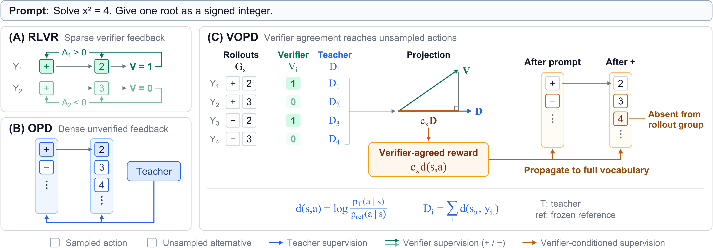
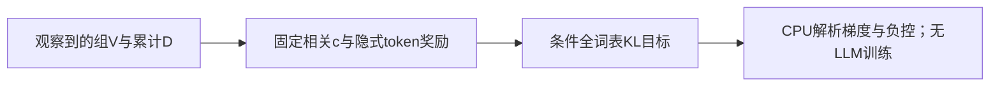

# Verifiable On-Policy Distillation

[English](README-en.md)

> **L1核心机制组件，diagnostic only；不是完整LLM训练或能力验证。纯CPU，无CUDA宣传路径，不接Evolve晋级。** 完整实验成本过高，不复现（审查 DONE）；不自动重试。

## 论文信息

| 字段 | 内容 |
| --- | --- |
| 论文链接 | [arXiv:2611.30325v1](https://arxiv.org/abs/2611.30325v1)；[固定v1全文](https://arxiv.org/html/2611.30325v1) |
| 公司 / 作者机构 | 一作 **Juntong Shi**：**Stanford University**；Stanford University；Google DeepMind（前三作者Stanford，Minkai Xu为Google DeepMind；机构映射经作者README核实） |
| 首次公开日期 | **2026-11-23T09:04:36Z**；固定v1修订同首发；发现/审查2026-11-24，公告日期未独立确认，不写成今天首发 |
| 原作者开源代码 | [作者仓库](https://github.com/juntongshi48/VOPD)；已核作者仓库，但固定提交仅README声明代码即将发布，方法源码尚未发布；不能标成可运行开源实现。 |
| 本地 adapter / key | `vopd`；`adapter: null` |
| 本地复现代码 | `src/auto_research/post_training/vopd.py` |

## 原始论文总结

### 背景与主要改动

RLVR只给已采样整条response稀疏结果反馈；OPD给每个访问prefix的完整teacher分布，但该信号未被verifier验证。VOPD先对每组response计算teacher/reference累计log-ratio D，再以population标准差标准化V和D，最小二乘投影得到Pearson相关c。把投影信号乘回σ_D恢复原奖励尺度，然后采用immediate-token近似，在已观察组与prefix固定时，对一个新的假想next-token取全词表条件期望。它传播的是teacher可表示方向上的verifier偏好，不是给所有备选token逐一调用verifier。

<!-- paper-figure:start -->
### 原论文关键图

[](https://arxiv.org/html/2611.30325v1/vopd_main_cropped.svg)

图片来自[原论文](https://arxiv.org/html/2611.30325v1/vopd_main_cropped.svg)，已完整保留并视觉核对，无科学内容修改；版权归原作者所有。[出处与SHA256](assets/provenance.json)。图示是论文方法，不是本地训练或结果。
<!-- paper-figure:end -->



### 核心公式

$$
D_i=\sum_t\log\frac{p_T(y_{it}\mid s_{it})}{p_{\mathrm{ref}}(y_{it}\mid s_{it})},\quad c_x=\frac1n\sum_i A_i^V A_i^D,\quad \ell= D_{KL}(p_\theta\Vert p_T)-\lambda c_x\sum_a p_\theta(a\mid s)\log\frac{p_T(a\mid s)}{p_{\mathrm{ref}}(a\mid s)}.
$$

来源：§4 Eq.6–18。A^V和A^D都用population方差，因而(1/n)Σ(A^D)²=1。c_x与prefix在本地反传中固定；Rao–Blackwellization只消去新token抽样方差，不消去组和轨迹方差，也不撤销immediate-token近似。等价target为q∝p_T^(1+λc)p_ref^(−λc)。verifier组内无方差时原文用固定0.25外推，不是把c置0退回普通OPD；teacher D无方差但V变化的情况未规定，本组件显式拒绝，不擅自补fallback。

### 论文离线与线上效果

固定v1八个数学benchmark宏平均：4B同规模VOPD为66.38，OPD为64.71；4B→1.7B为53.32对50.88。不是每个单项都最好，例如4B的AMC23低于OPD，且这些是作者模型的avg@n结果，不是本地验证。原文实验全部采用student top-16近似；本地只实现理论full-vocabulary有限核，不将二者误标为同一实测路径。未报告生产线上A/B。

### 与已有方法的关系

GKD区分监督状态来自学生还是固定轨迹，以及采用哪种散度；VOPD在学生访问状态上再用verifier与teacher/reference奖励相关性改变蒸馏目标。不是把GKD的on-policy比例λ换个名字：这里λ控制外推强度，另有冻结reference和组统计。现有GKD候选协议及本轮有限核都不能证明大模型能力收益。

## 本地复现

### 数据协议与代码映射

纯CPU执行masked累计log-ratio之和、population Pearson系数、zero-verifier-variance固定0.25外推fallback、full-vocabulary KL目标/解析logit梯度及条件新token期望。teacher方差为0但verifier变化时原文未规定，显式拒绝。没有teacher/student模型、rollout、verifier读取gold、训练器或benchmark；不猜测未发布top16实现。

### 结果、负控与边界

```bash
PYTHONPATH=src python -c 'from auto_research.post_training.vopd import diagnostic; print(diagnostic(42))'
PYTHONPATH=src:scripts python -m pytest -q tests/test_nov24_post_training.py
```

针对性测试已实际执行CPU三种子公式与负控；本批统一冻结产物为[component-cpu-seeds42-44.json](metrics/component-cpu-seeds42-44.json)。多seed不升级机制诊断为能力比较，没有下载数据/权重、生成真实response、训练模型或调用judge。显式拒绝`device="cuda"`，不伪造GPU回执。有限差分与解析期望只验证当前函数合同，不为完整论文benchmark背书。

### 高成本完整实验

固定v1 §5.1/AppendixA每run用8×A100；4B教师、1.7B/4B学生和冻结reference，140/160步×64prompt×4response，最大12288response token；单配置名义35840/40960 rollout槽，另八benchmark最高31744token多采样评测。相对单A100/A30或Mac预算完整矩阵成本过高，计数来自配置不是本机测量，不下载、不试跑。

**成本过高，不复现（审查 DONE）**。可用资源是一张A100或A30，或本地Mac，不假设多卡/两台同时可用。CPU组件每seed预算不超过30秒；不为证明昂贵启动长探针，不进入自动实现或重试队列。
