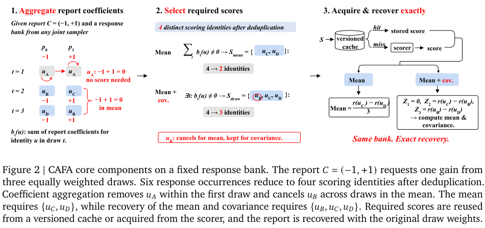
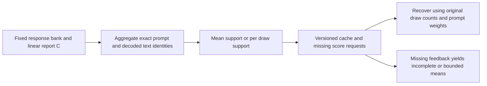

# CAFA: determine the report's needs before acquiring feedback

<!-- source-sha256: 02b0e8e4e25c58ce6ac51b2d8c883b962840cce23355ce15b84f2170a9a004eb -->
[简体中文](README.md)

> CPU L1 exact-support components, diagnostic only; neither language-model capability nor measured paid-judge savings. Full experiments are too expensive and not reproduced (review DONE); no retry/Evolve. This is a November24 backfill, not a November27 release.

## Paper information

| Field | Value |
| --- | --- |
| Paper | [Fixed v1](https://arxiv.org/abs/2611.31931v1); [full text](https://arxiv.org/html/2611.31931v1) |
| Company / institutions | First author Hui Zhang: Beijing Institute of Technology; Haoda Yue: Nanyang Technological University; Bicheng Deng and Rui Qian: Fudan University; Yuanchao Zhu: University of Electronic Science and Technology of China; Jun He: Beijing Technology and Business University. Not Google/Meta |
| Original publication | 2026-11-24 04:33:55 UTC, arXiv v1; discovered/reviewed November27. The PDF's November13 manuscript heading is not the verified first public release. The older announcement date was not captured in this run |
| Author code | [Author repository](https://github.com/huizhang-ai/CAFA), HEAD `210ca37e26e3b21bf98f73ac27af159b14ec0da6`, contains only a Coming soon README. Method source is not released/found; license unknown. The manuscript's supplementary-code statement does not establish source availability in this review |
| Local adapter / stable key | `cafa`; `adapter: null`, standalone CPU components |
| Local code directory | `src/auto_research/post_training/cafa.py` |

## Original paper summary

### Background and changes

Checkpoint comparison often needs differences rather than absolute scores. Common scores for identical responses cancel in contrasts, while ordinary caching may still purchase an unnecessary score. CAFA aggregates exact scoring-identity coefficients before acquisition. Means and ordinary sample covariances need not have the same support.

<!-- paper-figure:start -->
### Original key figure



From [the original paper](https://arxiv.org/pdf/2611.31931v1#page=2), Figure2 and its complete caption; copyright remains with the original authors. Scientific content is unchanged. Illustrated scores are teaching examples, not local model results. [Provenance/SHA](assets/provenance.json).
<!-- paper-figure:end -->



### Core equations

Section3 Eqs.2–4 define $b_{itu}=\sum_{j:\kappa(x_i,Y_{itj})=u}C_{:j}$ and $A_{iu}=\sum_tb_{itu}$. Mean recovery needs $S_{mean}=\{(i,u):A_{iu}\ne0\}$; adding ordinary covariance needs $S_{draw}=\{(i,u):\exists t,b_{itu}\ne0\}$. Both lie within ordinary caching support over active columns.

$$
\overline Z_i=\frac1{n_i}\sum_u A_{iu}r(u),\qquad
\widehat\theta=\sum_iw_i\overline Z_i,\qquad
\widehat V=\sum_i\frac{w_i^2}{n_i}\widehat\Sigma_i.
$$

The ordinary sample covariance uses every original draw and denominator $n_i-1$; zero-contribution draws cannot be dropped. Mirror draws$(A,B)$ and$(B,A)$ require no scores for their zero mean, but variance $2[r(B)-r(A)]^2$ still needs both scores. Fixed-bank recovery is algebraic; interpreting $\widehat V$ as Monte Carlo covariance additionally needs within-prompt IID draws and independence across prompts. It excludes repeated judge noise and does not guarantee interval coverage.

### Reported offline and online results

Controlled experiments remove55.8%/90.1% scoring inputs beyond cache-only. The46.1–51.3% workflow-cost differences also change samplers/draw budgets and cannot be attributed solely to CAFA. Numerical recovery of504 report cells is a fixed-bank audit, not model accuracy. Production online A/B was not reported.

### Relation to existing work

[Probabilistic Autorater](../2510.00263-probabilistic-autorater/README-en.md) calibrates preference probabilities; CAFA assumes a fixed/versioned scalar scorer and determines which inputs require scoring. Fewer queries do not improve judge correctness or bias, and proper rewards do not automatically cancel report coefficients. Their local components do not share a capability-improvement claim.

## Local reproduction

### Data protocol and code mapping

`plan_report` implements Eqs.2–4 on complete decoded-response banks, general linear matrices and positive prompt weights. `Fraction` aggregates exactly before dividing by draw counts; finite float spellings define decimal rationals, without numerical-zero tolerance. Identity is exact(prompt,text), not normalized text, token IDs or semantic matching. `recover` implements Algorithm2's versioned cache, missing requests, means, ordinary covariance and stratified mean covariance. Missing feedback is never zero-imputed. An explicit range permits mean bounds but no covariance. `new_score_calls` counts callback invocations, not verified API charges.

```bash
PYTHONPATH=src python -c 'from auto_research.post_training.cafa import diagnostic; print(diagnostic(42))'
PYTHONPATH=src:scripts python -m pytest tests/test_nov27_post_components.py -q
```

### Results, negative controls and limits

CPU seeds42/43/44 self-check fixed-bank equivalence, different mean/covariance supports, anchors, scorer versions and non-imputation. [Formal independent metrics](metrics/component-cpu-seeds42-44.json) come from the shared runner. No Independent Star generation, token-probability replay, language model, real judge or paid call is executed; no production monetary saving is measured. CPU only, `REQUIRES_GPU_VALIDATION=False`.

### High-cost full experiment

Section5 and AppendicesB/G include1.5B/1.7B models, three GRPO trajectories, multiple samplers/budgets/repetitions,128 prompts and versioned judges. AppendixG.5.1 records223.04 reserved card-hours across the research campaign, including training, recovery and diverse studies, not one deployment; paid judging and unresolved billing entries are separate. The full matrix exceeds the one-A100/A30-or-Mac short budget: too expensive, not reproduced (review DONE). Only small-bank exact components are accepted; no resource downloads, probes or retries.
