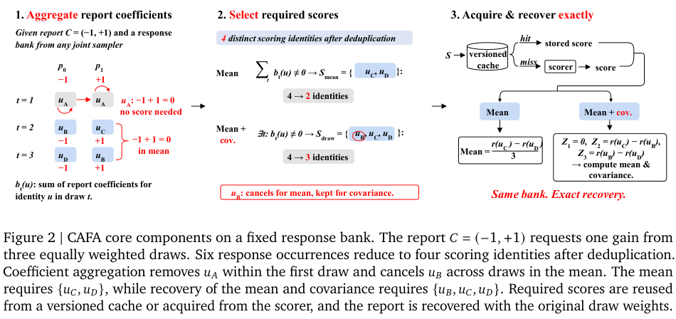
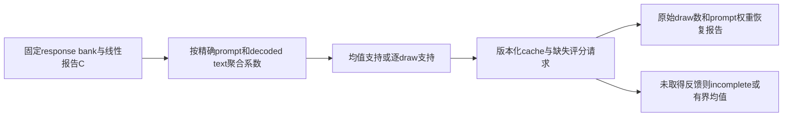

# CAFA：先看报告需要什么，再购买反馈

[English](README-en.md)

> CPU L1精确支持规划组件，diagnostic only；不是语言模型能力或真实judge节费实测。完整实验成本过高，不复现（审查 DONE）；无retry/evolve。本篇是11月24日首发的近期补漏，不是11月27日新发。

## 论文信息

| 字段 | 内容 |
| --- | --- |
| 论文链接 | [固定v1](https://arxiv.org/abs/2611.31931v1)；[全文](https://arxiv.org/html/2611.31931v1) |
| 公司 / 作者机构 | 一作Hui Zhang：Beijing Institute of Technology；Haoda Yue：Nanyang Technological University；Bicheng Deng、Rui Qian：Fudan University；Yuanchao Zhu：University of Electronic Science and Technology of China；Jun He：Beijing Technology and Business University；非Google/Meta |
| 首次公开日期 | 2026-11-24 04:33:55 UTC，arXiv v1；11月27日发现/审查。PDF页首2026-11-13不是已核原始公开日期；本轮未捕获本篇旧公告日期 |
| 原作者开源代码 | [作者仓库](https://github.com/huizhang-ai/CAFA)存在，但HEAD `210ca37e26e3b21bf98f73ac27af159b14ec0da6`只有README，写明Coming soon；公开方法源码未发布/未找到，许可未知。论文称supplement含代码，不等于本轮已取得可核源码 |
| 本地adapter / 稳定键 | `cafa`；`adapter: null`，独立CPU组件 |
| 本地复现代码目录 | `src/auto_research/post_training/cafa.py` |

## 原始论文总结

### 背景与主要改动

比较checkpoint常只需要分数差，而不需要每个绝对分数。相同回答的共同分数会在contrast中抵消，普通缓存仍可能多买一次不需要的反馈。CAFA先按请求的线性报告聚合精确scoring identity的系数，再决定评分支持；均值和普通样本协方差需要的支持不一定相同。

<!-- paper-figure:start -->
### 原论文关键图



图片来自[原论文](https://arxiv.org/pdf/2611.31931v1#page=2)Figure2及完整图注，版权归原作者所有；无科学内容改动，图中分数是方法教学例，不是本地模型结果。[来源与SHA](assets/provenance.json)。
<!-- paper-figure:end -->



### 核心公式

§3 Eq.2–4：$b_{itu}=\sum_{j:\kappa(x_i,Y_{itj})=u}C_{:j}$，$A_{iu}=\sum_tb_{itu}$。均值只需$S_{mean}=\{(i,u):A_{iu}\ne0\}$；同时报告普通协方差需$S_{draw}=\{(i,u):\exists t,b_{itu}\ne0\}$，二者均包含于active column的普通缓存支持。

$$
\overline Z_i=\frac1{n_i}\sum_u A_{iu}r(u),\qquad
\widehat\theta=\sum_iw_i\overline Z_i,\qquad
\widehat V=\sum_i\frac{w_i^2}{n_i}\widehat\Sigma_i.
$$

$\widehat\Sigma_i$使用全部原始draw和分母$n_i-1$；完全抵消的draw不能删除。例：$(A,B)$与$(B,A)$的均值差为0、不用评分，但普通方差为$2[r(B)-r(A)]^2$，仍需两个分数。精确恢复是固定bank代数；把$\widehat V$解释为MC估计还要求prompt内IID和不同prompt独立。它不包含重复judge噪声，也不自动给区间覆盖保证。

### 论文离线与线上效果

作者报告控制实验相对cache-only减少55.8%/90.1%评分输入；完整workflow的46.1–51.3%成本差还改变了sampler和draw预算，不能全归给CAFA。504个报告cell复原到数值精度是固定bank核验，不是模型准确率。未报告生产线上A/B。

### 与已有方法的关系

[Probabilistic Autorater](../2510.00263-probabilistic-autorater/README.md)校准评分者输出的偏好概率；CAFA在给定固定/版本化scalar scorer后规划哪些输入必须评分。少查分数不改善judge正确性或偏置；严格proper奖励也不会自动抵消线性报告的共同项。两者不能共享一个“评测更好”的能力结论。

## 本地复现

### 数据协议与代码映射

`plan_report`执行Eq.2–4，输入完整decoded-response bank、任意线性系数矩阵与正prompt权重；用`Fraction`在除draw数前精确聚合，float按十进制拼写解释为有理数，无近零容差。identity为精确(prompt,text)，不归一化、不按token ID或语义合并。`recover`执行Algorithm2的版本cache、缺失调用、均值/普通协方差和分层均值协方差；缺失反馈不补0，若声明分数范围则仅给均值bounds、不给协方差。new_score_calls只是callback调用数，不是已核API账单。

```bash
PYTHONPATH=src python -c 'from auto_research.post_training.cafa import diagnostic; print(diagnostic(42))'
PYTHONPATH=src:scripts python -m pytest tests/test_nov27_post_components.py -q
```

### 结果、负控与边界

CPU seeds42/43/44自验固定小bank的均值/协方差等价、mean与draw支持差别、anchor恢复、版本隔离与缺失不补0；[正式独立指标](metrics/component-cpu-seeds42-44.json)由统一runner生成。没有Independent Star/token概率回放、LLM生成、真实judge或付费调用；不声称实测节省生产费用。仅CPU，`REQUIRES_GPU_VALIDATION=False`。

### 高成本完整实验

正文§5及附B/G含1.5B/1.7B模型、三个GRPO轨迹、多个sampler/预算/重复、128prompt与版本judge。附G.5.1报告研究campaign223.04保留卡时，包含训练、失败恢复与多类实验，不是单次部署成本；另有付费评分和未核账条目。完整矩阵超单A100/A30或Mac短预算：**成本过高，不复现（审查 DONE）**。只承接无下载的小bank精确核，不探跑、不重试。
