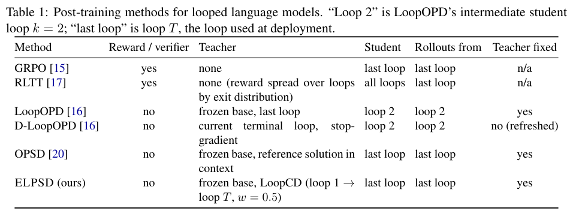
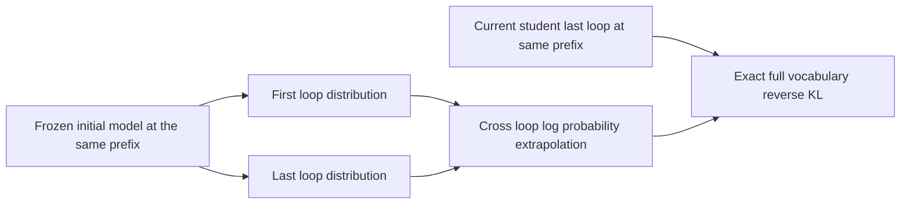

# ELPSD: train the last loop toward a frozen cross-loop extrapolated teacher

<!-- source-sha256: f2c16826e48b6659928af1b39ee1fd3f5ff2282ab1e9f5f87bd5f32df64633cc -->
[简体中文](README.md)

> CPU L1 supplied-logit mathematics, diagnostic only. No looped Transformer, on-policy sampling or training is implemented. This is a November24 backfill, not today's release. Full experiments are too expensive and not reproduced (review DONE); no retry/Evolve.

## Paper information

| Field | Value |
| --- | --- |
| Paper | [Fixed v1](https://arxiv.org/abs/2611.32452v1); [full text](https://arxiv.org/html/2611.32452v1) |
| Company / institution | Sole author Linghua Zhang; fixed-v1 PDF/HTML discloses no affiliation. Do not infer independent-researcher, Google or Meta status |
| Original publication | 2026-11-24 11:48:41 UTC, arXiv v1; discovered/reviewed November27. The older announcement date was not captured in this run |
| Author code | No method repository in fixed-v1 text/abstract or found by targeted title/author searches. License and commit unknown; Ouro/vLLM dependencies are not ELPSD source |
| Local adapter / stable key | `elpsd`; `adapter: null`, standalone CPU components |
| Local code directory | `src/auto_research/post_training/elpsd.py` |

## Original paper summary

### Background and changes

Distilling the final loop from its frozen identical copy gives zero initial loss and gradient. ELPSD instead extrapolates from first-loop to final-loop readouts of the frozen initial model, without an external teacher or reference answer. Students still sample from the final loop, and deployed decoding remains unchanged. The teacher is never refreshed during training.

<!-- paper-figure:start -->
### Original key visual



From [the original paper](https://arxiv.org/pdf/2611.32452v1#page=4), page4 Table1 and complete caption. The paper has no method architecture figure; this original table is not mislabeled a figure. Copyright remains with the original authors; scientific content is unchanged. [Provenance/SHA](assets/provenance.json).
<!-- paper-figure:end -->



### Core equations

Let $\ell_1=\log P_{\theta_0}^{(1)}$ and $\ell_T=\log P_{\theta_0}^{(T)}$. Section3 Eqs.3–5 use $w=0.5$, temperature1 and no truncation:

$$
\log q=\operatorname{logsoftmax}((1+w)\ell_T-w\ell_1),\quad
KL(p\Vert q)=(1+w)KL(p\Vert P_T)-wKL(p\Vert P_1)+\log Z.
$$

Average valid prefixes within each response before averaging responses; this is not a global token mean. At a supplied fixed prefix, the student-logit gradient is $p_v[(\log p_v-\log q_v)-KL(p\Vert q)]$ times response/position weights. Teacher and sampled prefixes are frozen; no importance ratios or clipping are added.

Proposition2 idealizes exact fitting to each refreshed teacher with the early loop fixed, obtaining $\log p_k=\ell_1+(1+w)^k(\ell_T-\ell_1)-\log Z_k$. This moving-target degeneration is a negative control, not a theorem about actual shared-parameter optimization. No pretend optimizer is used locally to establish it.

### Reported offline and online results

Table2 gives five-task avg@8 of63.69 for ELPSD,61.15 Base,62.32 GRPO and61.77 OPSD. Only seed42 is used; there is no multi-training-seed stability claim. Avg@8 averages correctness over eight samples, not pass@8. Production online A/B was not reported.

### Relation to existing work

Existing [LoOPSD](../../reproductions/2610.18162-loopsd/README-en.md) searches repeated-layer routes in an ordinary model, validates a teacher and alternates teacher refresh with distillation. ELPSD reads fixed early/final loops in a native looped model and extrapolates, without route search. LoOPSD is not the separately named LoopOPD compared in this paper. Neither extra-compute view should be reduced to an undifferentiated generic KL; local logit kernels do not execute either full model.

## Local reproduction

### Data protocol and code mapping

`extrapolated_teacher` constructs/fixes Eq.3's full-vocabulary target. `loss_gradient` computes Eqs.4/5 and analytical student-logit gradients, masking padding and requiring at least one valid prefix per response. `refreshed_rounds` implements only Proposition2's bounded idealized map. There is no shared Transformer stack, LM head, loop-state extraction, vLLM, rollout, model copy or optimizer.

```bash
PYTHONPATH=src python -c 'from auto_research.post_training.elpsd import diagnostic; print(diagnostic(42))'
PYTHONPATH=src:scripts python -m pytest tests/test_nov27_post_components.py -q
```

### Results, negative controls and limits

CPU seeds42/43/44 check exact-KL gradients against finite differences, contrastive decomposition, zero-weight initialization, frozen-target stationarity, padding isolation and refreshed-target log-odds growth. [Formal independent metrics](metrics/component-cpu-seeds42-44.json) come from the shared runner. Random logits are not model-loop readouts, and three seeds do not establish reasoning ability. CPU only, `REQUIRES_GPU_VALIDATION=False`.

### High-cost full experiment

Section4/AppendixB uses full-parameter Ouro-1.4B-Thinking,24 layers/four loops,14,684 problems and100 updates×64 prompts×8 responses=51,200 response slots, capped at16,384 tokens. Five benchmarks use eight evaluation samples and multiple trained controls. Every training GPU also holds a frozen float32 model. The source specifies one node/eight GPUs but no model/hour total; A100 runtime is not invented. Against one A100/A30 or a Mac's short budget, it is too expensive and not reproduced (review DONE). No model/data download, probe or automatic retry.
