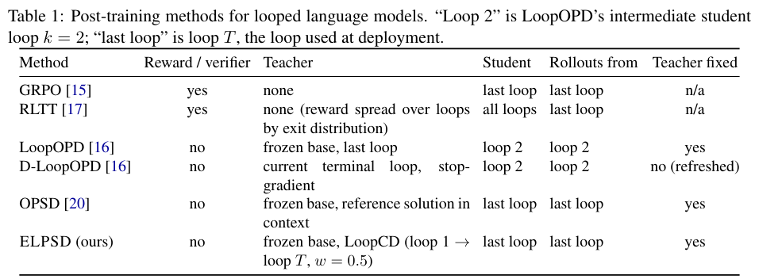
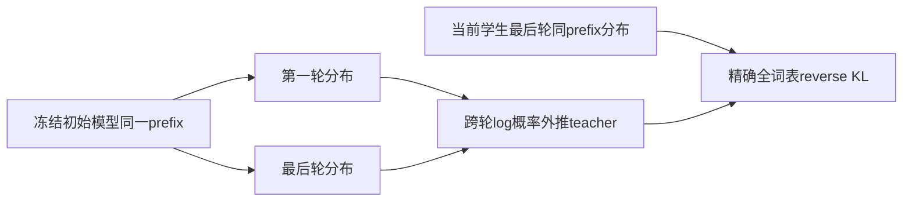

# ELPSD：最后一轮向冻结的跨轮外推教师学习

[English](README-en.md)

> CPU L1给定logits数学组件，diagnostic only；没有循环Transformer、on-policy采样或训练。本篇为11月24日首发补漏，不是今日新发。完整实验成本过高，不复现（审查 DONE）；无retry/evolve。

## 论文信息

| 字段 | 内容 |
| --- | --- |
| 论文链接 | [固定v1](https://arxiv.org/abs/2611.32452v1)；[全文](https://arxiv.org/html/2611.32452v1) |
| 公司 / 作者机构 | 单作者Linghua Zhang；固定v1 PDF/HTML未披露机构，不能推定为独立研究者、Google或Meta |
| 首次公开日期 | 2026-11-24 11:48:41 UTC，arXiv v1；11月27日发现/审查，本轮未捕获本篇旧公告日期 |
| 原作者开源代码 | 固定v1全文/摘要未给本方法源码链接，定向标题/作者检索未找到；代码许可与commit未知，不把Ouro/vLLM等依赖当方法源码 |
| 本地adapter / 稳定键 | `elpsd`；`adapter: null`，独立CPU组件 |
| 本地复现代码目录 | `src/auto_research/post_training/elpsd.py` |

## 原始论文总结

### 背景与主要改动

最后一轮向自己的冻结拷贝蒸馏，在初始化时loss和梯度都为0。ELPSD不换成外部教师或给参考答案，而把冻结初始模型的第一轮和最后一轮读数沿差异方向外推，形成高于最后一轮的target。学生仍从最后一轮生成，训练后保持标准最后轮解码；teacher在整个训练中不刷新。

<!-- paper-figure:start -->
### 原论文关键图



图片来自[原论文](https://arxiv.org/pdf/2611.32452v1#page=4)第4页Table1及完整表注；原文没有方法架构图，保留原始方法对比表，不伪称Figure。版权归原作者所有；无科学内容改动。[来源与SHA](assets/provenance.json)。
<!-- paper-figure:end -->



### 核心公式

令$\ell_1=\log P_{\theta_0}^{(1)}$、$\ell_T=\log P_{\theta_0}^{(T)}$。§3 Eq.3–5使用$w=0.5$、temperature1且不截断：

$$
\log q=\operatorname{logsoftmax}((1+w)\ell_T-w\ell_1),\quad
KL(p\Vert q)=(1+w)KL(p\Vert P_T)-wKL(p\Vert P_1)+\log Z.
$$

每条响应先对有效prefix取均值，再跨响应取均值，不能改为全部token统一均值。对给定prefix的学生logits，梯度为$p_v[(\log p_v-\log q_v)-KL(p\Vert q)]$，再乘响应/位置归约权重；teacher及prefix样本停止梯度，不加ratio或clip。

Proposition2只理想化“每轮精确拟合刷新teacher，且第一轮固定”得到$\log p_k=\ell_1+(1+w)^k(\ell_T-\ell_1)-\log Z_k$。这是移动目标的退化负控，不是实际共享参数训练的收敛定理；本地不伪造优化器来证明它。

### 论文离线与线上效果

Table2的五数学任务avg@8为ELPSD63.69、Base61.15、GRPO62.32、OPSD61.77。仅seed42，不能声称跨训练seed稳定提升；avg@8是八次样本的平均正确率，不是pass@8。未报告生产线上A/B。

### 与已有方法的关系

已有[LoOPSD](../../reproductions/2610.18162-loopsd/README.md)在普通模型上搜索重复层路由，验证选择教师并交替刷新；ELPSD在原生looped模型中读取固定第一/最后轮后外推，不搜索路由。LoOPSD与论文另比较的LoopOPD不是同一标题/方法。不能把“同模型额外计算视角”都改成一个generic KL，也不能据本地logits核宣称运行了两者任一完整模型。

## 本地复现

### 数据协议与代码映射

`extrapolated_teacher`固定Eq.3的完整词表target并冻结数组；`loss_gradient`计算Eq.4/5及解析logit梯度，显式mask排除padding且每响应至少一个有效prefix。`refreshed_rounds`仅执行Proposition2的有限理想化映射作负控。不包含shared transformer stack、LM head、first/last hidden-state提取、vLLM、rollout、teacher model copy或optimizer。

```bash
PYTHONPATH=src python -c 'from auto_research.post_training.elpsd import diagnostic; print(diagnostic(42))'
PYTHONPATH=src:scripts python -m pytest tests/test_nov27_post_components.py -q
```

### 结果、负控与边界

CPU seeds42/43/44自验精确reverse-KL梯度与有限差分、contrastive decomposition、w0初始化零梯度、冻结target驻点、padding梯度0和刷新target log-odds复合；[正式独立指标](metrics/component-cpu-seeds42-44.json)由统一runner生成。随机logits不是模型loop读数，三seed不构成推理能力证据。仅CPU，`REQUIRES_GPU_VALIDATION=False`。

### 高成本完整实验

§4/附B：Ouro-1.4B-Thinking全参数、24层×4loops、14,684题；100步×64prompt×8响应=51,200响应槽，最长16,384token，另有五任务八采样与多个训练对照。每卡还有冻结float32模型副本；硬件为单节点8GPU，型号/小时未给，不编造A100耗时。相对单A100/A30或Mac短预算，**成本过高，不复现（审查 DONE）**。不下载模型/数据、不探跑或自动重试。
