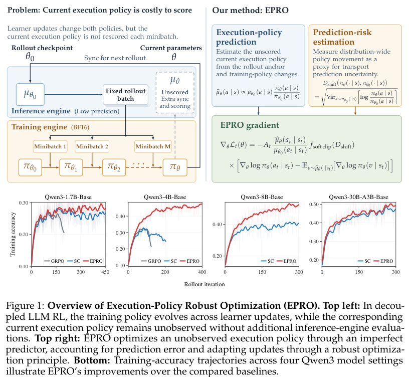
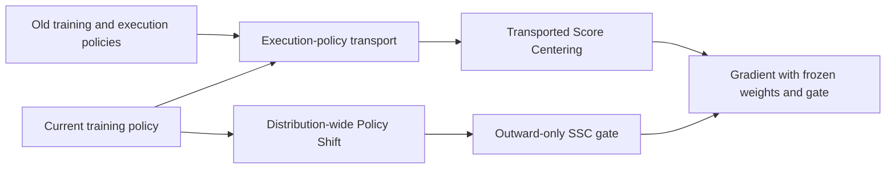

# EPRO: predict the execution policy, then control update risk

<!-- source-sha256: 66703ac045c4039cf8dc8eb5df856eb2ad7655bf23e2e5cbcf122bab606a4632 -->

[简体中文](README.md)

> L1 CPU equation components, diagnostic only, not LLM reinforcement-learning capability reproduction. Full experiments are too expensive and not reproduced (review DONE); no automatic retry or Evolve promotion.

## Paper information

| Field | Value |
| --- | --- |
| Paper | [EPRO, fixed v1](https://arxiv.org/abs/2611.32810v1); [full text](https://arxiv.org/html/2611.32810v1) |
| Institutions | First author Yibo Wang: Northwestern University; coauthors also list Carnegie Mellon University. Not a Google/Meta paper |
| Original publication | 2026-11-24 15:29:28 UTC, original arXiv v1 submission. Its announcement date is absent from this batch's announcement pool, not inferred |
| Author code | The paper links [EPRO](https://github.com/yibowangnwu/EPRO), but a read-only `git ls-remote` on 2026-11-25 returned `Repository not found`. Public method code is not found/verified; commit and license are unknown |
| Local adapter / key | `epro`; `adapter: null`, standalone component |
| Local code | `src/auto_research/post_training/epro.py` |

## Original method

### Motivation and changes

The same weights need not induce the same distribution in a BF16 training engine and a low-precision rollout engine. Both distributions are observable at the old checkpoint, but the execution distribution corresponding to intermediate learner updates is not. EPRO transports the old execution anchor using training-policy changes, then attenuates risky outward updates using distribution-wide movement.

### Original paper figure



Image from [the original paper](https://arxiv.org/pdf/2611.32810v1#page=2), Figure1. Copyright belongs to the original authors. Cropped from fixed-v1 page2 with its caption intact. Curves are author results, not local measurements. [Provenance and SHA](assets/provenance.json).



### Core equations

Write $p=\pi_0$, $q=\mu_0$ and $u=\pi_\theta$. Section2, Eq.2:

$$
\widehat\mu(v)=\frac{q(v)u(v)/p(v)}{Z},\qquad Z=\sum_vq(v)u(v)/p(v).
$$

This recovers $q$ when $u=p$ and reduces to $u$ when the two engine anchors agree, $q=p$. Section4, Eqs.8/10:

$$
S=\sqrt{\operatorname{Var}_{v\sim p}[\log(u(v)/p(v))]},\quad
\kappa=\begin{cases}e^{-[S-\tau]_+/\sigma},&A\log(u(a)/p(a))>0\\1,&\text{otherwise}.\end{cases}
$$

In Eqs.11/12, $A\min(\widehat\mu(a)/q(a),C)\kappa$ is frozen during differentiation. The loss gradient with respect to current training logits is this coefficient times $\widehat\mu-\operatorname{onehot}(a)$. Differentiating the gate is a different update.

AppendixB, Eqs.35–39 reconstruct the unrecorded tail outside the old execution top-K set $H$ as $\widetilde q(v)=\rho p(v)$, where $\rho=(1-q(H))/(1-p(H))$. Policy Shift is also computed on head tokens plus one tail bucket. This is a coarse-grained approximation, not a full-vocabulary measurement. Paper training uses K32; the local small-vocabulary diagnostic uses K3.

The theoretical high-probability improvement result assumes bounded prediction error, STE Jacobian approximation, bounded scores and smoothness. Policy Shift is an empirical risk proxy; SSC does not inherit an unconditional improvement guarantee.

### Author-reported evidence

Section5/Table1 reports unweighted seven-benchmark averages of21.5/36.7/39.1/39.1 for the1.7B/4B/8B/30B-A3B settings. Three evaluation seeds do not mean three independent training seeds. No production online A/B is reported. Common-support replay KL is not full-vocabulary error.

### Comparison

[Regularized Score Centering](../2611.21791-regularized-score-centering/README-en.md) estimates a center under fixed behavior using independent auxiliary actions and constrains drift with reverse KL. EPRO transports its centering distribution with learner movement and uses Policy Shift for outward attenuation. Neither is reward-mean subtraction; importance caps, centering distributions and regularization cannot be interchanged. There is no reported matched-budget EPRO-versus-RSC comparison here, and component results do not rank capabilities.

## Local components

### Inputs and code

`prepare_update` consumes external old-training, old-execution and current logits, actions, advantages and a mask, then freezes the Eq.11 multiplier. `loss_gradient` returns the transported loss and analytic logit gradient; head-tail mode uses the AppendixB reconstructed anchor. Numerically unresolved tail mass at or below$10^{-12}$ fails explicitly. Stable top-K selection under ties is a local convention.

```bash
PYTHONPATH=src python -c 'from auto_research.post_training.epro import diagnostic; print(diagnostic(42))'
PYTHONPATH=src:scripts python -m pytest tests/test_nov25_post_components.py -q
```

### Results, controls and limits

CPU seeds42/43/44 were executed. [Stable metrics](metrics/component-cpu-seeds42-44.json) show maximum finite-difference error below$1.54\times10^{-10}$. Tests cover full/head-tail gradients, anchor recovery, matched-engine reduction, offset invariance, masks, capping and outward-only attenuation; re-differentiating the gate is a negative control.

Head-tail and full-vocabulary gradients may differ; that is approximation error, not a reason to force equality. No LLM, vLLM/SGLang, quantization replay, real rollout or RL training was executed. Multiple small-tensor seeds are not math-task or production evidence. Only CPU is supported, with `requires_gpu_validation=False`.

### Full-experiment cost

Section5/AppendixF Table2 use1.7B/4B/8B/30B-A3B models,300–450 iterations,128 or256 prompts per iteration with8 responses and up to4096 response tokens,16 learner minibatches, multiple baselines and seven multi-sampled benchmarks. Configuration maxima are not measured consumption. The full matrix exceeds one A100/A30 or a short Mac budget: too expensive, not reproduced (review DONE). No model or training dataset was downloaded or probed to prove cost.
