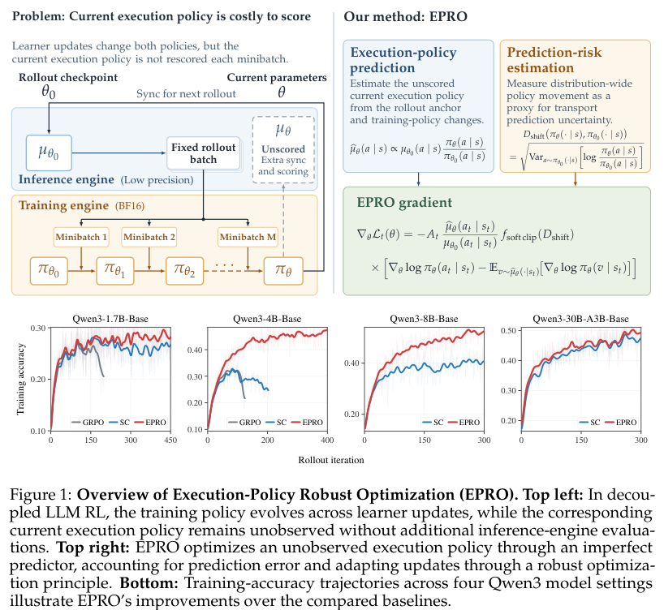
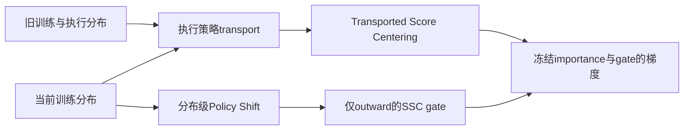

# EPRO：预测执行策略之后，再控制更新风险

[English](README-en.md)

> L1 CPU公式组件，diagnostic only；不是LLM强化学习能力复现。完整实验成本过高，不复现（审查 DONE）；不自动重试，不接Evolve晋级。

## 论文信息

| 字段 | 内容 |
| --- | --- |
| 论文链接 | [EPRO，固定v1](https://arxiv.org/abs/2611.32810v1)；[正文](https://arxiv.org/html/2611.32810v1) |
| 公司 / 作者机构 | 一作Yibo Wang：Northwestern University；共同署名含Carnegie Mellon University；不是Google/Meta论文 |
| 首次公开日期 | 2026-11-24 15:29:28 UTC，arXiv v1原始提交；本轮公告池未捕获其公告日，不推断 |
| 原作者开源代码 | 论文列出[EPRO仓库](https://github.com/yibowangnwu/EPRO)，但2026-11-25只读`git ls-remote`返回`Repository not found`；公开方法源码未找到/未核实，commit和许可均未知 |
| 本地adapter / 稳定键 | `epro`；`adapter: null`，独立组件 |
| 本地复现代码目录 | `src/auto_research/post_training/epro.py` |

## 原始论文总结

### 背景与主要改动

同一权重在BF16训练引擎与低精度rollout引擎中不一定给出相同分布。旧checkpoint时两者可观测，但中间learner更新对应的当前执行分布不可直接读取。EPRO不把当前训练策略直接当执行策略，而从旧执行锚点出发，用训练策略变化构造transported predictor，再用分布移动量衰减不可靠的outward更新。

<!-- paper-figure:start -->
### 原论文关键图



图片来自[原论文](https://arxiv.org/pdf/2611.32810v1#page=2)Figure1，版权归原作者所有；从固定v1第2页裁剪，保留原图及图注。训练曲线属于作者，不是本地结果。[来源与SHA](assets/provenance.json)。
<!-- paper-figure:end -->



### 核心公式

令$p=\pi_0$、$q=\mu_0$、$u=\pi_\theta$。§2 Eq.2给出

$$
\widehat\mu(v)=\frac{q(v)u(v)/p(v)}{Z},\quad Z=\sum_vq(v)u(v)/p(v).
$$

它在$u=p$时恢复$q$，当两引擎锚点相同$q=p$时退化为$u$。§4 Eq.8/10定义

$$
S=\sqrt{\operatorname{Var}_{v\sim p}[\log(u(v)/p(v))]},\quad
\kappa=\begin{cases}e^{-[S-\tau]_+/\sigma},&A\log(u(a)/p(a))>0\\1,&\text{otherwise}.\end{cases}
$$

Eq.11/12的$A\min(\widehat\mu(a)/q(a),C)\kappa$在反传时冻结；对当前训练logits的loss梯度是该系数乘以$\widehat\mu-\operatorname{onehot}(a)$。不能连同gate重新求导。

附B Eq.35–39在旧执行top-K集合$H$之外用$\widetilde q(v)=\rho p(v)$、$\rho=(1-q(H))/(1-p(H))$近似尾部，Policy Shift也在$H$和一个tail bucket上计算。这是coarse-grained近似，不是全词表测量。论文训练$K=32$；本地小词表用$K=3$作诊断。

理论的高概率改进定理依赖预测误差上界、STE Jacobian近似、bounded score和光滑性。Policy Shift只是实用风险代理；SSC并不自动获得无条件改进保证。

### 论文离线与线上效果

§5/Table1：四种Qwen3设置的七数学benchmark无权均值，EPRO为21.5/36.7/39.1/39.1（1.7B/4B/8B/30B-A3B）。三个evaluation seed的均值/标准差不等于三个独立训练seed。未报告生产线上A/B；replay中的common-support KL也不是全词表误差。

### 与已有方法的关系

[Regularized Score Centering](../2611.21791-regularized-score-centering/README.md)在固定behavior下用独立辅助动作估计中心项，并用reverse-KL约束漂移。EPRO使中心分布随训练变化transport，并将Policy Shift作为outward衰减信号。两者都不是“reward减均值”，其importance cap、中心分布与正则不能互换。正文未给出与RSC的同预算实测比较，不据组件结果排列能力。

## 本地复现

### 数据协议与代码映射

`prepare_update`接受外部旧训练/旧执行/当前logits、action、advantage和mask，冻结Eq.11系数。`loss_gradient`返回全词表transport下的loss与解析logit梯度；head-tail模式使用附B重建锚点。只接受有限、可解析尾部的数组；尾部质量≤$10^{-12}$显式拒绝，不猜补未观测概率。旧执行概率并列时稳定选top-K是本地约定。

```bash
PYTHONPATH=src python -c 'from auto_research.post_training.epro import diagnostic; print(diagnostic(42))'
PYTHONPATH=src:scripts python -m pytest tests/test_nov25_post_components.py -q
```

### 结果、负控与边界

CPU seeds42/43/44已执行；[稳定标量](metrics/component-cpu-seeds42-44.json)记录最大有限差分误差$1.54\times10^{-10}$以内。测试覆盖full/head-tail梯度、锚点恢复、引擎一致退化、offset不变性、mask、importance cap和仅outward衰减；重新求导gate是负控，不是论文更新。

head-tail与full-vocabulary梯度可不同，这是近似误差，不应强制相等。没有执行LLM、vLLM/SGLang、量化误差replay、真实rollout或RL训练。小张量多seed不提供数学任务能力或生产效果证据。只开放CPU路径，`requires_gpu_validation=False`。

### 高成本完整实验

§5/附F Table2含1.7B/4B/8B/30B-A3B、300–450轮、每轮128或256prompt×8response、最多4096response token及16个learner minibatch；另有七任务多采样和多个baseline。配置上限不是实测消耗。完整矩阵明显超单A100/A30或Mac短预算：**成本过高，不复现（审查 DONE）**；未下载模型或训练数据，未试跑证明成本。
