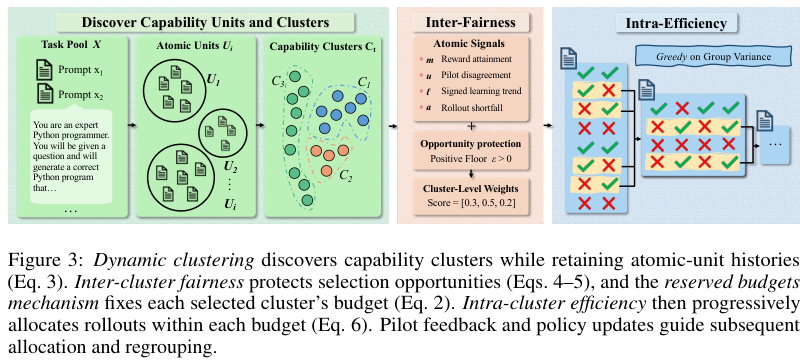
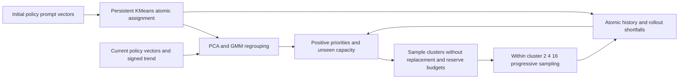

# FEAST: protect learning opportunities, then allocate compute within clusters

<!-- source-sha256: 676d734ea3ecc3a226000a6fb7e6cc653eaf182363f55077b2723190780448b3 -->
[简体中文](README.md)

> L1 CPU allocation components, diagnostic only; not LLM training or capability evidence. The full experiment is too expensive and is not reproduced (review DONE). No automatic retry or Evolve integration.

## Paper information

| Field | Value |
| --- | --- |
| Paper | [Fixed v1](https://arxiv.org/abs/2611.33827v1); [full text](https://arxiv.org/html/2611.33827v1) |
| Company / institutions | Yongxi Zhu, Ziyi Wang, Ruite Lu and Ying Wei: Zhejiang University; Yichen Wu: Harvard University; Chang Liao: Nanyang Technological University; Haipeng Li: The Hong Kong University of Science and Technology. Abstract metadata reverses Chang Liao to Liao Chang; PDF spelling is retained. Not Google/Meta |
| Original publication | 2026-11-25 05:56:03 UTC, arXiv v1; arXiv announcement and this discovery/review are dated2026-11-26, not its original publication date |
| Author code | V1 promises release upon acceptance; no method repository linked or published source found in this review. License and commit unknown |
| Local adapter / stable key | `feast`; `adapter: null`, standalone CPU components |
| Local code directory | `src/auto_research/post_training/feast.py` |

## Original paper summary

### Background and changes

Greedily pursuing current learning signal can reinforce neglect: a capability performs poorly after under-allocation, then receives even less experience. FEAST separates opportunity from compute allocation. Fixed atomic units retain history while current-policy representations and signed trends change their cluster membership. Selected clusters reserve independent budgets before prompts compete by reward variance inside each cluster.

<!-- paper-figure:start -->
### Original key figure



From [the original paper](https://arxiv.org/pdf/2611.33827v1#page=5), page5 Figure3 with its complete caption; copyright remains with the original authors. Scientific content is unchanged. This is the authors' method diagram, not local capability evidence. [Provenance and SHA](assets/provenance.json).
<!-- paper-figure:end -->



### Core equations

AppendixA.2 mean-pools final-normalized policy hidden states over non-padding prompt/template tokens, without L2 normalization. Euclidean KMeans++ creates64 persistent atoms. Every10 updates, current-policy atom centroids are centered, projected onto eight SVD axes, standardized per coordinate and augmented with smoothed signed trend. Diagonal GMMs with8–16 components are selected by original-fit BIC after repairing memberships to at least two atoms per cluster; histories are not reset.

Equations21–25 specify

$$
r_i=0.05+u_i e^{-\frac12((m_i-0.5)/0.22)^2}\left(1+\frac{0.2}{1+e^{(m_i-0.5)/0.05}}\right)(1+0.5|\ell_i|)+0.05a_i.
$$

Common two-sample pilots provide prompt-equal attainment and $u=\operatorname{mean}(R_1-R_2)^2$, with EMA0.1. Signed attainment change is normalized by all trajectories in nonzero-variance groups divided by8, clipped to[-1,1]; slower trend EMA is0.3. Shortfalls update as $d_i\leftarrow[d_i+B/J-g_i]_+$, $a_i=\min(1,d_i/(10B/J))$. The count $g_i$ includes pilots and zero-signal trajectories.

Cluster scores weight remaining lifetime-unseen capacity and shrink toward0.05 on exhaustion. Four clusters sampled without replacement each reserve256 trajectories:32 prompts receive2 pilots, top16 receive4 more, top8 receive16 more. Total1024 yields64 groups of2,32 of6 and32 of22. Promotion uses cumulative raw-reward variance; all samples for a prompt form its training group. Compute cannot migrate across reserved clusters.

### Reported offline and online results

AppendixTable16 reports GURU-18K averages36.18±0.13 versus Random35.43±0.18 at1.7B, and51.69±0.08 versus50.65±1.01 at8B. There are three and two training seeds respectively; question-level bootstrap does not add training seeds. Not every benchmark improves. Production online A/B was not reported.

### Relation to existing work

[RAIL](../2608.05080-rail/README-en.md) learns a contextual-bandit controller from shadow-intervention recoverability gains. FEAST instead protects opportunities through persistent atom histories, positive sampling support and selected-cluster reservations. Within-cluster variance promotion cannot replace those cross-cluster mechanisms. The historical RAIL mini-suite is not a matched-budget comparison with FEAST.

## Local reproduction

### Data protocol and code mapping

`kmeans` and `regroup` actually run KMeans++, PCA, diagonal-GMM EM/BIC and minimum-two-atom repair. `FeastScheduler` implements histories, shortfalls, lifetime-unseen capacity, without-replacement cluster sampling and stable prompt cycles. `progressive_rollouts` requests reward samples from a caller callback while preserving reservations. Real policy hidden vectors must be supplied externally; diagnostic random vectors and Bernoulli callbacks are explicitly not LLMs.

The paper does not specify repair order or ties. Locally, the lowest log-posterior-cost atom moves from a donor with more than two members, with stable ties. PCA uses population empirical standard deviation and preserves zero coordinates. GMM100 iterations,1e-3 tolerance and1e-6 variance floor are local numerical conventions, not bitwise claims about unreleased upstream code. The caller must hold its policy fixed across rounds. Hidden-state extraction, GRPO loss/optimization and an automatic ten-update training schedule are not implemented here.

```bash
PYTHONPATH=src python -c 'from auto_research.post_training.feast import diagnostic; print(diagnostic(42))'
PYTHONPATH=src:scripts python -m pytest tests/test_nov26_post_components.py -q
```

### Results, negative controls and limits

CPU seeds42/43/44 retain real clustering/allocation algorithms at16 atoms and two clusters of eight prompts:64 callback rewards per cluster,128 total. [Independent formal metrics](metrics/component-cpu-seeds42-44.json) are recorded by the shared runner. Tests additionally cover the default1024 budget, zero-signal exposure, promotion-unbiased pilots, history preservation and exhausted-capacity floors. No policy was trained and no capability benefit from fairness is claimed. CPU only; `requires_gpu_validation=False`.

### High-cost full experiment

AppendixA.3/Table11 estimates6.07 A100-80GB GPU-hours for one Qwen3-1.7B100-update arm, excluding evaluation, with1024 trajectories/update and2048-token input/output caps. The full scope additionally includes8B, multiple schedulers/seeds, long QEL quota studies and SMC. A single arm fitting one A100 does not make the whole matrix affordable. Against this run's one-A100/A30-or-Mac short budget, it is too expensive and is not reproduced (review DONE): no model/data downloads, probes, retries or Evolve promotion.
