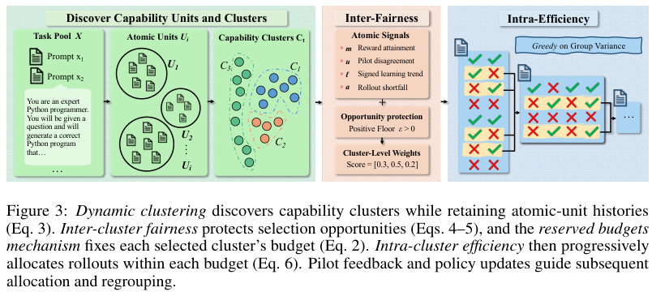
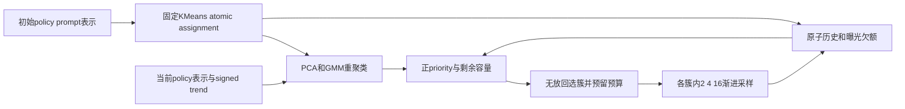

# FEAST：保护学习机会，再在簇内分配计算

[English](README-en.md)

> L1 CPU预算调度组件，diagnostic only；不是LLM训练或能力提升证据。完整实验成本过高，不复现（审查 DONE）；不自动重试，不接Evolve。

## 论文信息

| 字段 | 内容 |
| --- | --- |
| 论文链接 | [固定v1](https://arxiv.org/abs/2611.33827v1)；[全文](https://arxiv.org/html/2611.33827v1) |
| 公司 / 作者机构 | Yongxi Zhu、Ziyi Wang、Ruite Lu、Ying Wei：Zhejiang University；Yichen Wu：Harvard University；Chang Liao：Nanyang Technological University；Haipeng Li：The Hong Kong University of Science and Technology。摘要元数据把Chang Liao写作Liao Chang，PDF署名按Chang Liao保留；不是Google/Meta论文 |
| 首次公开日期 | 2026-11-25 05:56:03 UTC，arXiv v1；arXiv公告日期与本轮发现/审查均为2026-11-26，不等于首发日期 |
| 原作者开源代码 | v1明确“录用后发布”；正文/摘要未给本篇源码仓库，本轮未找到已发布方法源码，许可和commit未知 |
| 本地adapter / 稳定键 | `feast`；`adapter: null`，独立CPU组件 |
| 本地复现代码目录 | `src/auto_research/post_training/feast.py` |

## 原始论文总结

### 背景与主要改动

只追逐当前高学习信号会形成反馈环：弱能力因过去分配不足而表现差，又因此拿不到新经验。FEAST将学习机会与计算分配分开：固定atomic unit保存历史，当前策略表示和学习趋势只改变簇归属；选中簇先保留独立预算，随后才在各簇内按reward方差逐轮晋级prompt。

<!-- paper-figure:start -->
### 原论文关键图



图片来自[原论文](https://arxiv.org/pdf/2611.33827v1#page=5)第5页Figure3及完整图注，版权归原作者所有；无科学内容改动。图示是作者算法，不是本地能力结果。[来源与SHA](assets/provenance.json)。
<!-- paper-figure:end -->



### 核心公式

附A.2使用初始policy的final-normalized hidden states，对prompt含模板的非padding token做均值，不做L2归一化；Euclidean KMeans++分64个固定原子。每10步用当前policy重新嵌入，在原子centroid上中心化、取前8个SVD轴并按坐标标准差缩放，附上平滑signed trend，拟合8–16个对角GMM、按原始拟合BIC选择，修复每簇至少2原子；历史不能重置。

Eq.21–25的原子priority为

$$
r_i=0.05+u_i e^{-\frac12((m_i-0.5)/0.22)^2}\left(1+\frac{0.2}{1+e^{(m_i-0.5)/0.05}}\right)(1+0.5|\ell_i|)+0.05a_i.
$$

两个共同pilot给$m$的prompt等权均值和$u=\operatorname{mean}(R_1-R_2)^2$；EMA为0.1。$\ell$按非零方差组全部trajectory数$/8$归一化attainment变化，clip到[-1,1]；慢趋势EMA为0.3。欠额$d_i\leftarrow[d_i+B/J-g_i]_+$，$a_i=\min(1,d_i/(10B/J))$，其中$g_i$必须计入零信号和pilot样本。

簇priority按终生未采样容量加权，容量耗尽时向0.05收缩。四簇无放回抽取后各预留256：32题×2pilot，保留top16各加4，再保留top8各加16，共1024条；最终64组2条、32组6条、32组22条。晋级用累计原始reward方差，训练时同prompt全部样本计算优势，不跨簇抢预算。

### 论文离线与线上效果

附Table16：GURU-18K上1.7B平均36.18±0.13对Random35.43±0.18，8B为51.69±0.08对50.65±1.01；训练seed分别3和2个，问级bootstrap不是额外训练seed。不是各benchmark均提高。生产线上A/B未报告。

### 与已有方法的关系

[RAIL](../2608.05080-rail/README.md)通过shadow干预后的recoverability收益学习contextual-bandit controller。FEAST不是干预恢复控制器，而是持久atomic历史、正机会下界和选中簇预算保护；簇内方差晋级不能替代这些跨簇机制。旧RAIL条目的mini-suite结果不构成两者同预算能力比较。

## 本地复现

### 数据协议与代码映射

`kmeans`、`regroup`实际执行KMeans++/PCA/对角GMM-EM/BIC与最少2原子修复；`FeastScheduler`实现历史、欠额、终生未见容量、无放回选簇和稳定prompt循环；`progressive_rollouts`向调用方采样callback请求各轮reward，保留簇预算。当前policy hidden vectors必须由调用方真实提供；本地诊断明确使用随机向量和Bernoulli callback，不将它们称为LLM。

论文未指定GMM修复顺序与并列处理；本地选择从>2成员的donor移动log posterior代价最小原子，稳定并列。PCA坐标采用总体经验std；零方差轴保留为零。GMM的100轮/1e-3收敛/1e-6方差地板是本地数值约定，不声称复原未发布上游的bitwise行为。调用方须保持三轮采样policy冻结；这里不执行hidden-state提取、GRPO loss/优化和每10步自动训练调度。

```bash
PYTHONPATH=src python -c 'from auto_research.post_training.feast import diagnostic; print(diagnostic(42))'
PYTHONPATH=src:scripts python -m pytest tests/test_nov26_post_components.py -q
```

### 结果、负控与边界

CPU seeds42/43/44自验保留真实聚类与调度算法，缩为16原子、每轮2簇×8题；各簇64条、总128条callback reward。[正式独立指标](metrics/component-cpu-seeds42-44.json)由统一runner记录。测试另核对默认1024预算、全零信号仍占预算、pilot等权不受晋级偏置、history重聚类不丢失和未见容量耗尽后的floor。未训练policy，不声称公平性带来能力改善；仅CPU，`requires_gpu_validation=False`。

### 高成本完整实验

附A.3/Table11将Qwen3-1.7B单臂100更新估计为6.07 A100-80GB GPU小时，排除评测；每步1024trajectory，输入/输出各2048上限。还包含8B、多个scheduler与训练seed、QEL长程多配额和SMC。最低单臂能用一张A100不代表完整矩阵可负担；相对本轮单A100/A30或Mac短预算，**成本过高，不复现（审查 DONE）**。不下载模型/数据、不探跑、无retry/evolve。
