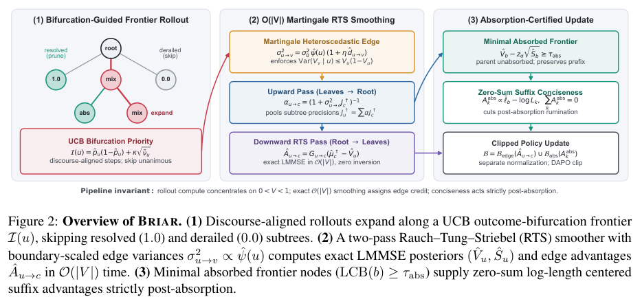
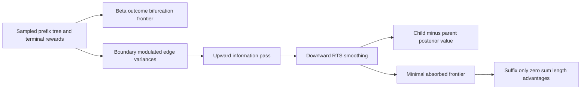

# BRIAR: separate branch exploration, tree credit and post-absorption conciseness

<!-- source-sha256: 32ea31e03dbd2dd78cc9260628c2a89cd8b64559b506b2ff0cf8e17c2cd16d2a -->
[简体中文](README.md)

> L1 CPU tree-credit components, diagnostic only; not mathematical-reasoning or RL capability reproduction. The full experiment is too expensive and is not reproduced (review DONE). No automatic retry or Evolve integration.

## Paper information

| Field | Value |
| --- | --- |
| Paper | [Fixed v1](https://arxiv.org/abs/2611.34746v1); [full text](https://arxiv.org/html/2611.34746v1) |
| Company / institutions | Tianyi Yang, Haoran Zhang, Yifan Chen and Zixuan Li, Jilin University; not Google/Meta |
| Original publication | 2026-11-25 17:23:23 UTC, arXiv v1; arXiv announcement and this discovery/review are dated2026-11-26, not the original publication date |
| Author code | No method repository linked in fixed-v1 text/abstract; none found in this targeted search. Code license and commit unknown |
| Local adapter / stable key | `briar`; `adapter: null`, standalone CPU components |
| Local code directory | `src/auto_research/post_training/briar.py` |

## Original paper summary

### Background and changes

Terminal correctness alone does not identify promising branch points or distinguish necessary derivation from repeated checking after an answer has settled. BRIAR connects three components through the martingale structure of prefix success probabilities: outcome-bifurcation exploration with uncertainty, global tree LMMSE credit under boundary-modulated variances, and zero-sum length comparison strictly after an absorbed frontier.

<!-- paper-figure:start -->
### Original key figure



From [the original paper](https://arxiv.org/pdf/2611.34746v1#page=4), page4 Figure2 with its complete caption; copyright remains with the original authors. Scientific content is unchanged. The figure's “enforces” and “preserves prefix” wording is the authors' presentation, not an unconditional guarantee established locally. [Provenance and SHA](assets/provenance.json).
<!-- paper-figure:end -->



### Core equations

Section4 Eq.3 uses Jeffreys prior: $\widetilde p_u=(s_u+0.5)/(m_u+1)$, $\widetilde\nu_u=\widetilde p_u(1-\widetilde p_u)/(m_u+2)$ and priority $\mathcal I(u)=\widetilde p_u(1-\widetilde p_u)+0.5\sqrt{\widetilde\nu_u}$. Only unresolved internal nodes with $0<s_u<m_u$ below the depth cap are eligible. Prior smoothing must not make a unanimous root into a useful training group.

Equation5 sets $\sigma_{u\to c}^2=2.2[\widetilde p_u(1-\widetilde p_u)+0.01]\,(1+0.4d_{u\to c}/L_{avg})$. Leaf noise is $\lambda=0.05$; the root prior is $(0.5,100)$. Equations6–9 give

$$
\alpha_{uc}=(1+\sigma_{uc}^2J_c)^{-1},\quad J_u=\sum_c\alpha_{uc}J_c,\quad h_u=\sum_c\alpha_{uc}h_c,
$$

$$
\widehat V_c=\alpha_{uc}\widehat V_u+(1-\alpha_{uc})h_c/J_c,\quad
\widehat S_c=\alpha_{uc}^2\widehat S_u+\sigma_{uc}^2\alpha_{uc},\quad \widehat A_{uc}=\widehat V_c-\widehat V_u.
$$

A minimal absorbed node needs at least two all-correct descendant leaves, $\widehat V_b-\sqrt{\widehat S_b}\ge0.85$, and an unqualified parent. Suffix lengths must span at least150 tokens and have max/min at least1.5. Center and standardize log lengths, clip to±2, then recenter to enforce zero sum (Eq.10). Final recentering can slightly exceed the initial clip bounds; clipping again would destroy zero sum.

The variance model is martingale-inspired, not a hard edgewise constraint $\sigma^2\le p(1-p)$: the2.2 multiplier and length factor can exceed that envelope. Gaussian/LMMSE values are not constrained to[0,1]. Excluding prefix-token losses does not imply unchanged prefix behavior after shared-parameter updates; no stronger guarantee is claimed locally.

### Reported offline and online results

Original Table1 reports Qwen3-4B five-benchmark average48.1 versus DAPO43.7, and lengths2410 versus3380. These are author three-seed results: Pass@16 for AIME/GPQA and Pass@8 for MATH/Olympiad, not local accuracy. Production online A/B was not reported.

### Relation to existing work

[OpCredit](../2610.21345-opcredit/README-en.md) computes BOC and answer-neighborhood FTC after matching KG operation contexts. BRIAR instead performs global LMMSE smoothing on explicit shared-prefix trees with fixed edge variances. Matched supports, answer neighborhoods and Gaussian covariance are distinct signals. No matched-budget capability comparison was run. The dense reference is an independent numerical solve, not gold-plan access for an agent.

## Local reproduction

### Data protocol and code mapping

`frontier_scores` implements Eq.3; `smooth_tree` implements Eqs.5–9; `dense_reference` independently builds shared-path covariance; `absorbed_suffixes` implements the minimal absorbed frontier and Eq.10. Inputs are a caller-sampled tree, binary terminal-verifier rewards and edge token lengths. Internal rewards must be NaN; parents precede children and root parent is-1. The module computes priorities but does not generate branches, segment text, run language policies, optimize DAPO or enforce the12% training-batch suffix cap.

```bash
PYTHONPATH=src python -c 'from auto_research.post_training.briar import diagnostic; print(diagnostic(42))'
PYTHONPATH=src:scripts python -m pytest tests/test_nov26_post_components.py -q
```

### Results, negative controls and limits

CPU seeds42/43/44 self-checks cover RTS/dense equivalence, unanimous-root exclusion, absorbed frontier detection, zero-sum lengths and prefix-edge exclusion. [Independent formal metrics](metrics/component-cpu-seeds42-44.json) are recorded by the shared runner. Fixed trees and illustrative lengths are not reasoning datasets, accuracy comparisons or measured rollout savings. CPU only; `requires_gpu_validation=False`.

### High-cost full experiment

AppendixC.2 uses16 A100-80GB GPUs even for1.7B/4B, and32 for7B/8B/14B;128 prompts/update,8K/16K generation caps and tree(D,B,M)=(5,6,6). AppendixD.3/Table10 reports1120 A100 GPU-hours to the4B target. One A100/A30 or a Mac cannot support the full model/baseline/seed matrix. It is too expensive and is not reproduced (review DONE): no model/data downloads, probes, retries or Evolve promotion.
