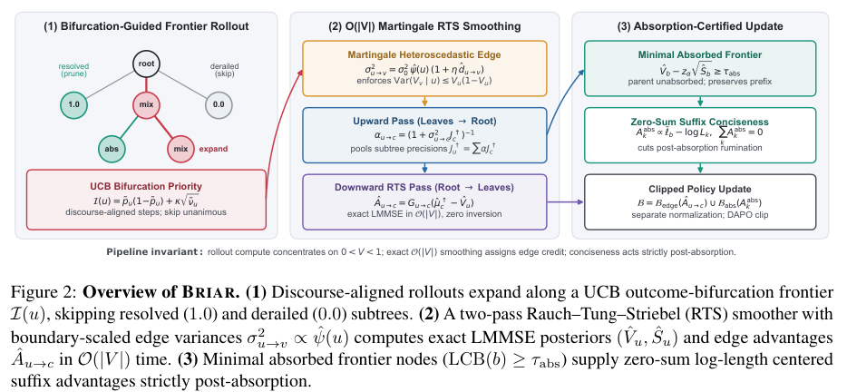
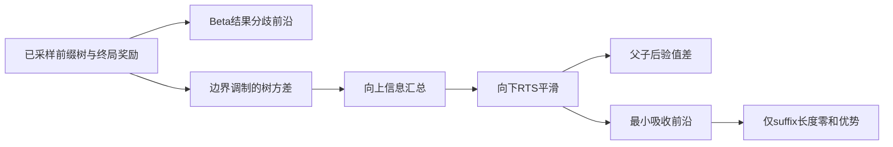

# BRIAR：把分支探索、树信用与吸收后简洁性分开

[English](README-en.md)

> L1 CPU树信用组件，diagnostic only；不是数学推理/RL能力复现。完整实验成本过高，不复现（审查 DONE）；不自动重试，不接Evolve。

## 论文信息

| 字段 | 内容 |
| --- | --- |
| 论文链接 | [固定v1](https://arxiv.org/abs/2611.34746v1)；[全文](https://arxiv.org/html/2611.34746v1) |
| 公司 / 作者机构 | Tianyi Yang、Haoran Zhang、Yifan Chen、Zixuan Li，Jilin University；不是Google/Meta论文 |
| 首次公开日期 | 2026-11-25 17:23:23 UTC，arXiv v1；arXiv公告日期与本轮发现/审查均为2026-11-26，不把公告或发现日当首发日 |
| 原作者开源代码 | 固定v1正文/摘要无本篇作者源码链接；本轮定向检索未找到，源码许可与commit未知 |
| 本地adapter / 稳定键 | `briar`；`adapter: null`，独立CPU组件 |
| 本地复现代码目录 | `src/auto_research/post_training/briar.py` |

## 原始论文总结

### 背景与主要改动

终局正确率不能告诉训练器哪一步值得继续分支，也不能区分必要推导和答案确定后的反复检查。BRIAR以prefix成功概率的martingale结构连接三个组件：用结果分歧和置信奖励选探索前沿；以边界调制方差做树上全局LMMSE信用；仅在吸收前沿之后对正确续写的长度做零和比较。

<!-- paper-figure:start -->
### 原论文关键图



图片来自[原论文](https://arxiv.org/pdf/2611.34746v1#page=4)第4页Figure2及完整图注，版权归原作者所有；原图不作科学内容改动。其“enforces”及“preserves prefix”措辞属于作者图示，不能扩大为下文未证明的无条件保证。[来源与SHA](assets/provenance.json)。
<!-- paper-figure:end -->



### 核心公式

§4 Eq.3采用Jeffreys先验：$\widetilde p_u=(s_u+0.5)/(m_u+1)$，$\widetilde\nu_u=\widetilde p_u(1-\widetilde p_u)/(m_u+2)$，优先级为$\mathcal I(u)=\widetilde p_u(1-\widetilde p_u)+0.5\sqrt{\widetilde\nu_u}$。只有$0<s_u<m_u$且未到深度上限的内部节点才可探索；全对/全错根不因prior平滑就变成有效训练组。

Eq.5取$\sigma_{u\to c}^2=2.2[\widetilde p_u(1-\widetilde p_u)+0.01]\,(1+0.4d_{u\to c}/L_{avg})$。叶观测噪声$\lambda=0.05$，根prior为$(0.5,100)$。Eq.6–9为

$$
\alpha_{uc}=(1+\sigma_{uc}^2J_c)^{-1},\quad J_u=\sum_c\alpha_{uc}J_c,\quad h_u=\sum_c\alpha_{uc}h_c,
$$

$$
\widehat V_c=\alpha_{uc}\widehat V_u+(1-\alpha_{uc})h_c/J_c,\quad
\widehat S_c=\alpha_{uc}^2\widehat S_u+\sigma_{uc}^2\alpha_{uc},\quad \widehat A_{uc}=\widehat V_c-\widehat V_u.
$$

最小吸收节点要求至少两条全对后代、$\widehat V_b-\sqrt{\widehat S_b}\ge0.85$且父节点未满足条件。suffix跨度至少150token、最长/最短≥1.5时，对$\log L$中心化/标准化、clip到±2后再次中心化，保证优势之和为零（Eq.10）。这个后置recenter可使最终极值略超初始clip界，不应二次clip破坏零和。

边界方差只是受martingale启发的经验模型；系数2.2和长度项意味着Eq.5不逐边硬性满足$\sigma^2\le p(1-p)$。Gaussian/LMMSE后验也不强制在[0,1]。suffix不包含prefix token loss，不等于共享参数更新后prefix行为完全不变；本地不重复更强结论。

### 论文离线与线上效果

原文Table1：Qwen3-4B五基准平均48.1，DAPO43.7；生成长度2410对3380。指标为作者三seed结果，AIME/GPQA用Pass@16、MATH/Olympiad用Pass@8，不是本地准确率。生产线上A/B未报告。

### 与已有方法的关系

[OpCredit](../2610.21345-opcredit/README.md)在匹配KG操作上下文后计算BOC及答案邻域前沿FTC；BRIAR在显式共享前缀树中用固定边方差进行全局LMMSE平滑。两者都做局部信用，但匹配支持集、答案邻域与Gaussian协方差不是同一信号；没有同预算能力比较。BRIAR的dense参考仅是独立数值解，不是给Agent读取gold计划。

## 本地复现

### 数据协议与代码映射

`frontier_scores`执行Eq.3；`smooth_tree`执行Eq.5–9；`dense_reference`独立建立共享路径协方差核对均值与方差；`absorbed_suffixes`执行最小吸收前沿和Eq.10。输入是调用方已采样树、二值verifier叶奖励、edge token长度；内部节点奖励必须NaN。节点按父先于子排序，root parent为-1。这里只计算前沿优先级，不生成分支，不执行语言策略、segmentation、DAPO优化或batch12%上限。

```bash
PYTHONPATH=src python -c 'from auto_research.post_training.briar import diagnostic; print(diagnostic(42))'
PYTHONPATH=src:scripts python -m pytest tests/test_nov26_post_components.py -q
```

### 结果、负控与边界

CPU seeds42/43/44自验执行了随机小树RTS/dense等价、全同奖励不可探索、吸收前沿、长度零和及prefix edge排除；[正式独立指标](metrics/component-cpu-seeds42-44.json)由统一runner记录。固定树和教学长度不是数学能力数据；不比较推理准确率、不声称减少真实rollout成本。仅支持CPU，`requires_gpu_validation=False`。

### 高成本完整实验

附C.2：1.7B/4B也用2节点×8张A100-80GB，7B/8B/14B用32卡；128prompt/步、8K或16K生成上限、树(D,B,M)=(5,6,6)。附D.3/Table10的4B达到目标需1120 A100 GPU小时。单A100/A30或Mac不承担多模型、多基线、多seed矩阵：**成本过高，不复现（审查 DONE）**。不下载模型/数据、不探跑、不进入retry或evolve。
