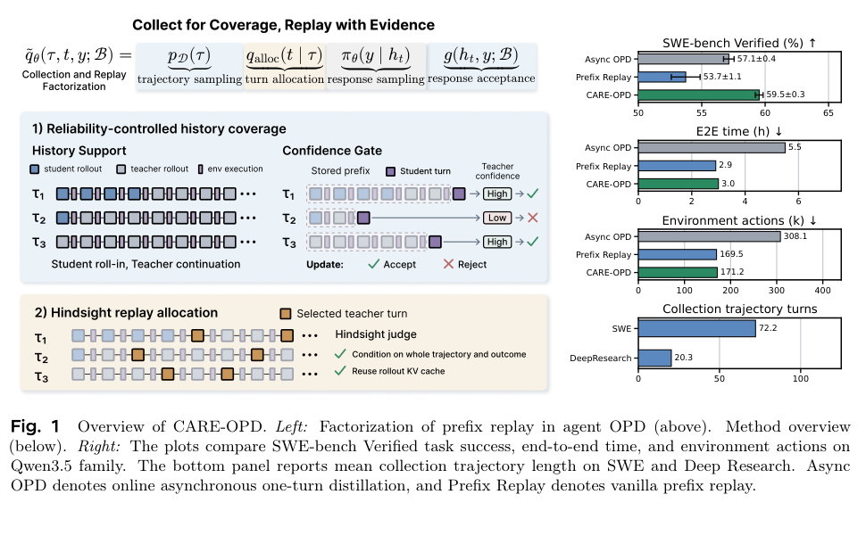
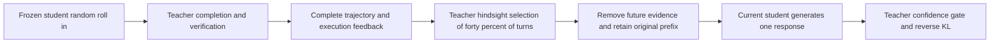

# CARE-OPD: student-history coverage and replay selected by hindsight execution evidence

<!-- source-sha256: 206dc50df086fbcd2fe05faf0aee6e046f5f1f64dc81ed226b158e6a78edcc27 -->
[简体中文](README.md)

> Review-only. The full experiment is too expensive and is not reproduced (review DONE). No local implementation, metrics or GPU receipt; no automatic retry or Evolve integration.

## Paper information

| Field | Value |
| --- | --- |
| Paper | [Fixed v1](https://arxiv.org/abs/2611.34756v1); [full text](https://arxiv.org/html/2611.34756v1) |
| Company / institutions | First author Haowen Hou: Shanghai Jiao Tong University, Shanghai Innovation Institute and JD.com. Other authors: Gen Li, Ruilin Li, Yicheng Liu, Zhen Huang, Shuai Dong, Congcong Wang, Kaiwen Tuo, Hongrui Wu, Zelin Peng, Kanghui Tian, Ji Zhao, Dianyi Wang and Jiaqi Wang. Not Google/Meta |
| Original publication | 2026-11-25 17:27:31 UTC, arXiv v1; arXiv announcement and this discovery/review are dated2026-11-26, not its original publication date |
| Author code | No method repository in fixed-v1 text/abstract and no verified release found. Citing Uni-Agent does not establish CARE-OPD source availability; license and commit unknown |
| Local adapter / stable key | `care-opd`; `adapter: null`; `local_operator: null` |
| Local code directory | None; read-only review, no implementation created |

## Original paper summary

### Background and changes

Prefix replay generates a current-student response from stored history and obtains teacher supervision without putting long environment execution on the learner's critical path. Teacher-only histories miss student-induced states, while early-turn preferences can miss later diagnoses. CARE-OPD adds short student roll-ins followed by teacher completion, filters new student responses by teacher confidence, and selects replay turns using execution evidence from completed trajectories.

<!-- paper-figure:start -->
### Original key figure

From [the original paper](https://arxiv.org/pdf/2611.34756v1#page=3), page3 Figure1 with its complete caption; copyright remains with the original authors. Author training results are not local results. [Provenance and SHA](assets/provenance.json).
<!-- paper-figure:end -->

### Core equations

Section3 Eq.4 selects student roll-in with probability $\alpha=0.1$ and $K\sim U\{1,\ldots,K_{max}\}$, followed by teacher continuation. Student turns are context only, not replay targets. Trajectories without teacher continuation or failed verification are discarded. Equations5–6 use

$$
P_T(h,y)=\frac1{|y|}\sum_j\max_v\pi_T(v\mid h,y_{<j}),\quad
g=\mathbf1[P_T(h,y)\ge Q_\gamma(B)],\quad\gamma=0.1.
$$

Confidence proxies teacher certainty, not correctness. The hindsight selector reads the complete trajectory, execution feedback and outcome, retaining $\lceil0.4|E_i|\rceil$ teacher turns. Sampling is uniform over trajectories then their selected turns, avoiding extra weight for long trajectories. Students receive only original prefixes: temporary turn IDs, selector outputs and future evidence are removed. Token-averaged reverse KL is computed along a newly sampled student response, not SFT on an archived teacher response.

### Reported offline and online results

Tables1/2 report Qwen3.5 SWE-bench Verified success59.5±0.3 versus asynchronous one-turn OPD57.1±0.4, end-to-end3.0±0.1 versus5.5±0.1 hours, and171.2k versus308.1k environment actions. Author three-seed measurements on the same32-GPU allocation cannot be converted to local single-GPU duration. Production online A/B was not reported.

### Relation to existing work

[TreeOPSD](../2610.23181-treeopsd/README-en.md) turns shared-tree leaf credit into frozen bounded Bernoulli targets to limit overshoot across repeated updates. CARE-OPD instead selects history support, teacher turns and response eligibility while retaining teacher-token reverse KL. Finite targets and hindsight allocation are different mechanisms. Fixed turn lists or handwritten selection heuristics would remove the defining learned selector, not faithfully reduce its cost.

## Local reproduction

### Data protocol and code mapping

No implementation, run command or data download. No paper metrics or GPU receipt is created. Hindsight feedback may inform a training selector, never an evaluated agent. Any future implementation must test student-prefix whitelists and future-evidence removal.

### Results, negative controls and limits

This review verifies fixed-v1 method, authorship, source availability and cost only. It reports no local success rate or training outcome. A generic confidence gate or fixed selected-turn fixture is insufficient to cover CARE-OPD; the selector is not replaced to manufacture an implementation.

### High-cost full experiment

AppendixB uses four nodes of eight H200 GPUs: one teacher node, two rollout nodes and one learner node. Models are Qwen3.5 student9B/teacher27B, plus8B/30B-A3B;128K context,150 turns,60 updates,batch64 and three seeds. Table2's roughly three hours per arm implies approximately96 H200 GPU-hours by allocation multiplication, not an A100 measurement, plus heavy SWE execution. Deep Research also filters75,372 candidates to16,855 tasks using DeepSeek-V4-Flash and requires retrieval/judge infrastructure.

One A100/A30 or a Mac does not meet this matrix. It is too expensive and is not reproduced (review DONE), a terminal review decision rather than an implementation TODO. No probes, automatic retries, Evolve or promotion eligibility.
