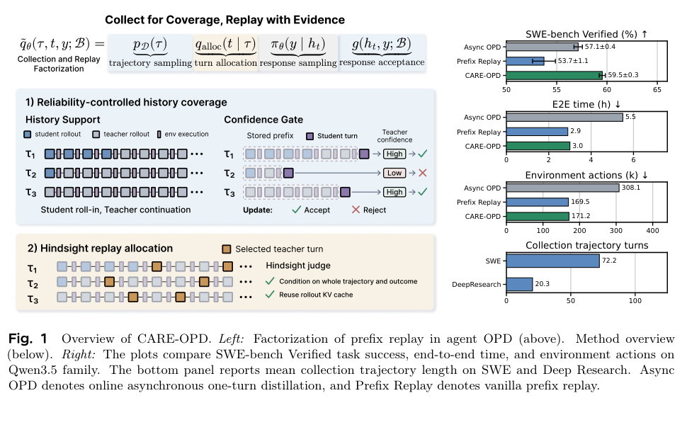
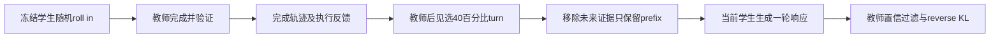

# CARE-OPD：扩充学生历史，用后见执行证据决定回放

[English](README-en.md)

> Review-only。完整实验成本过高，不复现（审查 DONE）；无本地实现、metrics或GPU回执，不自动重试，不接Evolve。

## 论文信息

| 字段 | 内容 |
| --- | --- |
| 论文链接 | [固定v1](https://arxiv.org/abs/2611.34756v1)；[全文](https://arxiv.org/html/2611.34756v1) |
| 公司 / 作者机构 | 一作Haowen Hou：Shanghai Jiao Tong University、Shanghai Innovation Institute、JD.com；其他署名包括Gen Li、Ruilin Li、Yicheng Liu、Zhen Huang、Shuai Dong、Congcong Wang、Kaiwen Tuo、Hongrui Wu、Zelin Peng、Kanghui Tian、Ji Zhao、Dianyi Wang、Jiaqi Wang；不是Google/Meta论文 |
| 首次公开日期 | 2026-11-25 17:27:31 UTC，arXiv v1；arXiv公告日期与本轮发现/审查均为2026-11-26，不等于首发日期 |
| 原作者开源代码 | 固定v1正文/摘要未提供本篇源码仓库，本轮未找到可验证作者方法源码；引用Uni-Agent不等于CARE-OPD源码，许可与commit未知 |
| 本地adapter / 稳定键 | `care-opd`；`adapter: null`；`local_operator: null` |
| 本地复现代码目录 | 无；本篇只读审查，未创建实现 |

## 原始论文总结

### 背景与主要改动

prefix replay让当前学生从已保存历史生成一轮响应，再由教师监督，从训练关键路径中移走长环境交互；但教师独有历史可能漏掉学生造成的状态，且固定早轮偏好会漏掉晚期诊断。CARE-OPD以少量学生roll-in再由教师完成来扩历史，用教师在新学生响应上的置信门过滤更新，并让已完成轨迹中的执行反馈支持回放turn选择。

<!-- paper-figure:start -->
### 原论文关键图

图片来自[原论文](https://arxiv.org/pdf/2611.34756v1#page=3)第3页Figure1及完整图注，版权归原作者所有；作者训练结果不是本地结果。[来源与SHA](assets/provenance.json)。
<!-- paper-figure:end -->

### 核心公式

§3 Eq.4以概率$\alpha=0.1$选学生roll-in，$K\sim U\{1,\ldots,K_{max}\}$，随后教师续写；学生turn只作上下文、不作可回放target，无教师续写或验证失败的轨迹丢弃。Eq.5–6用

$$
P_T(h,y)=\frac1{|y|}\sum_j\max_v\pi_T(v\mid h,y_{<j}),\quad
g=\mathbf1[P_T(h,y)\ge Q_\gamma(B)],\quad\gamma=0.1.
$$

置信是教师确定性的proxy，不是正确率。后见selector读完整轨迹、执行反馈和结果，选$\lceil0.4|E_i|\rceil$个教师turn；先均匀选轨迹、再均匀选其选中turn，不给长轨迹额外权重。学生只接收原prefix，临时turn ID、selector输出和未来证据都移除。损失是该新学生响应上逐token reverse KL，不是把旧教师响应直接当SFT。

### 论文离线与线上效果

Table1/2：Qwen3.5 SWE-bench Verified成功率59.5±0.3，对async one-turn OPD57.1±0.4；端到端3.0±0.1对5.5±0.1小时，环境动作171.2k对308.1k。三seed且相同32卡资源的作者测量不能转换成本地单卡时长。生产线上A/B未报告。

### 与已有方法的关系

[TreeOPSD](../2610.23181-treeopsd/README.md)把共享树的叶信用变成冻结有界Bernoulli蒸馏目标，抑制多次更新后的overshoot；CARE-OPD选择历史支持、teacher turn和响应更新资格，仍使用教师token分布reverse KL。二者都可利用轨迹结果，但有限目标与后见样本分配不是同一机制。用固定turn列表或手写heuristic代替后见教师会移除定义性selector，不是低成本忠实复现。

## 本地复现

### 数据协议与代码映射

无本地实现、运行命令或数据下载；不建立paper metrics或GPU回执。后见反馈仅可供训练时selector，绝不成为被评测Agent输入；若未来实现，应对学生prefix白名单及未来信息移除建立隔离测试。

### 结果、负控与边界

本轮仅核验固定v1方法、署名、作者开源状态与成本，不提供任何本地成功率或训练结果。通用confidence gate或固定选轮fixture不足以覆盖完整CARE-OPD，不为凑实现而替换其selector。

### 高成本完整实验

附B：4节点×8张H200，1节点教师、2节点学生rollout、1节点更新；Qwen3.5 9B学生/27B教师，另一组8B/30B-A3B；128K上下文、150turn、60步、batch64、三seed。Table2每臂约3小时对应约96 H200 GPU小时的资源乘积估计，另需大量SWE执行；不是A100实测。Deep Research还用75,372候选经DeepSeek-V4-Flash筛为16,855任务，并需检索/judge环境。

单A100/A30或Mac不符合该矩阵：**成本过高，不复现（审查 DONE）**。这是终态审查完成，不是待实现TODO；不探跑、不自动重试、无evolve或晋级资格。
