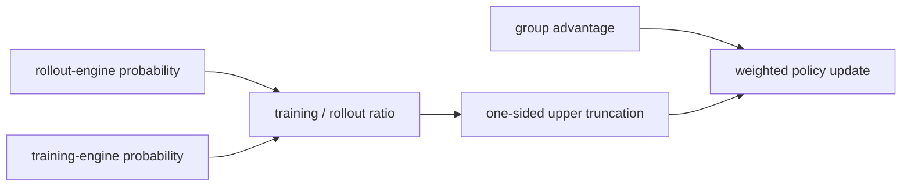

# TIS: truncated importance sampling for training–inference correction

<!-- source-sha256: 523d2b1b155dbc3fd06097c0b090706f205175d615340a011b98b67c44b6da83 -->

[简体中文](README.md)

> Isolates the web source's RL update on a public candidate policy. The lightweight experiment does not reproduce the large-model results in the source.

## Source information

| Field | Details |
|---|---|
| Source | [Your Efficient RL Framework Secretly Brings You Off-Policy RL Training](https://fengyao.notion.site/off-policy-rl) |
| Organization | UC San Diego / Microsoft Research |
| First public release | 2025-08-05 |
| Authors' code | No standalone algorithm repository was released; the article lists subsequent OAT, SkyRL, and OpenRLHF implementations. |
| Adapter / method | `tis` |
| Local reproduction code | [`src/auto_research/post_training/`](https://github.com/daiwk/auto-research/tree/main/src/auto_research/post_training/) |

## Original source

### Motivation and method

In mixed training frameworks a rollout engine samples actions and a training engine recomputes their log probabilities. Precision and kernel differences can make behavior and training distributions diverge even at identical weights. TIS multiplies policy gradients by the training-to-rollout probability ratio. A one-sided upper cap controls heavy-tail variance while retaining small-weight samples.



### Core equations

$$
\rho_t^{\rm TI}=\frac{\pi_{\rm train}(a_t\mid s_t)}{\pi_{\rm rollout}(a_t\mid s_t)},\qquad w_t=\min(\rho_t^{\rm TI},c),\qquad \mathcal L=-\mathbb E[w_t r_t^{\rm policy}A_t].
$$

### Source results

The original web article compares Vanilla IS, PPO-IS, and TIS across LLM RL settings. It reports that truncation prevents training collapse caused by training–inference probability mismatch. The article is not a standalone paper and does not report a production online A/B test.

## Local reproduction

The local run maintains an old training policy and a rollout-engine distribution with deterministic numerical/router perturbations. It caps the training-to-rollout ratio at `c=2` on one side only. TIS does not drop out-of-range samples and still retains the PPO stale-policy ratio.

```bash
auto-research post-train --algorithm tis --dataset gsm8k-candidate --maximum-examples 256 --steps 120 --seed 42
```

See the [fixed-seed aggregate metrics](../../experiments/rl-papers-summary-seed42.json).

## Reproduction boundaries

Candidate-action distributions stand in for per-token LLM probabilities and deterministic engine perturbations stand in for actual vLLM/FSDP numerical differences. This verifies TIS weights and gradients, not the web article's large-model training.
