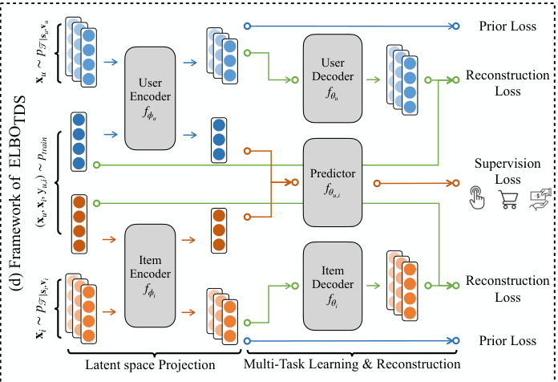

<!-- source-sha256: e14f7cb94d9a8623d55a324e6d78c3b43be6937d8947b65ff72237754dc2faab -->
# ELBO-TDS: variational reconstruction and cross-view priors under temporal drift

[简体中文](README.md)

> L1 component, not a complete industrial reproduction. Originally published2025; this historical intake follows the November25,2026 v2, not a release today.

## Paper information

| Field | Value |
| --- | --- |
| Paper | [ELBO-TDS](https://arxiv.org/abs/2511.21032); [reviewed v2](https://arxiv.org/pdf/2511.21032v2) |
| Company / author institution | First author Yuxuan Zhu and Cong Fu:Shopee; collaborators NTU and Singapore Management University |
| Original publication | November26,2025 04:02:23UTC(v1); reviewed v2 November25,2026 03:39:34UTC, November26 replacement announcement |
| Author code | [ELBO4TDS](https://github.com/FuCongResearchSquad/ELBO4TDS), public repository confirmed; HEAD `85358987d35e12ca6e454da2520f6c43e0c99dbb`. No license verified; independent formula implementation, no copied upstream source |
| Local adapter / stable key | `elbo-tds`; adapter=null, not a full pipeline |
| Local code | `src/auto_research/reproductions/elbo_tds_components.py` |

## Original paper

### Motivation and changes

ELBO-TDS assumes short-term fluctuations around relatively stable user/item factors. It does more than align augmented representations: unit-variance encoder posteriors are reparameterized, decoders retain individual features, and cross-view priors suppress transient noise. Task prediction uses deterministic means from original observations. Statistical buckets are perturbed locally, sequence inputs masked and categorical embeddings dropped, gated by global feature selection.

### Original figure



From the [original paper](https://arxiv.org/pdf/2511.21032v2), copyright belongs to the authors. Crop of Figure2(d), not a local result. [Provenance](assets/provenance.json).

### Core equations

Use Equations3–7 shown in the Chinese companion: $z_s^j=f_{\phi_s}(x_s^j)+\epsilon_s^j$, $\epsilon_s^j\sim\mathcal N(0,I)$, and $\bar z_s=J^{-1}\sum_jz_s^j$. The total objective is original-observation predictive loss plus alpha times reconstruction and cross-view-prior losses for both sides. The prior mean is across views of one sample, never users, and is not detached. Fixed unit variance makes entropy constant. Reconstruction targets each augmented input, not a hidden clean target. Prediction is deterministic and unaugmented; alpha zero leaves only supervision.

### Reported offline and online results

Table3, KuaiRand single-task MLP, ERM→ELBO-TDS:AUC0.9053±0.0029→0.9112±0.0008 and GAUC0.5086±0.0053→0.5191±0.0037. Section4.3 reports a two-week real traffic-split A/B against the same incremental-training system, adding ELBO-TDS at coarse/fine ranking: GMV/User+2.33% relative and independent human relevance+0.2%. The latter is reported with a percent sign, not established as percentage points. Traffic fraction, arm counts, p-values and confidence intervals are undisclosed. Production gains cannot be attributed to synthetic local losses.

### Relationship to existing methods

COTTI uses a differentiable CPC gate for regular/promotional-view consistency, history-distance RW weights and serving-time ABA calibration. ELBO-TDS instead constrains stable factors through a multi-view Gaussian prior and input reconstruction, leaving supervised prediction on original observations; it has no ABA-style serving probability correction. Both rely on stable-semantics assumptions. Alignment or reconstruction does not establish causal identifiability, and different production A/B experiments do not establish a head-to-head winner.

## Local implementation

### Data and code mapping

The L1 component implements a small dual encoder/decoder with dot-product prediction, unit-Gaussian reparameterization and slot-level augmentation for Equations3–7/Algorithm1. Callers provide bucket IDs or embedded floating slots; no production features or true stable factors are read. Slot selection, independent slot masking and element-mean MSE are explicit local choices. Complete field embedding/dropout grouping, chronological incremental training, MMoE, private ranking and public benchmark comparisons are absent.

```bash
PYTHONPATH=src python -c 'from auto_research.reproductions.elbo_tds_components import diagnostic; print(diagnostic(42, device="cpu"))'
```

`augment_features` covers Section3.3 boundaries; `ELBOTDSCore.objective` covers Equations3–7; `predict` is the original-mean supervision/inference path. The identical CUDA entry completed seeds42/43/44 on one real A100 (about1.41seconds in the shared runner), not a speedup or capability claim.

[CPU metrics](metrics/component-cpu-seeds42-44.json) · [A100 metrics](metrics/component-cuda-seeds42-44.json) · [Sanitized GPU receipt](../../gpu-validations/elbo-tds-a100-20261127-latest.json).

### Controls and limits

Six pairs, three views, three latent dimensions and seeds42/43/44 provide L1 arithmetic/gradient diagnostics only. Controls independently compute the prior through pairwise-distance identity, remove SSL at alpha zero, preserve supervised loss when SSL views change, preserve inputs at zero global selection, enforce bucket bounds and verify finite gradients/real encoder/decoder updates. Tests additionally check zero cross-view gradient sum for the prior and complete masking. There is no candidate/hyperparameter selection, test access, accuracy improvement or Evolve promotion. CPU/CUDA raw results, source proof and receipts remain separate.

### Complete experiment cost

Table1 lists28B training,0.9B validation and0.9B test interactions for Commercial-Main; KuaiRand has5.3M training interactions. The full campaign also covers baselines, tasks, MLP/MMoE and augmentation/weight grids. AppendixB.5 uses a single V100-16GB/A30-24GB, so multi-GPU infeasibility must not be invented. Table9 reports roughly999–1611ms per batch on the0.7B-example Commercial-Small; the multi-configuration/multi-seed/private-production campaign exceeds this bounded intake. Total GPU-hours are not reported: this is configuration-based cost assessment, not local measurement. The complete matrix is high cost, not reproduced(review DONE), without downloads, probes or retries. Component execution cost is recorded separately.
