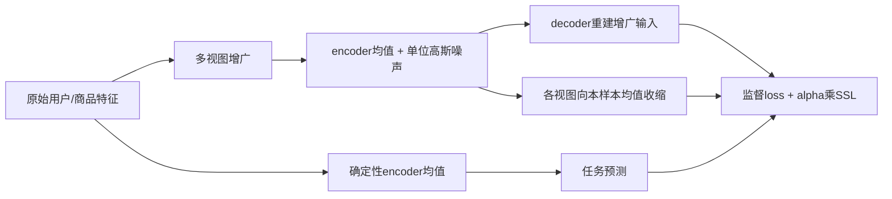
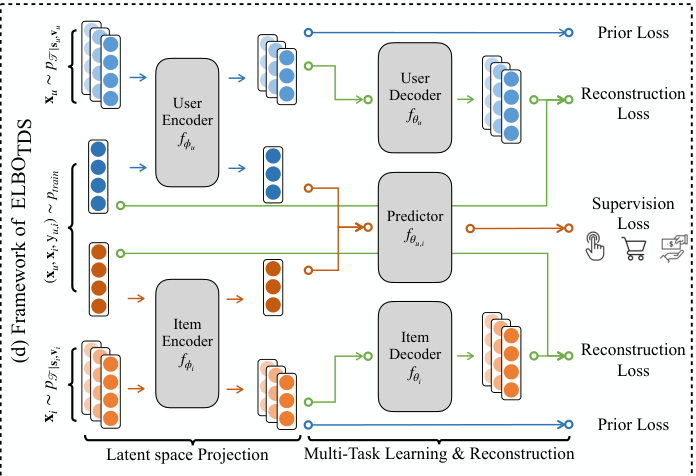

# ELBO-TDS：时间漂移中的变分重建与跨视图prior

[English](README-en.md)

> L1机制组件，不是完整工业复现；原始首发2025年，2026年11月25日v2带出本次补录，不是今天新发。

## 论文信息

| 字段 | 内容 |
| --- | --- |
| 论文链接 | [ELBO-TDS](https://arxiv.org/abs/2511.21032)；[固定v2](https://arxiv.org/pdf/2511.21032v2) |
| 公司 / 作者机构 | 一作Yuxuan Zhu及Cong Fu：Shopee；合作机构NTU、Singapore Management University |
| 首次公开日期 | 2025-11-26 04:02:23 UTC（v1）；本轮核对v2为2026-11-25 03:39:34 UTC，11月26日replacement公告 |
| 原作者开源代码 | [ELBO4TDS](https://github.com/FuCongResearchSquad/ELBO4TDS)，本轮核验公开；固定HEAD `85358987d35e12ca6e454da2520f6c43e0c99dbb`；未核到许可证，按公式独立实现，未复制作者源码 |
| 本地adapter / 稳定键 | `elbo-tds`；adapter=null，组件函数不是全pipeline |
| 本地复现代码目录 | `src/auto_research/reproductions/elbo_tds_components.py` |

## 原始论文总结

### 背景与主要改动

ELBO-TDS假设短期变化围绕相对稳定的用户/商品因素发生。它不只对齐增广表示：固定单位方差的encoder后验经重参数采样，decoder保留个体特征，跨视图prior约束抑制暂态噪声；任务预测只用原始观测的确定性均值。统计特征做分桶邻域扰动，序列随机mask，类别embedding dropout，再用全局特征选择限制增广强度。



<!-- paper-figure:start -->
### 原论文关键图



图片来自[原论文](https://arxiv.org/pdf/2511.21032v2)，版权归原作者所有；只裁出原Figure2(d)模型结构，不是本地结果。[出处与SHA256](assets/provenance.json)。
<!-- paper-figure:end -->

### 核心公式

$$
z_s^j=f_{\phi_s}(x_s^j)+\epsilon_s^j,\quad \epsilon_s^j\sim\mathcal N(0,I),\quad
\bar z_s=J^{-1}\sum_jz_s^j.
$$

$$
L=L_{pred}(f_{\theta}(\mu_u(x_u),\mu_i(x_i)),y)+\alpha\sum_{s\in\{u,i\}}
\left[\operatorname{MSE}(f_{\theta_s}(z_s^j),x_s^j)+\operatorname{MSE}(z_s^j,\bar z_s)\right].
$$

对应Eq3–7：prior均值按同一样本跨视图计算，不混用户；不stop-gradient。方差固定为I使熵项是常数。重建目标是各自增广输入，不偷偷替换为干净真值。预测头不加噪声、不使用增广视图；alpha=0只剩原始监督分支。

### 论文离线与线上效果

Table3在KuaiRand单任务MLP报告ERM→ELBO-TDS：AUC0.9053±0.0029→0.9112±0.0008、GAUC0.5086±0.0053→0.5191±0.0037。§4.3是两周真实流量切分A/B，对照为同一incremental-training系统，实验在粗排与精排加入ELBO-TDS；GMV/User相对+2.33%、独立人工相关性+0.2%。后者原文以百分号报告，不能擅写百分点。流量比例、分臂人数、p值和置信区间未披露。完整生产效果不能归给本地合成损失。

### 与已有方法的关系

COTTI的CPC用常态/促销两视图的可微门控控制对比一致性，RW对历史距离重加权，ABA在服务logit上作促销校准。ELBO-TDS用多视图高斯prior与输入重建约束稳定因素，并把有标签任务留在原始观测上；没有ABA式上线概率修正。两者都依赖稳定语义假设，不能从对齐或重建直接推断因果可识别，也不能用不同生产A/B宣称彼此胜负。

## 本地复现

### 数据协议与代码映射

本地L1只实现Eq3–7/Algorithm1的小型双encoder/decoder与dot-product预测器、单位高斯重参数采样和slot级增广。输入为调用者给定的分桶ID或已嵌入浮点slot：不读取生产特征或学习真实稳定因素。slot选择、各slot独立mask、MSE的元素均值是显式本地配置；没有完整字段embedding/dropout分组、时序增量trainer、MMoE、私有排序链路或公开benchmark效果比较。

```bash
PYTHONPATH=src python -c 'from auto_research.reproductions.elbo_tds_components import diagnostic; print(diagnostic(42, device="cpu"))'
```

`augment_features`→§3.3边界；`ELBOTDSCore.objective`→Eq3–7；`predict`→原始均值的监督/推理路径。CUDA同入口，已在真实单A100完成42/43/44三seed诊断（统一runner计时约1.41秒），不代表性能加速或能力提升。

[CPU指标](metrics/component-cpu-seeds42-44.json) · [A100指标](metrics/component-cuda-seeds42-44.json) · [脱敏GPU回执](../../gpu-validations/elbo-tds-a100-20261127-latest.json)。

### 结果、负控与边界

6对样本、3视图、3维latent、42/43/44种子只作L1数值与梯度诊断。独立两两距离恒等式核prior，alpha=0核SSL消失，改变SSL视图不能改变监督loss，全局选择概率0保持输入，检查bucket边界、所有encoder/decoder梯度有限且参数真更新。单测另核prior梯度跨视图和为0及完全mask。没有候选/超参数选择、test集读取、准确率提升或Evolve晋级；CPU/CUDA原始结果、源码证明和回执分别保留。

### 高成本完整实验

Table1的完整Commercial-Main有280亿训练交互、9亿验证和9亿测试；KuaiRand也有530万训练交互，完整实验还比较多种baseline/任务/MLP与MMoE、J和增广/权重网格。AppendixB.5为单V100-16GB/A30-24GB，不能伪称多卡不可行；但Table9在7亿样本Commercial-Small上每batch约999–1611ms、完整多配置多seed及私有生产评测超出本轮短时预算。总GPU小时未报告，以上是配置基础的成本判断，不是本地测量。完整矩阵成本过高，不复现（审查 DONE）；不下载数据、不探跑或重试。小型组件实际成本另记运行产物。
