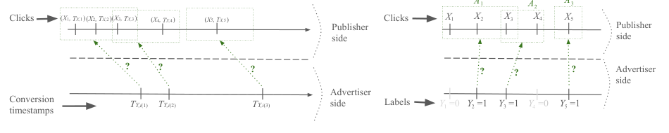

# Attribution Sets: Risk estimation from weak attribution signals

<!-- source-sha256: b020a92f838766a459d615402f2f755c78c9dab69d5a4f4e96f2c4a5e2151219 -->

[简体中文](README.md)

> **Standalone CPU math component**, no `reproduce` adapter or Evolve promotion. Formula execution is not proof of unbiasedness. Full experimental grid too costly and not reproduced (review DONE).

## Paper information

| Field | Details |
|---|---|
| Paper | [Paper or original source](https://arxiv.org/abs/2602.06276) |
| Institution | Google Research; listed-first Lorne Applebaum, with authors ordered alphabetically |
| First public release | 2026-02-06 (arXiv v1) |
| Author code | No author implementation found in reviewed v1; this is not a global claim. |
| Local adapter or method key | `attribution-sets` |
| Local reproduction code | `src/auto_research/reproductions/attribution_sets_components.py` |

## Paper method and evidence

One conversion may map to an overlapping set of candidate clicks. With no true assignments, decompose binary loss into a label-independent term and a label-dependent moment. Use position priors and binomial tail probabilities to estimate risk and squared-prior weighting for ERM, rather than random or max-prior pseudo-labeling. Implement printed v1 literally and preserve its failed finite-sample identity check. [v1 Section 3 Theorem 1 and Section 4.1 Eqs. 6–7](https://arxiv.org/html/2602.06276v1#S3).


<!-- paper-figure:start -->
### Original paper figure

[](https://arxiv.org/pdf/2602.06276v1#page=5)

Figure 1 (PDF page 5) shows clicks, delayed conversions and possibly overlapping sets. Its latent variables are not learner inputs. [Source, crop and hash](assets/provenance.json). From the [original paper](https://arxiv.org/pdf/2602.06276v1#page=5); copyright remains with the authors.
<!-- paper-figure:end -->

### Core equation

$$
\ell(h(x),y)=f_1(h(x))+yf_2(h(x)),\qquad
\widehat\ell=\frac{f_2(h(A_j[i]))}{\beta_1}
+\frac{\mathbb E f_1}{B_{n,p,j+k}}
-\frac{\beta_0\mathbb E f_2}{\beta_1B_{n,p,j+k}}.
$$

$$
p\beta_1+\beta_0=\pi[i]B+(1-\pi[i])\ne B
$$

The implementation keeps $1\{j\le M-k\}$ and the fixed Eq. 6 denominator.

### Reported results

The paper simulates attribution sets on MNIST, CIFAR-10 and Higgs vs random/max-prior baselines. No real production A/B or full rollout. User-approved mathematics component, not an industrial lift reproduction.

## Local reproduction

`unbiased_cell` implements the printed equation, despite the target name; `squared_risk` follows Eq. 6 and `finite_erm` searches finite hypotheses. The original binomial tail, indicator and fixed Eq. 6 denominator are retained without observed-window renormalization. Singularities error rather than clamp. Population moments and priors are explicit inputs; plug-in estimates do not inherit exact unbiasedness.

Only small constructed fixtures: singleton sets match true risk over exhaustive hidden streams. Multi-element coefficients fail a constant-function check when $B=B_{n,p,j+k}<1$; $n=10,p=0.3,j=k=2,\pi=(0.6,0.4)$ gives a reproducible counterexample. This concerns the printed finite-sample identity, not a proof the whole paper is invalid or an author correction. No silent fix. [CPU metrics](metrics/component-cpu-seed42.json). A roughly 7,800-run, 100–200 epoch matrix was not run; no public-data training, recommendation gain or Evolve promotion.

```bash
pip install -e '.[research-components]'
PYTHONPATH=src python scripts/run_google16_statistics.py --seed 42 --output runs/google16-statistics.json
python -m pytest tests/test_google16_statistical.py
```
