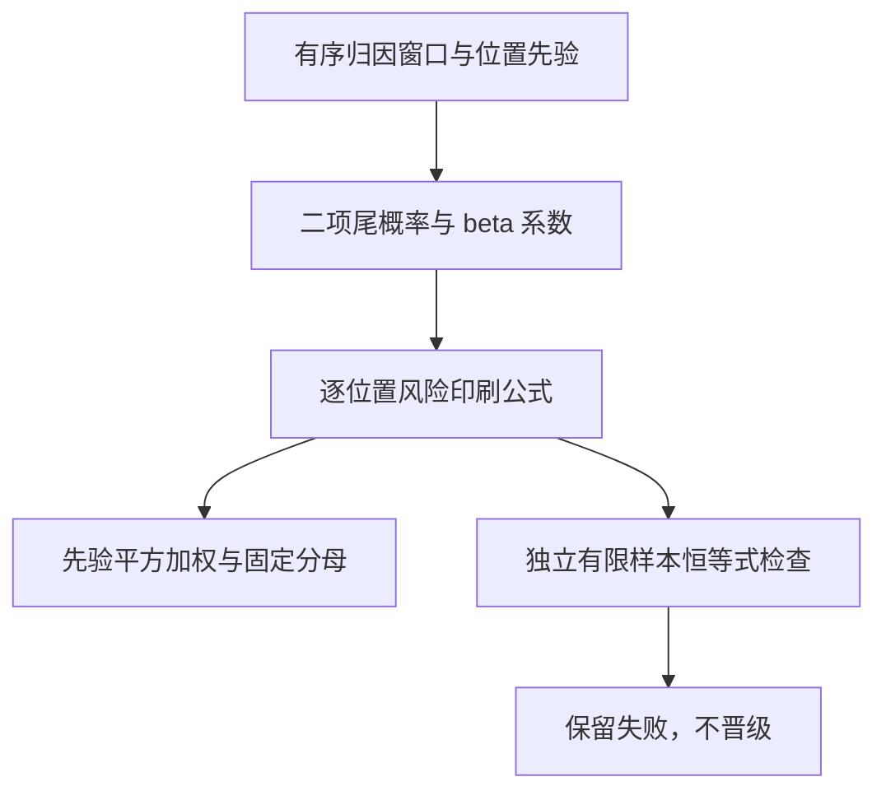
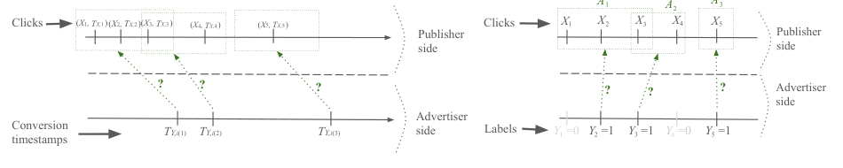

# Attribution Sets：弱归因信号上的风险公式组件

## 论文信息

| 字段 | 内容 |
|---|---|
| 论文链接 | [Statistical Learning from Attribution Sets](https://arxiv.org/abs/2602.06276) |
| 公司 / 机构 | Google Research；按首列作者 Lorne Applebaum 归类，作者按字母排序 |
| 首次公开日期 | 2026-02-06（arXiv v1；不以网页抓取时间代替） |
| 原作者开源代码 | 已审读 v1 正文未找到作者实现仓库；不声称全网不存在 |
| 本地 adapter | `attribution-sets`，独立数学组件，无 reproduce adapter |
| 本地复现代码 | `src/auto_research/reproductions/attribution_sets_components.py` |

## 方法摘要

把一次转化对应的候选点击视为归因集合，用位置先验和二项尾概率反解标签相关风险，再以先验平方加权构造ERM目标。本地逐式实现v1印刷公式，同时保留有限样本恒等式校验失败，不将公式执行成功写成无偏性验证成功。

## 原始论文总结

### 背景与主要改动

隐私归因场景不提供点击到转化的真实配对，候选集合还可能重叠。方法不采用随机或最大先验伪标签，而将二元损失拆为与标签无关的部分及标签相关矩，再由归因集合统计估计风险。主源定位：[v1 §3 Theorem 1、§4.1 Eq6–7](https://arxiv.org/html/2602.06276v1#S3)。



<!-- paper-figure:start -->
### 原论文关键图

[](https://arxiv.org/pdf/2602.06276v1#page=5)

> **Figure 1，PDF第5页**：点击、延迟转化与可重叠归因集合的观测结构。原图并不消除下文保留的v1公式反例；不把图中隐变量作为本地学习器输入。版权归原作者；[来源、裁剪与hash](assets/provenance.json)。
<!-- paper-figure:end -->

### 核心公式

$$
\ell(h(x),y)=f_1(h(x))+yf_2(h(x)),\qquad
\widehat\ell=\frac{f_2(h(A_j[i]))}{\beta_1}
+\frac{\mathbb E f_1}{B_{n,p,j+k}}
-\frac{\beta_0\mathbb E f_2}{\beta_1B_{n,p,j+k}}.
$$

代码保留原文的二项尾概率、$1\{j\le M-k\}$选择及Eq6固定分母，不按实际窗口数重新归一化。边界奇异时显式报错，不裁剪成另一个估计器；人口矩与位置先验是显式输入，插入样本估计不再声称严格无偏。

### 论文离线与线上效果

论文在MNIST、CIFAR-10和Higgs模拟归因集合，比较随机/最大先验基线；未报告真实生产A/B或全流量实验。本条由用户批准作为数学组件，不补写线上资格，也不登记为工业效果复现。

## 本地复现

```bash
pip install -e '.[research-components]'
PYTHONPATH=src python scripts/run_google16_statistics.py --seed 42 --output runs/google16-statistics.json
python -m pytest tests/test_google16_statistical.py
```

### 数据协议与结果

仅使用自建小规模数学夹具。单元素集合在穷举隐藏二元流时匹配真实风险；多元素集合的v1印刷系数未通过常数函数检查。令$B=B_{n,p,j+k}$，原式给出
$$
p\beta_1+\beta_0=\pi[i]B+(1-\pi[i])\ne B
$$
（当集合多于一个元素、$B<1$时）。测试给出$n=10,p=0.3,j=k=2,\pi=(0.6,0.4)$的可重复反例。它只说明此印刷式在该有限样本检查不一致，不冒称已经证明整篇论文理论无效；未静默修补或宣称取得作者勘误。

完整约7,800次、100–200epoch网格成本过高，不复现（审查DONE）。本轮是CPU公式组件与反例审计，`diagnostic_only=true`；没有公开数据训练、推荐效果或evolve晋级资格。

### 代码映射与边界

`unbiased_cell`名称对应论文目标，文档字符串明确它仅是印刷式；`squared_risk`对应Eq6，`finite_erm`仅在有限候选上执行选择。稳定指标见本目录`metrics/component-cpu-seed42.json`，与论文结果严格分开。
