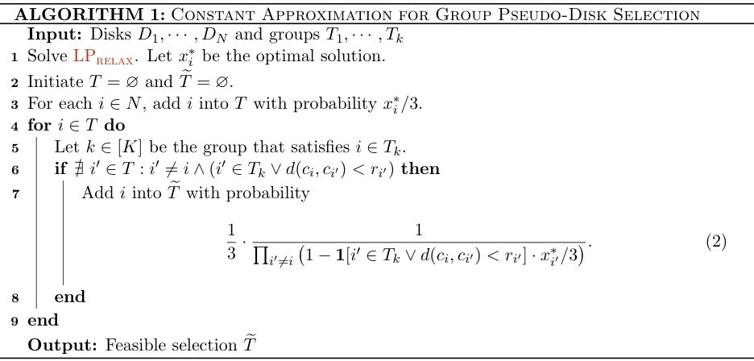

# Spatial Ads: LP and Randomized Rounding for Spatial Externalities

<!-- source-sha256: 54c05721e6200bbb8e7dfdf4270d366c3043f741770d0a9e71a82ed9c02672eb -->

[简体中文](README.md)

## Paper information

| Field | Details |
|---|---|
| Paper | [Online Advertising with Spatial Interactions](https://arxiv.org/abs/2602.12481) |
| Organization | Google Research; first-listed author Gagan Aggarwal. |
| First public release | 2026-02-12 (arXiv v1); a printed August date does not replace v1. |
| Authors' code | No author code link was found in the reviewed paper. |
| Adapter / method | `spatial-ads`; standalone CPU component, no `reproduce` adapter. |
| Local reproduction code | `src/auto_research/reproductions/spatial_ads_components.py` |

## Method overview

Neighboring ad placements affect ad value. The local component implements the paper's grouped pseudo-disk LP relaxation and two-stage randomized rounding, checking group exclusivity and that no selected disk's center is covered by another selected disk. It does not reproduce full matching, live auctions, or the end-to-end factor-18 approximation.

## Original paper

### Motivation and method

Independent slot auctions ignore spatial interference. The paper reduces nearest-neighbor externalities to grouped pseudo-disk selection and rounds an LP to a feasible set. It also studies simple auctions for decomposable value, a 2D PTAS, and hardness of the product-distance model. Local scope is [v1 Section 2.2, Algorithm 1 and Eq. 2](https://arxiv.org/html/2602.12481v1#S2.SS2).


<!-- paper-figure:start -->
### Key figure from the paper

[](https://arxiv.org/pdf/2602.12481v1#page=10)

> **Algorithm 1, PDF p. 10:** Original sampling, full-sample conflict checks, and second thinning. The screenshot is a mathematical algorithm, not a model diagram. From the [original paper](assets/provenance.json); copyright remains with the authors.
<!-- paper-figure:end -->

[Source, crop, and hash](assets/provenance.json).

### Core equations

$$
\max_x\sum_iw_ix_i,\quad
\sum_{i:d(c,c_i)<r_i}x_i\le1,\quad
\sum_{i\in T_k}x_i\le1,\quad0\le x_i\le1.
$$

The first stage samples independently with $x_i/3$; an unconflicted item survives with probability:

$$
\frac{1}{3\prod_{i'\ne i}(1-\mathbf1[\text{same group or covers center}]x_{i'}/3)}
$$

The indicator in the formula is one when the other disk is in the same group or covers the center. SciPy HiGHS solves the actual LP. Conflicts are evaluated against the **entire original sample**, not a greedily accepted subset, and coverage uses strict inequality. Invalid distances or probabilities fail without heuristic fallback.

### Paper results

This theoretical algorithm paper reports no production A/B or full-traffic evidence. The factor-18 approximation requires the complete reduction and reverse matching; this component does not establish that guarantee. There is no expensive neural training experiment to reproduce.

## Local reproduction

```bash
pip install -e '.[research-components]'
PYTHONPATH=src python scripts/run_google16_statistics.py --seed 42 --output runs/google16-statistics.json
```

### Data protocol and results

A constructed three-point metric and three disks test LP feasibility, constraint II for all samples, and marginal retention near $x_i/9$ under independent seeds. This is L1 mechanism evidence, not ad performance. CPU only. Stable record: `metrics/component-cpu-seed42.json`.

### Implementation and limits

`constraints` and `solve_relaxation` implement the LP, `round_solution` implements Algorithm 1, and `feasible_ii` checks feasibility independently. The full ad-matching reduction, Myerson payments, and 2D PTAS are out of scope. `full_experiment_status=not_applicable_theoretical_paper` records that no training experiment exists, rather than labeling it costly. This user-selected theoretical component does not become an industrial adapter or Evolve operator automatically.
