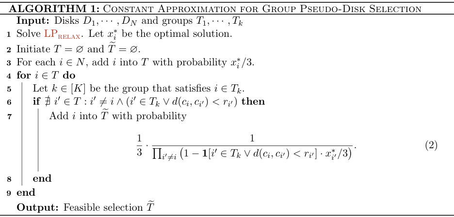

# Spatial Ads：空间外部性的LP与随机舍入组件

## 论文信息

| 字段 | 内容 |
|---|---|
| 论文链接 | [Online Advertising with Spatial Interactions](https://arxiv.org/abs/2602.12481) |
| 公司 / 机构 | Google Research；首列作者 Gagan Aggarwal |
| 首次公开日期 | 2026-02-12（arXiv v1；正文另印8月日期，不用它覆盖v1） |
| 原作者开源代码 | 已审读原文未找到作者代码链接；明确记为未找到 |
| 本地 adapter | `spatial-ads`，独立CPU组件，无 reproduce adapter |
| 本地复现代码 | `src/auto_research/reproductions/spatial_ads_components.py` |

## 方法摘要

广告价值受相邻广告空间位置影响；本地实现论文分组伪圆盘选择的线性松弛与两阶段随机舍入，检查组内互斥和所选圆盘中心不被其他圆盘覆盖。没有把几何子问题的成功冒充完整广告匹配、真实竞价或18近似端到端验收。

## 原始论文总结

### 背景与主要改动

传统逐位置竞价忽略屏幕上的空间干扰。论文将最近邻外部性问题约化到分组伪圆盘选择，再将LP解舍入为可行圆盘集合；同时研究可分解价值的简单拍卖、二维PTAS与乘积距离模型的困难性。实现范围为[v1 §2.2 Algorithm1及Eq2](https://arxiv.org/html/2602.12481v1#S2.SS2)。


<!-- paper-figure:start -->
### 原论文关键算法截图

[](https://arxiv.org/pdf/2602.12481v1#page=10)

> **Algorithm 1，PDF第10页**：原文是数学算法而非神经模型架构；截图保留采样、对全部已采样项检查冲突及第二次稀释的精确步骤，不强造架构图。版权归原作者；[来源、裁剪与hash](assets/provenance.json)。
<!-- paper-figure:end -->

### 核心公式

$$
\max_x\sum_iw_ix_i,\quad
\sum_{i:d(c,c_i)<r_i}x_i\le1,\quad
\sum_{i\in T_k}x_i\le1,\quad0\le x_i\le1.
$$

第一阶段独立以$x_i/3$采样；无冲突者以
$$
\frac{1}{3\prod_{i'\ne i}(1-\mathbf1[\text{同组或覆盖中心}]x_{i'}/3)}
$$
保留。代码使用SciPy HiGHS求真实LP，冲突是针对**原始整个采样集合**而非贪心已选集合，圆盘边界使用严格小于。距离非度量或概率不合法会失败，不改为启发式兜底。

### 论文离线与线上效果

这是理论算法论文，未报告生产A/B或全流量。18近似需要完整约化与反向匹配，本组件不宣称已验证该整体保证；也没有将理论论文虚构为高成本神经网络实验。

## 本地复现

```bash
pip install -e '.[research-components]'
PYTHONPATH=src python scripts/run_google16_statistics.py --seed 42 --output runs/google16-statistics.json
```

### 数据协议与结果

自建3点度量、3个圆盘的数学测试；检查LP可行、所有采样满足约束II，并以独立种子检验边际保留概率接近$x_i/9$。属于L1机制诊断，不是线上广告收益。CPU无需GPU；稳定记录见`metrics/component-cpu-seed42.json`。

### 代码映射与边界

`constraints`/`solve_relaxation`实现LP，`round_solution`实现Algorithm1，`feasible_ii`独立核验。未实现全广告匹配约化、Myerson支付或二维PTAS；它们不是本轮低成本组件承诺。论文没有完整训练实验，故`full_experiment_status=not_applicable_theoretical_paper`，不伪造“高成本不复现”理由。无线上门槛的条目仅作用户明确指定的理论组件，不能自动成为工业adapter或evolve算子。
