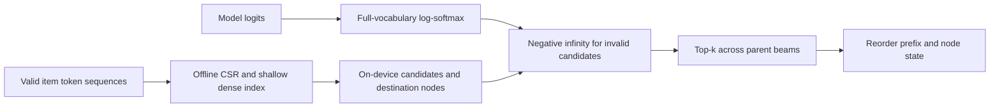
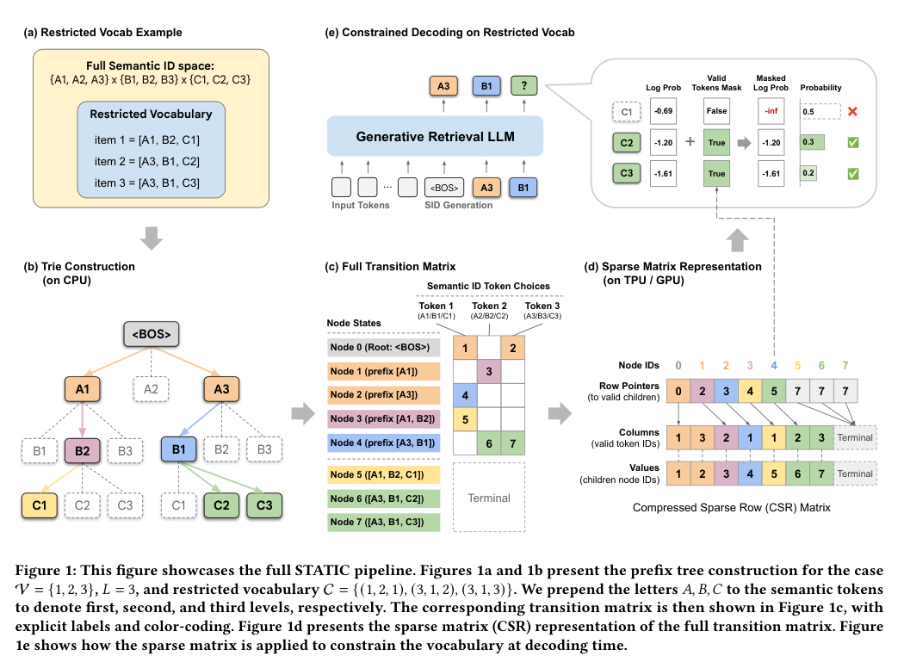

# STATIC: Accelerator-Native Constrained Decoding

<!-- source-sha256: 8012c5264811bd13cf9092c6cfefaf8a1e896c207922e2715a879af06aa992bc -->

[简体中文](README.md)

## Paper information

| Field | Details |
|---|---|
| Paper | [Vectorizing the Trie](https://arxiv.org/abs/2602.22647); implementation checked against [v3](https://arxiv.org/html/2602.22647v3). |
| Organization | Google / YouTube. Co-first author Isay Katsman lists Yale; the work was done in the Google Student Researcher Program. |
| First public release | 2026-02-26 (v1, 06:00:56 UTC); v3 on 2026-10-07 is a revision, not a new release. |
| Authors' code | [Official Apache-2.0 implementation](https://github.com/youtube/static-constraint-decoding), pinned at `ac18fa1870ac45e0a3559090a0ea9ec005226cf5`. |
| Adapter / method | `static-constraint-decoding`; standalone component, not a full-model adapter. |
| Local reproduction code | `src/auto_research/reproductions/static_constraint_decoding/algorithm.py`; CLI `scripts/run_oct16_recommendation_components.py`. |

## Original paper

### Motivation and method

Generative recommendation often constrains decoding to eligible items for freshness, inventory, or geography. STATIC compresses a trie offline into CSR transitions, with dense lookup available for shallow layers. Candidate gathering happens on the GPU or TPU at each step, avoiding CPU pointer traversal and device round trips.



<!-- paper-figure:start -->
### Key figure from the paper



> **Figure 1:** Screenshot from v3 PDF p. 4: trie, CSR, and constrained decoding. This is not a local experimental result. From the [original paper](https://arxiv.org/pdf/2602.22647v3#page=4); copyright remains with the authors.
<!-- paper-figure:end -->

### Core computation

For prefix state $s$, CSR row pointers index contiguous legal tokens and destination states. Compute $p=\log\operatorname{softmax}(L)$ before masking invalid candidates to $-\infty$; do not renormalize the legal subset. Add $p_v$ to the cumulative beam score and reorder prefixes and trie nodes together.

### Paper results

Section 5.4/Table 2 reports YouTube Home Feed online A/B: seven-day fresh views +5.1%, CTR +0.15% (95% CI [0.01%,0.29%]). The GPU/TPU timings, 948× CPU trie speedup, and Amazon cold-start results with a 1B model are author measurements, not local results.

## Local reproduction

A standalone PyTorch implementation of Algorithms 1 and 2 builds CSR offline, performs fixed-max-fan-out vectorized speculative gathers, handles shallow dense lookup, masks in log space, reorders parent beam states, and uses explicit EOS. With variable-length IDs, retain EOS and collect completed beams separately. No complete language model is supplied.

The fixed prefix is 4,096 rows of official KuaiRand-Pure impressions. Video IDs are reversibly encoded as base-16 token sequences, **not learned RQ-VAE Semantic IDs**. This checks constraints, not recommendation performance. Three-seed CPU and GPU outputs are retained separately. See `metrics/` and the [actual CUDA receipt](../../gpu-validations/static-constraint-decoding-a100-20261016.json).

```bash
PYTHONPATH=src python scripts/prepare_oct16_public_prefix.py \
  --source data/kuairand-pure/data/log_standard_4_22_to_5_08_pure.csv \
  --output public/kuairand-prefix.csv
PYTHONPATH=src python scripts/run_oct16_recommendation_components.py \
  --csv public/kuairand-prefix.csv --device cuda --seeds 42,43,44 \
  --output runs/oct16-recommendation.json
```

### Results and limits

`validity=1` establishes mathematical constraint validity only. Timings measure candidate gathering at selected shapes, not end-to-end inference. No SID tokenizer, 1B retriever, or private YouTube A/B was reproduced. **Full experiment not reproduced due to cost (review complete)**: original work uses TPU v6e, a 1B model, and production infrastructure. Local scope is a bounded operator, without automatic Evolve integration.
