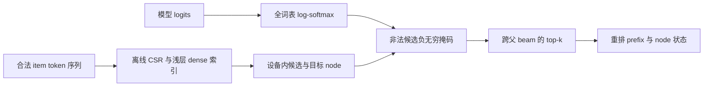
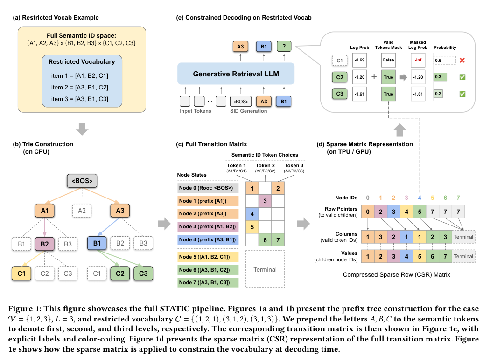

# STATIC：加速器原生约束解码

## 论文信息

| 字段 | 内容 |
| --- | --- |
| 论文链接 | [Vectorizing the Trie](https://arxiv.org/abs/2602.22647)，本实现核对 [v3 正文](https://arxiv.org/html/2602.22647v3) |
| 公司/机构 | Google / YouTube；共同一作 Isay Katsman 署名 Yale，工作在 Google Student Researcher Program 完成 |
| 首次公开日期 | 2026-02-26（v1 06:00:56 UTC）；v3 为 2026-10-07，不当成新首发 |
| 原作者代码 | [官方 Apache-2.0 实现](https://github.com/youtube/static-constraint-decoding)，固定版本 `ac18fa1870ac45e0a3559090a0ea9ec005226cf5` |
| Adapter / 组件键 | `static-constraint-decoding`；独立组件，不注册完整模型复现 adapter |
| 本地复现代码 | `src/auto_research/reproductions/static_constraint_decoding/algorithm.py`；命令 `scripts/run_oct16_recommendation_components.py` |

## 原始论文总结

### 背景与主要改动

生成式推荐常需要将解码限制在新鲜内容、库存或地域等合法 item 子集中。STATIC 将前缀树离线压成 CSR 迁移矩阵，浅层可用 dense lookup；每步在 GPU/TPU 上抽取合法候选，消除 CPU 指针追踪和设备往返。



<!-- paper-figure:start -->
### 原论文关键图



> 来自 [v3 PDF 第 4 页 Figure 1](https://arxiv.org/pdf/2602.22647v3#page=4) 的截图，版权归原作者所有。图展示前缀树、CSR 和受限解码，不是本地实验结果。
<!-- paper-figure:end -->

### 核心公式

对于前缀状态 $s$，CSR 的行指针给出合法 token 与目标状态的连续区间。先计算 $p=\log\operatorname{softmax}(L)$，再设置非法候选为 $-\infty$，不在合法集合上重新归一化。beam 得分为旧累计得分加 $p_v$，选择后必须同步重排 prefix 和 trie node。

### 论文离线与线上效果

§5.4 / Table 2 明确报告 YouTube Home Feed 线上 A/B：7-day fresh views +5.1%，CTR +0.15%（95% CI [0.01%,0.29%]）。论文 GPU/TPU 延迟、948× CPU trie 加速、1B 模型 Amazon 冷启动结果均是作者测量，不是本地结果。

## 本地复现

本次实现 Algorithms 1/2 的独立 PyTorch 算子：CSR 离线构建、固定最大分支宽度的向量化 speculative gather、浅层 dense lookup、log-space 掩码、beam 父状态重排和显式 EOS。使用变长 ID 时必须保留 EOS，调用方需收集已结束 beam；不提供完整语言模型。

数据来自官方 KuaiRand-Pure 曝光日志的固定 4,096 行前缀，视频 ID 可逆转成 base-16 token 序列，**不是 RQ-VAE 学到的语义 ID**。这足以验证约束算子，不支持推荐能力结论。CPU/GPU 三种子产物分别保留；最终执行指标见本目录 `metrics/`，真实 CUDA 证据见 [验收回执](../../gpu-validations/static-constraint-decoding-a100-20261016.json)。

```bash
PYTHONPATH=src python scripts/prepare_oct16_public_prefix.py \
  --source data/kuairand-pure/data/log_standard_4_22_to_5_08_pure.csv \
  --output public/kuairand-prefix.csv
PYTHONPATH=src python scripts/run_oct16_recommendation_components.py \
  --csv public/kuairand-prefix.csv --device cuda --seeds 42,43,44 \
  --output runs/oct16-recommendation.json
```

### 结果与边界

`validity=1` 只表示约束的数学正确性，不是模型准确率；计时仅是指定形状的候选抽取，不是端到端推理延迟。没有训练 SID tokenizer、1B 检索模型，也没有复现私有 YouTube A/B。**成本过高，不复现（审查 DONE）**：完整实验需要 TPU v6e、1B 模型及生产环境；本地仅有限算子验收，不自动接入 Evolve。
