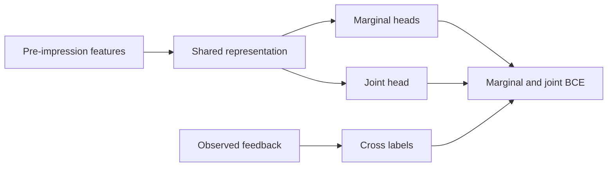
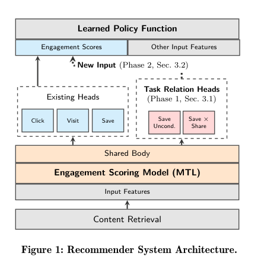

# YouTube: Auxiliary heads for learned cross-task relationships

<!-- source-sha256: c31f52c07dc2d10e5946c003d800237558f703ee396c33a2cdfd278f379c171f -->

[简体中文](README.md)

> Public-data auxiliary component, not downstream RL or production deployment.

## Paper information

| Field | Details |
|---|---|
| Paper | [Learned Cross-Task Relationships in Multi-Task Models](https://arxiv.org/abs/2609.28776) |
| Institution | Google / YouTube; first author Victor Zhang. |
| First public release | 2026-09-23 (historical release) |
| Author code | No public method-specific implementation found. |
| Local adapter or method key | `cross-task-relationships` (standalone, not a full YouTube adapter). |
| Local reproduction code | `src/auto_research/reproductions/cross_task_relationships/model.py`; `scripts/run_oct16_recommendation_components.py`. |

## Paper method and evidence

Marginal heads discard joint information. Paired joint labels or missing unconditional auxiliary heads supply shared gradients and downstream policy features; the paper tests these effects separately.

<!-- paper-figure:start -->
### Original paper figure

Figure 1 on v1 PDF page 3 shows auxiliary heads and downstream policy. Local RL was not retrained. From the [original paper](https://arxiv.org/pdf/2609.28776v1#page=3); copyright remains with the authors.
<!-- paper-figure:end -->

### Core equation

$\mathcal L=\mathcal L_X+\mathcal L_Y+\lambda\mathcal L_{XY}$ with joint label $y_X y_Y$ and covariance $E[XY]-E[X]E[Y]$. Recover $p_{11}=p_{XY}$, $p_{10}=p_X-p_{XY}$, $p_{01}=p_Y-p_{XY}$, $p_{00}=1-p_X-p_Y+p_{XY}$. Mark infeasible estimates; do not silently clamp them.

### Reported results

Section 6 distinguishes online A/B with tens of millions of users per arm from launch at full traffic. Table 2 covers Notifications, Homepage and Watch Next; valued Watch Next watch time rose 0.19% (95% CI [0.15%,0.23%]). Different stages/products are not one head-to-head; transfer to old heads is not downstream RL gain.

## Local reproduction

Use the first 4,096 official KuaiRand-Pure impressions sorted in time, 70/15/15 train/validation/test. Inputs are pre-impression user/video ID, time, and duration. `is_click` and `long_view` enter only loss/scoring; require all four train labels and exclude unsupported/mutually exclusive/nested/constant pairs. Compare marginal-only, real cross-label and shuffled cross-label under the same initialization, batches and 32 AdamW steps, weight 0.1. No validation/test tuning; test only after training. Commands shared with [STATIC](../2602.22647-static-constraint-decoding/README.md), artifacts in `metrics/`, [CUDA receipt](../../gpu-validations/cross-task-relationships-a100-20261016.json). Shared gradients, joint BCE and distribution readout execute, with negative results retained. Billions of samples/day, weeks of training, private rewards/labels and production A/B/launch exceed budget and were not reproduced; review complete. No Evolve integration.
