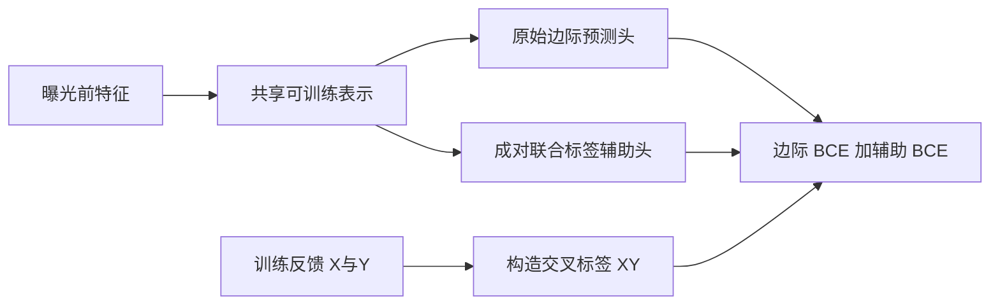
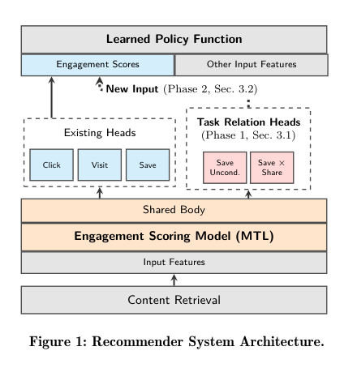

# YouTube：学习跨任务关系的辅助头

## 论文信息

| 字段 | 内容 |
| --- | --- |
| 论文链接 | [Learned Cross-Task Relationships in Multi-Task Models](https://arxiv.org/abs/2609.28776) |
| 公司/机构 | Google / YouTube；论文第一作者 Victor Zhang |
| 首次公开日期 | 2026-09-23；不是本轮新首发 |
| 原作者代码 | 原文未给出专属方法实现仓库；未发现公开代码，不写成已开源 |
| Adapter / 组件键 | `cross-task-relationships`；独立组件，不注册完整 YouTube 复现 adapter |
| 本地复现代码 | `src/auto_research/reproductions/cross_task_relationships/model.py`；实验命令 `scripts/run_oct16_recommendation_components.py` |

## 原始论文总结

### 背景与主要改动

多任务网络只预测各反馈的边际概率，可能丢掉任务之间的联合信息。该方法加入成对联合标签或缺失的无条件辅助头，既给共享表示提供额外梯度，也能把联合预测作为下游策略的新输入；论文将这两种收益分阶段隔离测试。

<!-- paper-figure:start -->
### 原论文关键图

> 来自 [v1 PDF 第 3 页 Figure 1](https://arxiv.org/pdf/2609.28776v1#page=3) 的截图，版权归原作者所有。下游 RL 未在本地重训，不把结构图视为已实现整个产品系统。
<!-- paper-figure:end -->

### 核心公式

$\mathcal L=\mathcal L_X+\mathcal L_Y+\lambda\mathcal L_{XY}$，联合标签为 $y_X y_Y$，协方差为 $E[XY]-E[X]E[Y]$。成对联合分布由三个预测恢复：$p_{11}=p_{XY}$、$p_{10}=p_X-p_{XY}$、$p_{01}=p_Y-p_{XY}$、$p_{00}=1-p_X-p_Y+p_{XY}$。本实现保留负概率等不可行估计的标记，不静默裁剪后宣称校准正确。

### 论文离线与线上效果

§6 定义 live experiment 为千万用户/臂的线上 A/B，launch 为全量部署。Table 2 给出 Notifications、Homepage 和 Watch Next 多阶段结果；Watch Next valued watch time +0.19%（95% CI [0.15%,0.23%]）。各产品/阶段不是同一组 head-to-head，对原头的迁移收益也不能冒充下游 RL 输入收益。

## 本地复现

使用官方 KuaiRand-Pure 固定 4,096 行曝光前缀，时间排序后按 70/15/15 划分 train/validation/test。特征仅含曝光前的用户/视频 ID、时段和视频时长；`is_click` / `long_view` 只进入损失与评分。训练集检查四种联合标签均存在，排除互斥、嵌套、常量或当前切片无法支持的任务对。

三个训练臂共享初始化、minibatch 顺序、32 步预算和 AdamW 设置：只训练边际头、真实 cross-label 辅助头、打乱 cross-label 控制。权重固定为 0.1，不用 validation/test 调参；test 仅在各臂固定训练结束后报告。小切片稀疏且有前缀选择偏差，三种子仍只是诊断，不是稳定能力提升。运行命令与 [STATIC](../2602.22647-static-constraint-decoding/README.md) 共享，产物在 `metrics/`；[CUDA 回执](../../gpu-validations/cross-task-relationships-a100-20261016.json) 与原文线上结果分离。

### 结果与边界

实现真实共享梯度、联合标签 BCE 和成对分布读出，并保留未提升/退化结果。未实现依赖私有产品 reward 的下游 RL policy，也未复现生产标签定义和全量部署。**成本过高，不复现（审查 DONE）**：原文每日数十亿样本、多周训练与线上实验不在单卡预算内；本地可执行的是小网络辅助训练组件，不自动进入 Evolve。
