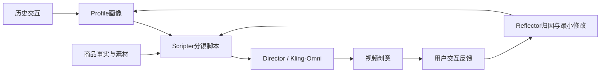

# MAPS：个性化视频广告的四Agent闭环

> 仅研究资料。**成本过高，不复现（审查 DONE）**，不把通用GRPO或三个分数加权冒充视频广告生成系统。

## 论文信息

| 字段 | 内容 |
| --- | --- |
| 论文链接 | [arXiv 2610.25748v1](https://arxiv.org/abs/2610.25748v1)；[固定PDF](https://arxiv.org/pdf/2610.25748v1) |
| 原文标题 | MAPS: A Multi-Agent Personalized Script-Driven Video Advertising System Enhanced by Reinforcement Learning |
| 公司 / 机构 | 一作Zhongyu Wang：Beihang University（首列）、Kuaishou Technology；共同一作Chen Zuo、Qingxuan Sun为Kuaishou |
| 首次公开日期 | 2026-10-19 04:00:27 UTC；10月20日arXiv公告 |
| 原作者代码 | 本轮原文与arXiv未找到可核验作者源码仓库；Kling-Omni是外部生成服务，不等同开源实现 |
| 本地 adapter / 稳定键 | `maps-creative`（资料键）；`adapter: null` |
| 本地复现代码 | 无；仅本文与`src/auto_research/paper_specs/catalog/recommendation/maps-creative.json` |

## 原始论文总结

### 背景与主要改动

从固定广告库存检索创意，无法及时适应个体偏好和反馈。MAPS以Profile提取画像、Scripter生成分镜、Director调用视频生成、Reflector归因反馈，区分画像问题与脚本问题并路由最小修改。画像不仅含兴趣，也包含呈现风格与决策倾向。

脚本先SFT学习结构，再用结构正确性、个性化偏好和商品事实一致性构造混合奖励，以GRPO式组内标准化更新。它的关键是大模型/视频生成与私有反馈环境的组合，不是独立奖励公式。

原文Figure2是四Agent系统总览，Figure3是脚本训练流程。

<!-- paper-figure:start -->
### 原论文关键图

> **原论文 Figure 2（关键图）**：Profile、Scripter、Director和Reflector四Agent广告创意闭环；这里是原文完整系统，本地未复现视频模型或线上反馈。图片来自[原论文](https://arxiv.org/abs/2610.25748v1)，版权归原作者所有；点击图片可查看来源。
<!-- paper-figure:end -->

### 核心公式

$$
R=.3R_{struct}+.4R_{pers}+.3R_{prod},\qquad
A_k=\frac{R_k-\bar R}{\sigma_R+\epsilon}.
$$

原文以优势加权对数似然减去相对SFT策略KL描述RL目标。结构奖含格式、完整性、场景角色一致性和物理合理性；个性化与商品奖使用LLM judge。本文不把这些语义judge替换为关键词计数。

### 论文离线与线上效果

PCG/PCI各50用户×5商品的离线矩阵，包含生成质量、偏好、商品一致性等多维指标。Section4.3/Table3的快手特定广告场景线上A/B，对比GRM：CTR +2.87%、CVR +2.74%、ARPU +9.85%；对比DLRM为+4.88%、+4.01%、+12.89%。原文该节未报告流量比例与试验时长，不能自行补成全流量或某周数；但正文量化线上证据满足收录门槛。

## 本地复现与成本判断

Profile/Reflector是Qwen3-VL-32B，Scripter是8B；SFT20epoch、最大8192tokens，随后RL5000步，原文在8张H100上实验。导演依赖Kling-Omni，反馈闭环依赖生产系统。单卡A100/A30与Mac不承担此完整矩阵，**成本过高，不复现（审查 DONE）**。没有本地模型、评测指标或GPU回执，不进入自动重试与Evolve。
