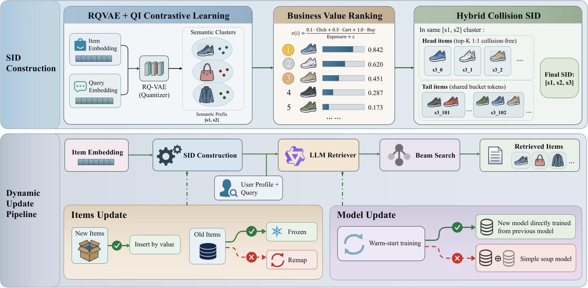

# SID Topology: Preserving semantic paths in dynamic e-commerce retrieval

<!-- source-sha256: 9b65aff140fc3923c77886367d80da5ac3c882fbe7e1a3abcc139e18da793e13 -->

[简体中文](README.md)

> The CPU mapping component is implemented and validated as an L1 mechanism diagnostic, not a reproduction of RQ-VAE or LLM retrieval capability. The full 64-GPU training and production experiment was reviewed and not reproduced because of cost.

## Paper information

| Field | Details |
| --- | --- |
| Paper links | [arXiv 2610.26105v1](https://arxiv.org/abs/2610.26105v1); [pinned PDF](https://arxiv.org/pdf/2610.26105v1) |
| Original title | Don't Rewrite the SID Map: Topology Preservation for Generative Retrieval in Dynamic E-Commerce Search |
| Company / institution | First author Jianbo Zhu: Alibaba / Taobao & Tmall Group; collaborators at Nankai University and USTC |
| First public release | 2026-10-19 10:01:25 UTC. The arXiv announcement was on 2026-10-20, not the first release. |
| Author code | No verifiable author repository was found in the paper or on arXiv in this review. Production logs are not public. |
| Local adapter / stable key | `sid-topology`; `adapter: null`, standalone CPU component |
| Local implementation | `src/auto_research/reproductions/sid_topology.py`; runner `scripts/run_oct20_sid_topology.py` |
| Validation evidence | [Three-seed mapping diagnostic](metrics/component-cpu-seeds42-44.json); not eligible for Evolve promotion |

## Paper summary

### Background and main changes

Generative retrieval learns a decoding path from a query to a multi-level semantic ID (SID). Reordering existing products by business value changes what those paths mean. The paper separates mapping updates from continued training: a large beam can conceal severe drift under a narrow beam, and short-budget warm-start training cannot repair arbitrary remapping.

The method retains all three SID levels for existing products. For a new product, an external RQ-VAE first supplies a two-level semantic prefix, and the current business-value rank determines the third-level insertion. Initial assignment gives head items exclusive tokens and puts tail items into fixed-capacity shared buckets. A new head item may collide with a previously exclusive token; existing products must not be shifted to eliminate the collision. Each periodic update uses the checkpoint obtained by continuing training from the old model, without mixing old and new weights.

~~~mermaid
flowchart LR
  E[External semantic prefixes and business counts] --> R[Value rank within the prefix]
  O[Existing item-to-SID map] --> F[Freeze existing paths in full]
  R --> N[Assign tokens only to new products]
  F --> M[Incremental map that permits collisions]
  N --> M
  M --> D[Decode an SID to all collision members]
  M --> A[Audit the fraction of existing products remapped]
~~~

The original Figure 1 shows SID construction and the two update paths. It does not depict a local training pipeline.

<!-- paper-figure:start -->
### Original paper figure

> **Paper Figure 1:** The two-level semantic prefix, the third business-value level, and two dynamic update paths. The green path preserves existing SIDs and warm-starts training; the red path remaps SIDs or mixes weights. From the [original paper](https://arxiv.org/abs/2610.26105v1); copyright remains with the authors. Click the image to open its source.
<!-- paper-figure:end -->

### Core equations

$$
v(i)=\frac{.1\,Click(i)+.3\,Cart(i)+Buy(i)}{Exposure(i)+10},\quad
\gamma=\frac1{|I_{old}|}\sum_{i\in I_{old}}\mathbf1[SID_{new}(i)\ne SID_{old}(i)].
$$

The local preservation update satisfies `SID_new=SID_old` for every existing product, including products not present in the current input. Business counts do not trigger updates to existing paths either. The paper does not disclose the tail bucket group size, so callers must supply it explicitly; the test value is not a production configuration. Exhausted capacity raises an error rather than silently applying modulo arithmetic or re-encoding.

### Offline and online results reported in the paper

Across 67 days of logs and two nonoverlapping update periods, refreshing existing paths reduced HitRate by 41.78%–62.05% at beam 1, versus only 8.33%–10.85% at beam 1000. Beam width is therefore an important evaluation variable. This is an observation about the paper's business-value SID design, not a general result for every SID system.

Section 4.7 reports a three-week A/B test on 20% of Tmall APP retrieval traffic. Against a baseline trained two months earlier that retained existing SIDs and inserted new products without periodic retraining, UCTCVR increased 0.29% and GMV increased 1.16%. The gains belong to the system combining map preservation and periodic warm-start training, not to the local dictionary operations.

## Local reproduction and limits

~~~bash
PYTHONPATH=src python scripts/run_oct20_sid_topology.py \
  --device cpu --seeds 42,43,44 --output runs/sid-topology-fresh.json
~~~

The component computes the value prior, assigns the initial head and tail tokens, inserts new products, expands collisions, and measures drift in old paths. It checks against independently expected buckets, insertion-order invariance, head collisions, and a complete-remapping negative control. `frozen_old_path_address_recovery` only checks whether an old address still recovers its members in the synthetic map; it is not recommendation accuracy, HitRate, or model success rate. There is no quantizer, semantic encoder, beam-search model, production A/B test, or Evolve integration.

The full study requires 64 GPUs, 90 million / 20 million log records, three-stage Qwen2.5-0.5B training, RQ-VAE, and production data. It was reviewed and not reproduced because of cost. No automatic retry is queued, and no private logs or model weights were downloaded.
