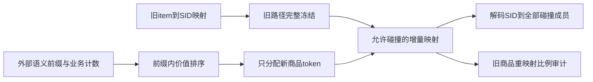
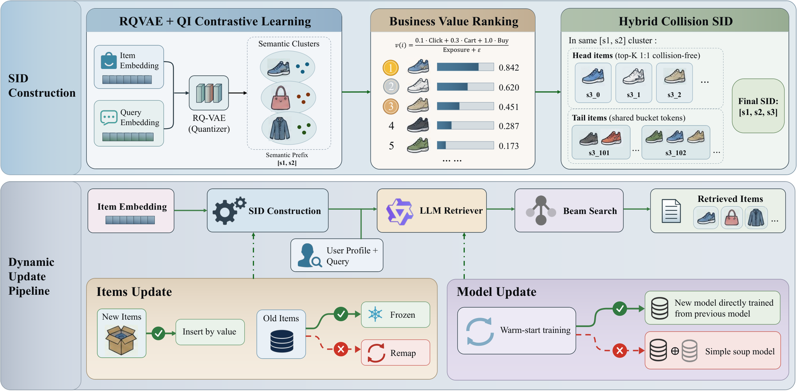

# SID Topology：动态电商检索中的语义路径保留

> 已实现CPU映射组件，证据为L1机制诊断；不是RQ-VAE/LLM检索能力复现。64卡完整训练和生产实验**成本过高，不复现（审查 DONE）**。

## 论文信息

| 字段 | 内容 |
| --- | --- |
| 论文链接 | [arXiv 2610.26105v1](https://arxiv.org/abs/2610.26105v1)；[固定PDF](https://arxiv.org/pdf/2610.26105v1) |
| 原文标题 | Don't Rewrite the SID Map: Topology Preservation for Generative Retrieval in Dynamic E-Commerce Search |
| 公司 / 机构 | 一作Jianbo Zhu：Alibaba / Taobao & Tmall Group；合作Nankai University、USTC |
| 首次公开日期 | 2026-10-19 10:01:25 UTC；2026-10-20 arXiv公告，不是10月20日首发 |
| 原作者代码 | 本轮在原文和arXiv未找到可核验作者代码仓库；生产日志未公开 |
| 本地 adapter / 稳定键 | `sid-topology`；`adapter: null`，独立CPU组件 |
| 本地复现代码 | `src/auto_research/reproductions/sid_topology.py`；命令脚本` scripts/run_oct20_sid_topology.py` |
| 验收证据 | [三种子映射诊断](metrics/component-cpu-seeds42-44.json)，不参与Evolve晋级 |

## 原始论文总结

### 背景与主要改动

生成式检索学习的是从查询到多级SID的解码路径，重新按业务价值排序旧商品会改变路径含义。论文把“映射更新”和“继续训练”拆开，发现大beam可以掩盖窄beam下的严重漂移；短预算warm-start也不能修复任意重映射。

方法保留全部旧商品的三层SID，新商品先由外部RQ-VAE得到两层语义前缀，再按当前业务价值排名插入第三层。头部初始分配独占token，尾部采用固定容量共享桶；新商品插入头部时可以与原独占token碰撞，但不能顺移旧商品来强行消碰撞。周期更新直接使用从旧模型继续训练的新checkpoint，不混合新旧权重。



原文Figure1同时展示SID构造与两类更新路径；不是本地训练流程。

<!-- paper-figure:start -->
### 原论文关键图

[](https://arxiv.org/html/2610.26105v1/fig_frame.png)

> **原论文 Figure 1（关键图）**：SID的两层语义前缀、业务价值第三层与动态更新分叉；绿色路径保留旧SID并warm-start，红色路径重映射或混合权重。图片来自[原论文](https://arxiv.org/abs/2610.26105v1)，版权归原作者所有；点击图片可查看来源。
<!-- paper-figure:end -->

### 核心公式

$$
v(i)=\frac{.1\,Click(i)+.3\,Cart(i)+Buy(i)}{Exposure(i)+10},\quad
\gamma=\frac1{|I_{old}|}\sum_{i\in I_{old}}\mathbf1[SID_{new}(i)\ne SID_{old}(i)].
$$

本地保留式更新满足所有旧商品`SID_new=SID_old`，包括本次输入中未出现的旧商品。业务计数同样不触发旧路径更新。尾桶组大小在原文未公布，因此必须由调用方显式给定；测试值不是生产配置。容量耗尽直接报错，不擅自取模或重编码。

### 论文离线与线上效果

正文67天日志、两个不重叠更新周期中，旧路径刷新在beam1的HitRate降幅为41.78%–62.05%，beam1000仅8.33%–10.85%，说明评测beam是重要实验变量。这是该论文特定业务价值SID方案中的观察，不是所有SID系统的普遍定理。

Section4.7报告TmallAPP检索召回20%线上流量、三周A/B：相对“两个月前训练、保留旧SID且插入新商品但不周期训练”的基线，UCTCVR +0.29%、GMV +1.16%。收益属于保留映射结合周期warm-start的系统，不可归因于本地字典操作。

## 本地复现与边界

```bash
PYTHONPATH=src python scripts/run_oct20_sid_topology.py \
  --device cpu --seeds 42,43,44 --output runs/sid-topology-fresh.json
```

真实执行价值先验、初始HC分配、新商品插入、碰撞展开、旧路径漂移统计；用独立预期桶、插入顺序不变性、头部碰撞和全重映射负对照验收。`frozen_old_path_address_recovery`只是合成映射中旧地址仍能找回成员，不是推荐准确率、HitRate或模型成功率。没有量化器、语义编码器、beam-search模型或生产A/B，也未接入Evolve。

完整原文需64GPU，9000万/2000万日志、Qwen2.5-0.5B三阶段训练、RQ-VAE与生产数据。**成本过高，不复现（审查 DONE）**；不保留自动重试，不下载私有日志或模型。
