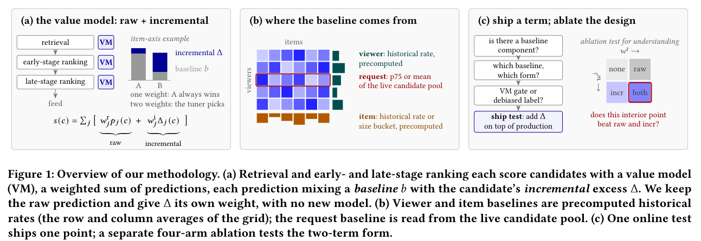

# Baseline and Incremental: Debiasing Instagram Feed ranking scores

<!-- source-sha256: ec3dc148bab020ffc7ac171992f8fb172b9fe0f5344677c3c0b2664ce36b079d -->

[简体中文](README.md)

> **L1 score operator; diagnostic only.** No new or trained ranking network or local online lift.

## Paper information

| Field | Details |
| --- | --- |
| Paper | [Baseline and Incremental: User, Item, and Request Debiasing in Instagram Feed Ranking](https://arxiv.org/abs/2610.27423v1) |
| Affiliations | Co-first authors Hsin-Chiang Chen and Hao Wang; Meta. |
| First public release | 2026-10-20 00:20:04 UTC |
| Author code | No verified author code repository in paper or arXiv; the production model is not presented as open source. |
| Local key | `baseline-incremental`; no adapter |
| Local code | `src/auto_research/reproductions/baseline_incremental.py` |
| Local evidence | [Local mechanism metrics](metrics/component-cpu-seeds42-44.json) |

## What the paper changes

Engagement reflects user habits, item popularity, request pool and relative candidate quality. Keep the raw prediction while weighting nonlinear baseline-relative increments separately. User/item baselines come from historical features and request baselines from the current pool. This is a scoring change, not causal uplift.

### Original paper figure



Original figure from the reviewed paper, reused without redrawing.

### Core equations

$$
\Delta=m(p,b)[\sigma(kd(p,b))-\mathrm{shift}],\qquad
V(c)=V_{other}(c)+w_rp(c)+w_i\Delta(c).
$$

Compare probabilities by log-odds and regression quantities in original units. Preserve $m=p$, $p-b$ and constant amplitudes, finite sigmoid and exact infinite-slope limits. Explicitly clamp historical features before logit. A negative constant times reverse gate still downweights near the prediction floor; merely negating the prediction-scaled positive gate does not. Infinite-slope gap gates give positive/negative hinges.

### Results reported by the authors

Section 6 reports a four-arm production test (none/raw/incremental/both), 3% per arm, shared seven days of 12–17 day runs. Table 5 request p10s both vs none increases Feed time spent 1.650%, not additional lift over raw. Single-arm weights were not retuned; no universal optimality. Section 5 reports deployment. Offline correlation is screening, not an online lift ranking; sparse/low-correlation signals remain unresolved.

## Local reproduction and limits

Synthetic CPU seeds 42/43/44 check rational reference, hinge/sigmoid, floor downweight and ranking with increment removed. `request_baseline` computes supplied pool statistics, not learned selection. No production data, weight tuning, actual recommendation gains or Evolve.

```bash
PYTHONPATH=src python scripts/run_oct21_ranking_components.py \
  --component baseline-incremental --device cpu --output runs/baseline-incremental-fresh.json
```

### Full experiment: not reproduced

Millions of private log entries, real model scores, ranker and randomized traffic are required. Full study not reproduced; no substitute data, training or retries.

### Additional references

[Paper PDF](https://arxiv.org/pdf/2610.27423v1) · [Paper PDF, p. 1](https://arxiv.org/pdf/2610.27423v1#page=1)
