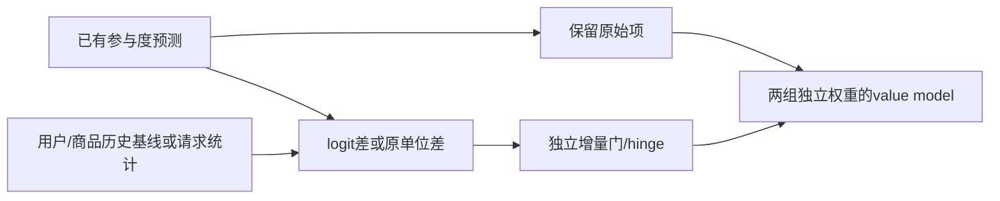
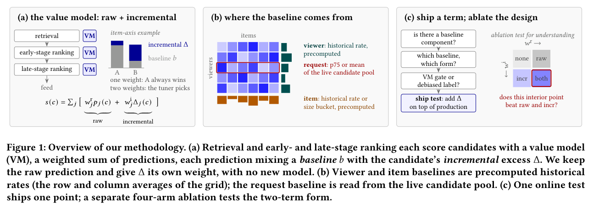

# Baseline and Incremental：Instagram Feed 的基线与增量去偏

> 已实现评分算子，不新增或训练排名网络。仅为L1机制诊断，不是线上收益复现；完整私有日志、排名系统及线上消融**成本过高，不复现（审查 DONE）**。

## 论文信息

| 字段 | 内容 |
| --- | --- |
| 论文链接 | [arXiv v1](https://arxiv.org/abs/2610.27423v1)；[固定PDF](https://arxiv.org/pdf/2610.27423v1) |
| 原文标题 | Baseline and Incremental: User, Item, and Request Debiasing in Instagram Feed Ranking |
| 公司 / 机构 | 一作Hsin-Chiang Chen：Meta；Hao Wang共同一作 |
| 首次公开日期 | 2026-10-20 00:20:04 UTC；10月21日公告 |
| 原作者代码 | 原论文与arXiv未发现作者实现仓库；不是开源生产模型 |
| 本地 adapter / 稳定键 | `baseline-incremental`；`adapter: null`，独立CPU算子 |
| 本地复现代码 | `src/auto_research/reproductions/baseline_incremental.py`；`scripts/run_oct21_ranking_components.py` |
| 本地证据 | [三种子机制诊断](metrics/component-cpu-seeds42-44.json) |

## 原始论文总结

### 背景与主要改动

参与度预测同时包含用户习惯、商品受欢迎程度、当前候选池水平和候选自身的相对优势。直接去掉基线可能丢失有用的绝对水平。论文保留原始预测，同时对相对基线的非线性增量单独加权；这是评分配置变化，不是因果uplift估计。

用户、商品基线来自历史特征，请求基线来自当前候选池。概率使用log-odds差，回归量使用同单位差；正向门和降权门的幅度不同，不能把乘预测值的正向门直接改符号用于降权，否则预测接近零时惩罚也消失。



<!-- paper-figure:start -->
### 原论文关键图

[](https://arxiv.org/pdf/2610.27423v1#page=1)

> **原论文 Figure 1**：已有预测分成原始项与独立增量项，基线分别来自用户、商品和请求。图片来自[原论文](https://arxiv.org/abs/2610.27423v1)，版权归原作者所有；由固定PDF第1页裁取，非本地效果图。
<!-- paper-figure:end -->

### 核心公式

$$
\Delta=m(p,b)[\sigma(kd(p,b))-\mathrm{shift}],\qquad
V(c)=V_{other}(c)+w_rp(c)+w_i\Delta(c).
$$

概率的比较量是`logit(p)-logit(b)`，回归量则为`p-b`。实现保留`m=p`、`m=p-b`与常数三种幅度，以及有限斜率和无穷斜率的精确分段极限。历史基线允许原特征超出概率范围，但在logit变换前必须显式clamp。常数降权是负常数乘反向门，不在预测地板消失；gap的无穷斜率形式分别得到正/负hinge。

### 论文离线与线上效果

Section6为真实线上四臂消融：none、raw、incremental、both，每臂3%流量，在12–17天实验中的共同7天窗口统计。Table5的请求p10s项，both相对none的feed time spent为+1.650%；这不等于“在已有raw上再提升1.650%”。论文对生产点做比较，单项权重没有重新调优，不能据此声称双项形式在任意调参预算下总优。

全流量部署见Section5。离线相关性只用于筛查信号，不应当成线上收益排名；低相关且稀疏的信号是未解析，不是无用。本地没有重建该离线筛查程序。

## 本地复现与边界

```bash
PYTHONPATH=src python scripts/run_oct21_ranking_components.py \
  --component baseline-incremental --device cpu --output runs/baseline-incremental-fresh.json
```

运行独立有理式参考、hinge与sigmoid区别、预测地板降权和移除增量项的排序负对照，seed42/43/44。输入为合成分数，不读取生产数据，不拟合或选择线上权重，不将数组排序改变解释为推荐提升。`request_baseline`只计算调用方指定的池内统计，不自行学会选择基线。

完整论文实验依赖数百万私有日志、真实排名预测与在线随机流量；本轮按资源门槛关闭，不伪造公共数据替代上线结论。不接入Evolve晋级。
