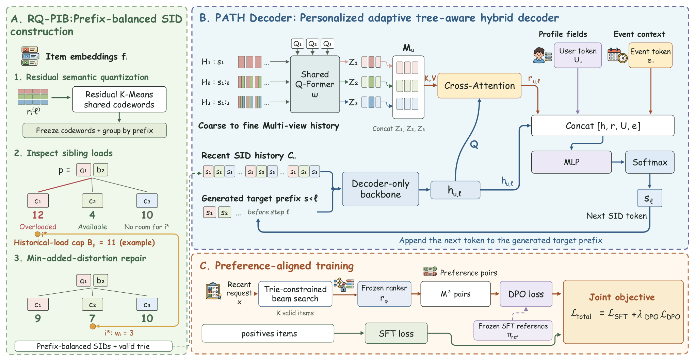

# SPAR: Prefix-conditioned recommendation and frozen-codebook load repair

<!-- source-sha256: 9152875f77b8e234fe8dc94e8533da432c39fd341c475ef79de4ca4a66e8b0bb -->

[简体中文](README.md)

> **L1 RQ-PIB repair only; diagnostic only.** No PATH decoder, quantizer training or preference optimization.

## Paper information

| Field | Details |
| --- | --- |
| Paper | [SPAR: Stepwise Personalized Autoregressive Recommendation with Prefix-Balanced Semantic IDs](https://arxiv.org/abs/2610.27898v1) |
| Affiliations | First author Chunrui Zhang: University of Electronic Science and Technology of China; collaborators include Alibaba HUJING and Youku. |
| First public release | 2026-10-20 09:17:14 UTC |
| Author code | No author implementation found in paper/arXiv. Youku logs are private. |
| Local key | `spar-prefix-balance`; no adapter |
| Local code | `src/auto_research/reproductions/spar_prefix_balance.py` |
| Local evidence | [Local mechanism metrics](metrics/component-cpu-seeds42-44.json) |

## What the paper changes

Relevant history depends on generated SID prefix; popular prefixes can dominate interaction load. SPAR uses PATH for coarse-to-fine prefix-conditioned memory, RQ-PIB to rebalance a frozen residual codebook, and SFT/DPO for preferences. The local scope is only the repair stage.

### Original paper figure



Original figure from the reviewed paper, reused without redrawing.

### Core equations

$$
C_p=W_p/K,\quad B_p=\max\{\tau C_p,C_p+(1-1/K)m_p\}.
$$

For a parent prefix, compute mean branch load and a feasible cap using total weight, largest item and sibling count. From an overloaded branch, choose a positive-weight item and feasible destination minimizing increase in squared residual-to-center distance. The greedy rule is not globally optimal or exactly equalizing. Never update centers, move an item more than once, move zero-load groups or change parent prefix.

### Results reported by the authors

Paper reports mean relative HR@10/20/50/100 +2.66% on Youku logs and seven-day, 10%-traffic A/B with watch time +3.95%, play conversion +3.38%. Full model outcomes cannot be attributed to local greedy moves.

## Local reproduction and limits

Provide frozen centers, residuals, assignments, train-only weights and parents. Tests for Eq.13–15/Algorithm 1 check smallest feasible move, empty destination, heavy-item cap, conservation, single move and unrepaired overload. Three CPU synthetic seeds do not establish recommendation performance or exposure fairness. No quantizer/PATH/beam/DPO or Evolve.

```bash
PYTHONPATH=src python scripts/run_oct21_ranking_components.py \
  --component spar-prefix-balance --device cpu --output runs/spar-prefix-fresh.json
```

### Full experiment: not reproduced

Qwen3-0.6B–4B, months of production history, daily preference data and live traffic. Full training/A/B not reproduced; no retries.

### Additional references

[Original figure resource](https://arxiv.org/html/2610.27898v1/Framework.png) · [Paper PDF](https://arxiv.org/pdf/2610.27898v1)
