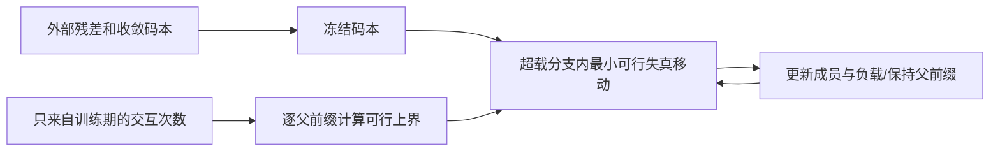
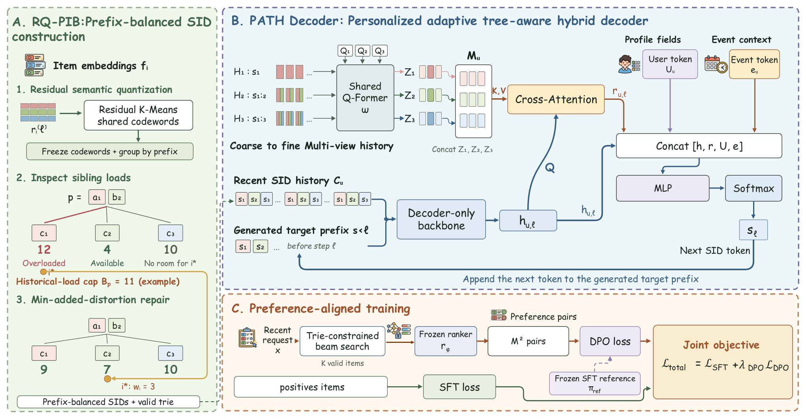

# SPAR：前缀条件个性化与语义ID负载平衡

> 已实现RQ-PIB的冻结码本修复阶段，仅L1机制诊断；没有实现PATH Decoder、RQ训练或偏好训练。完整生产训练与A/B**成本过高，不复现（审查 DONE）**。

## 论文信息

| 字段 | 内容 |
| --- | --- |
| 论文链接 | [arXiv v1](https://arxiv.org/abs/2610.27898v1)；[固定PDF](https://arxiv.org/pdf/2610.27898v1) |
| 原文标题 | SPAR: Stepwise Personalized Autoregressive Recommendation with Prefix-Balanced Semantic IDs |
| 公司 / 机构 | 一作Chunrui Zhang：中国电子科技大学；合作含阿里HUJING / Youku等，不按全部合作者拆分归类 |
| 首次公开日期 | 2026-10-20 09:17:14 UTC |
| 原作者代码 | 原论文与arXiv未找到作者实现仓库；Youku日志未公开 |
| 本地 adapter / 稳定键 | `spar-prefix-balance`；`adapter: null` |
| 本地复现代码 | `src/auto_research/reproductions/spar_prefix_balance.py`；`scripts/run_oct21_ranking_components.py` |
| 本地证据 | [三种子修复诊断](metrics/component-cpu-seeds42-44.json) |

## 原始论文总结

### 背景与主要改动

同一用户长历史中，有用证据随已生成SID前缀而变；热门前缀的交互负载还会压倒其他分支。SPAR由三部分组成：按前缀检索粗到细记忆的PATH、冻结残差码本后的RQ-PIB负载修复，以及SFT+DPO偏好对齐。本地只实现第二部分的修复子程序，不拿字典或K-means冒充整个推荐模型。



<!-- paper-figure:start -->
### 原论文关键图

[](https://arxiv.org/html/2610.27898v1/Framework.png)

> **原论文 Figure 2**：完整框架含码本平衡、前缀条件记忆读取、SFT与DPO。本地覆盖其中RQ-PIB的冻结码本修复阶段。图片来自[原论文](https://arxiv.org/abs/2610.27898v1)，版权归原作者所有。
<!-- paper-figure:end -->

### 核心公式

对父前缀`p`，总负载为`W_p`，最大单商品权重为`m_p`，兄弟分支数为`K`：

$$
C_p=W_p/K,\quad B_p=\max\{\tau C_p,C_p+(1-1/K)m_p\}.
$$

从一个超载分支选出有正权重的商品，在所有满足目的分支负载加该权重不超过`B_p`的位置中，最小化残差到码中心的平方距离增量。每次只选择当前可行移动，不是全局最优匹配，也不保证负载恰好均等。码中心不更新，零负载组不修复，商品最多移动一次，父前缀不变。

### 论文离线与线上效果

Youku生产日志上，论文报告HR@10/20/50/100的相对平均提升2.66%；7天、10%流量A/B的用户观看时长+3.95%、播放转化+3.38%。这些属于包含PATH、平衡SID和训练的完整模型，不可归因于本地贪心移动。

## 本地复现与边界

```bash
PYTHONPATH=src python scripts/run_oct21_ranking_components.py \
  --component spar-prefix-balance --device cpu --output runs/spar-prefix-fresh.json
```

输入必须提供冻结码中心、残差、分配、训练期权重和父前缀。算法实现Eq13–15/Algorithm1的分支修复，以独立构造验证最小可行移动、空分支目的地、重商品上界、总负载守恒、至多一次移动和“不修复则超载”的负对照。合成权重不是推荐指标，也不能说明未来曝光更公平。

原文完整训练使用Qwen3-0.6B至4B、数月生产历史、每日偏好数据与线上流量。**成本过高，不复现（审查 DONE）**；不训练量化器、不实现PATH/beam/DPO、不加入Evolve。
