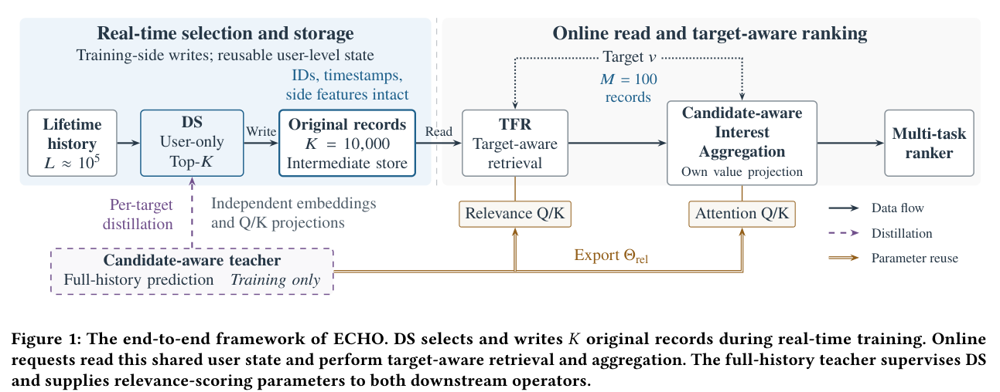

# ECHO: Selector distillation and boundary supervision for long user histories

<!-- source-sha256: 84371f3b8148cdea47cd190b42b0bfa2ce261d5bdb8c7e2687c92c5cda4ad8dd -->

[简体中文](README.md)

> **L1 selector loss validated on A100; diagnostic only.** No full ECHO/TWIN or recommendation capability.

## Paper information

| Field | Details |
| --- | --- |
| Paper | [ECHO: Efficient Cascade with Homogeneous Operators for Distillation-Guided 100K-Sequence Modeling](https://arxiv.org/abs/2610.28569v1) |
| Affiliations | First author Wenhao Li: Kuaishou Technology |
| First public release | 2026-10-20 17:28:16 UTC |
| Author code | No ECHO implementation repository in the paper or arXiv; serving and private logs are not public. |
| Local key | `echo-selector-loss`; no adapter |
| Local code | `src/auto_research/reproductions/echo_distillation.py` |
| Local evidence | [Local mechanism metrics](metrics/component-cuda-seeds42-44.json); [A100 validation receipt](../../gpu-validations/echo-selector-loss-a100-20261021.json) |

## What the paper changes

Latent compression loses record addresses, but per-candidate scanning 100K events is expensive. A user-side DS preserves original records, then target-side TFR selects a smaller subset. A candidate-aware training teacher supervises the full distribution and selection boundary and exports relevance parameters. DS and full-history scans are not used online.

### Original paper figure



Original figure from the reviewed paper, reused without redrawing.

### Core equations

$$
L_{KD}=-\frac{T^2}{B}\sum_b\sum_j\operatorname{sg}[p^T_{b,j}]\log p^S_{b,j}.
$$

$$
L_{aux}=\frac{\sum_{b,i}\omega_{b,i}\operatorname{softplus}((s^-_{b,i}-s^+_{b,i}+\delta)/T_{rank})}{\sum_{b,i}\omega_{b,i}+\epsilon}.
$$

Use detached full teacher probabilities and temperature-squared CE. Sharper mining uses $T_m<T$: rank missed items descending and selected items ascending by teacher quality; pair with detached positive probability gap. Normalize pair penalties across the whole batch, not per row. Selection/mining do not backpropagate; selected student scores do. Padding is excluded from selection, softmax, loss and gradient.

### Results reported by the authors

The paper compares GAUC on KuaiRand-1K and private tasks. Section 4.6 seven-day production A/B with 5% treatment reports +0.613% total App use and +0.640% per user versus production TWIN/compression baseline. Roughly 160× FLOP reduction is a full serving-budget comparison, not a local loss speedup.

## Local reproduction and limits

A100 synthetic logits on seeds 42/43/44 check scalar CE, real updates, detached teacher, padded zero gradient and no boundary pairs for matching rankings. No pretrained weights, formal accuracy, DS encoder, teacher training, TWIN, storage or Evolve.

```bash
PYTHONPATH=src python scripts/run_oct21_ranking_components.py \
  --component echo-selector-loss --device cuda --output runs/echo-loss-fresh.json
```

### Full experiment: not reproduced

100K-event histories, about 10K retained records, large multitask training and production traffic are beyond the budget. Full experiment not reproduced; no retry.

### Additional references

[Paper PDF](https://arxiv.org/pdf/2610.28569v1) · [Paper PDF, p. 3](https://arxiv.org/pdf/2610.28569v1#page=3)
