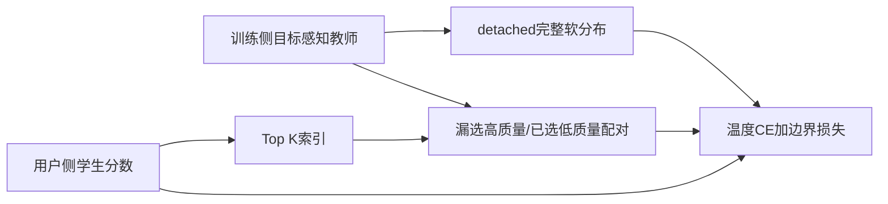
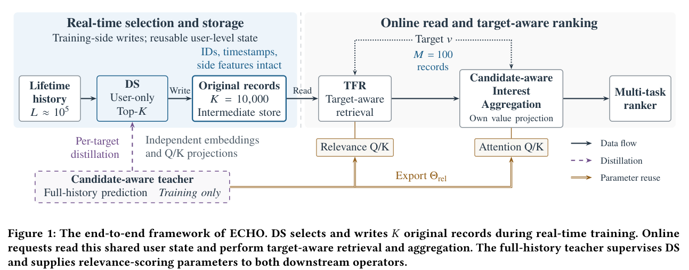

# ECHO：超长用户历史的蒸馏选择与边界监督

> 已实现选择器蒸馏损失，在真实A100上验证公式、梯度和短时更新。仅L1诊断，不是完整ECHO/TWIN或推荐能力；原文完整实验**成本过高，不复现（审查 DONE）**。

## 论文信息

| 字段 | 内容 |
| --- | --- |
| 论文链接 | [arXiv v1](https://arxiv.org/abs/2610.28569v1)；[固定PDF](https://arxiv.org/pdf/2610.28569v1) |
| 原文标题 | ECHO: Efficient Cascade with Homogeneous Operators for Distillation-Guided 100K-Sequence Modeling |
| 公司 / 机构 | 一作Wenhao Li：Kuaishou Technology |
| 首次公开日期 | 2026-10-20 17:28:16 UTC；忽略模板遗留的2018会议/2009收稿占位符 |
| 原作者代码 | 原论文与arXiv未找到作者实现仓库；实时系统和私有日志未公开 |
| 本地 adapter / 稳定键 | `echo-selector-loss`；`adapter: null` |
| 本地复现代码 | `src/auto_research/reproductions/echo_distillation.py`；`scripts/run_oct21_ranking_components.py` |
| GPU证据 | [A100回执](../../gpu-validations/echo-selector-loss-a100-20261021.json)；[逐种子指标](metrics/component-cuda-seeds42-44.json) |

## 原始论文总结

### 背景与主要改动

将100K历史压成少量潜向量会丢失记录地址；逐候选扫描全部历史又过贵。ECHO让用户侧DS保留原始记录，再由目标侧TFR选更小子集。训练侧候选感知教师通过完整软分布和选择边界监督DS，教师相关性参数还导出到检索和聚合。线上不运行DS，也不扫描完整历史。



<!-- paper-figure:start -->
### 原论文关键图

[](https://arxiv.org/pdf/2610.28569v1#page=3)

> **原论文 Figure 1**：训练侧DS、教师、原记录存储和线上TFR/聚合。本地只覆盖选择器损失，不声称实现图中双训练图或服务系统。图片来自[原论文](https://arxiv.org/abs/2610.28569v1)，版权归原作者所有；由固定PDF第3页裁取。
<!-- paper-figure:end -->

### 核心公式

$$
L_{KD}=-\frac{T^2}{B}\sum_b\sum_j\operatorname{sg}[p^T_{b,j}]\log p^S_{b,j}.
$$

较尖锐的教师分布用`T_m<T`，漏选项按教师质量降序，已选项按教师质量升序配对。权重为两者教师概率正差并detach：

$$
L_{aux}=\frac{\sum_{b,i}\omega_{b,i}\operatorname{softplus}((s^-_{b,i}-s^+_{b,i}+\delta)/T_{rank})}{\sum_{b,i}\omega_{b,i}+\epsilon}.
$$

分母在整个batch的有效配对上归一化，不是每行分别平均。Top-K与挖掘不反向传播，选中学生logit仍可求导；教师参数不能被这两项损失更新。所有padding不参与选择、softmax、损失或梯度。

### 论文离线与线上效果

正文含KuaiRand-1K及私有任务GAUC对照；线上Section4.6为7天、5%治疗流量，相对已有TWIN/压缩技术的生产基线，总App使用时长+0.613%、人均+0.640%。论文约160倍FLOPs降低来自完整预算与服务路径，不是本地loss的实测加速。

## 本地复现与边界

```bash
PYTHONPATH=src python scripts/run_oct21_ranking_components.py \
  --component echo-selector-loss --device cuda --output runs/echo-loss-fresh.json
```

固定合成logit、seed42/43/44，在A100执行逐标量CE参考、实际学生参数更新、教师无梯度、padding零梯度及同排序无有效边界配对的负对照。未加载预训练checkpoint，无推荐准确率或正式比较资格。

本地未实现DS编码器、教师预测分支训练、TWIN检索、实时双图存储和生产A/B。完整实验包含100K事件、万条保留记录、工业流量与多任务大规模训练；**成本过高，不复现（审查 DONE）**，不自动重试、不接Evolve晋级。
