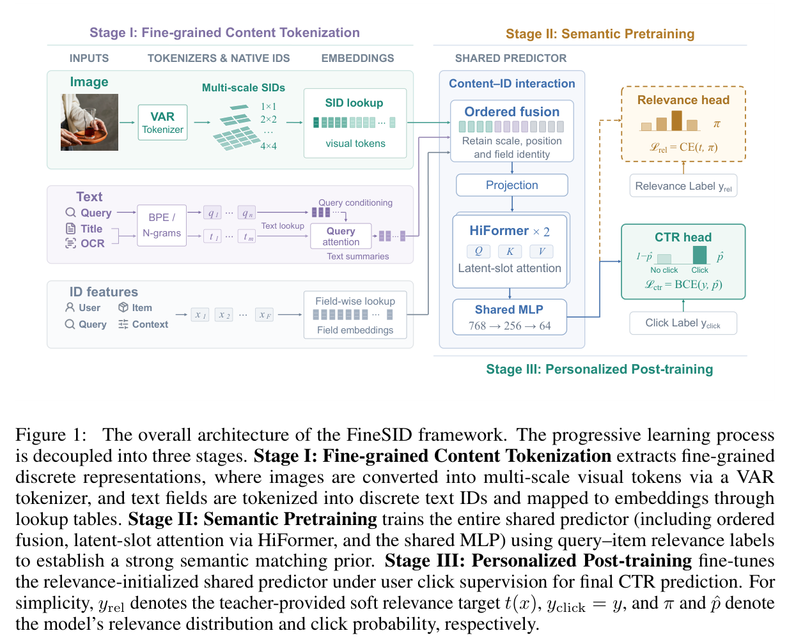

# FineSID: Progressive CTR learning from content through relevance to personalization

<!-- source-sha256: 460c2027ffbfbec96f129cd54baef8f43f58ddf6f4db61b10ccc29cd6922a21f -->

[简体中文](README.md)

> **Reference entry only.** No executable local adapter or result; complete experiments not reproduced due to cost.

## Paper information

| Field | Details |
| --- | --- |
| Paper | [Progressive Learning from Content to Relevance to Personalization for CTR Prediction](https://arxiv.org/abs/2610.29138v1) |
| Affiliations | First author Zhiguang Yang: Alibaba Group |
| First public release | 2026-10-21 03:19:02 UTC |
| Author code | No author source was found in the paper or arXiv as of 2026-10-22. Referenced VAR is not FineSID source. |
| Local key | `finesid`; no adapter |
| Local code | No executable local implementation. |
| Local evidence | No local experiment, metrics or GPU receipt. |

## What the paper changes

Preserve fine visual/text detail, train the whole shared predictor for query–item relevance, then transfer all shared parameters and normalization state to CTR. Stage I uses fixed VAR grids 1×1, 2×2, 3×3 and 4×4 (30 positions), codebook 4,096, preserving scale, location and fields. Code zero is valid; absence has a separate mask. Train randomly initialized CTR embeddings rather than copying VAR vectors. Fielded BPE/N-gram text, query-conditioned attention and native IDs feed ordered fusion.

### Original paper figure

Original figure from the reviewed paper, reused without redrawing. See [figure provenance](assets/provenance.json).

### Core equations

$$
\mathcal L_{rel}=-\sum_{c=1}^{4} t_c(x)\log \pi_c(x).
$$

$$
\mathcal L_{CTR}=-y\log\hat p-(1-y)\log(1-\hat p).
$$

Stage II learns four soft classes from a Qwen3.5 teacher with the complete shared predictor. Stage III retains all dense/embedding/normalization state (197 shared dense/normalization entries), replaces the head, resets Adagrad accumulators and fine-tunes on click BCE. The backbone uses two HiFormer layers, width 768, and MLP 768→256→64. Copying embeddings alone or optimizer state is not equivalent.

### Results reported by the authors

Section 4.8/Table 5 reports seven-day Taobao main-search production A/B: clicks (IPV) +0.21%, GMV +0.85% relative to production baseline. Offline AUC/GAUC point changes differ from online relative lifts. Public MMCTR is not a substitute for private logs or live traffic.

## Local reproduction and limits

Literature, original figure and author evidence only; no small fixture, local metrics, GPU receipt or Evolve.

### Full experiment: not reproduced

64 H20s, batch 4,096/card and 262,144 global. 51.2B impressions, $2.51\times10^8$ users, 200M queries, $4.18\times10^8$ products and $4.53\times10^8$ test impressions plus expert/private relevance labels. No full run, data download or automatic retry.
