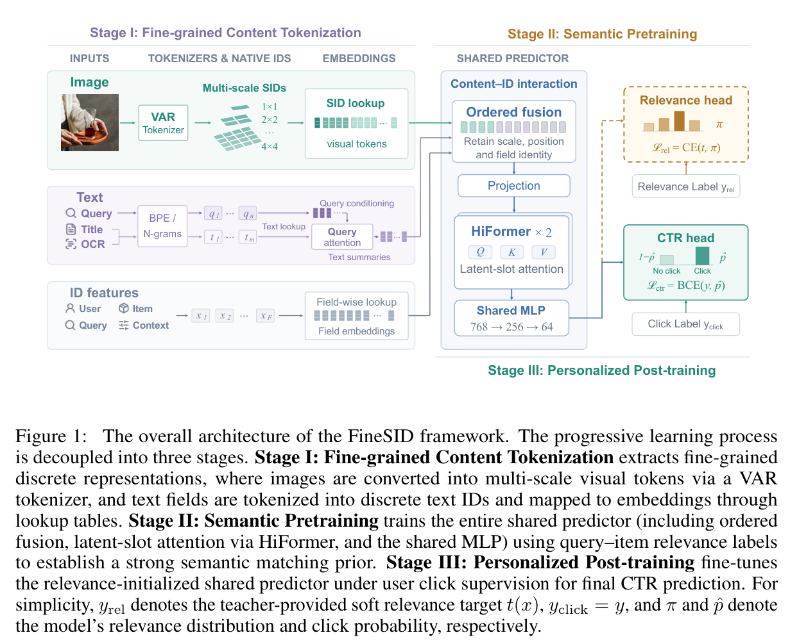
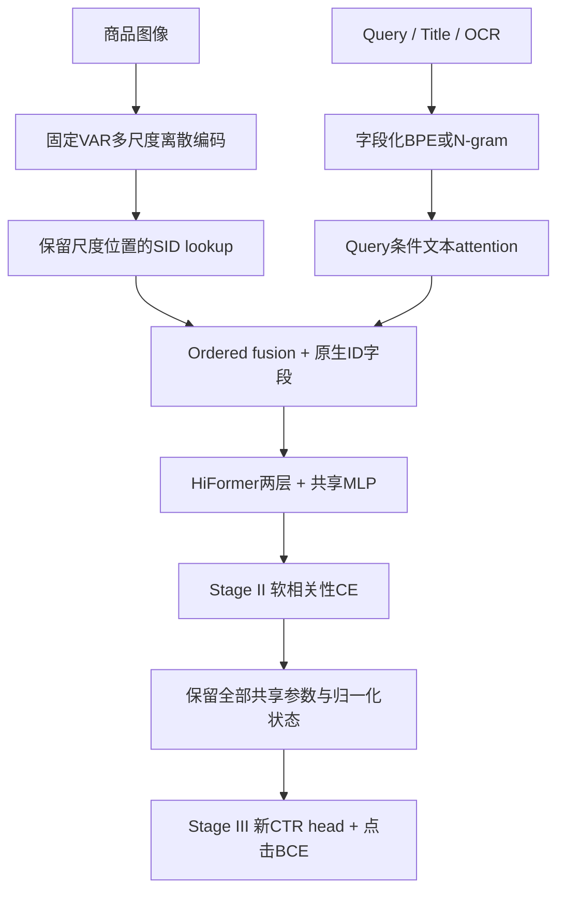

# FineSID：从内容到相关性再到个性化的渐进 CTR 学习

## 论文信息

| 字段 | 内容 |
| --- | --- |
| 论文 | [Progressive Learning from Content to Relevance to Personalization for CTR Prediction](https://arxiv.org/abs/2610.29138v1) |
| 公司 / 机构 | 一作 Zhiguang Yang，Alibaba Group；淘宝搜索场景 |
| 首次公开日期 | 2026-10-21 03:19:02 UTC（arXiv v1；10月22日公告） |
| 原作者开源代码 | 原文与 arXiv 未提供 FineSID 作者源码仓库；2026-10-22 核验未找到。VAR 等依赖代码不等于 FineSID 实现已开源。 |
| 本地 Adapter | 无；纯方法/线上证据收录，不注册可执行 adapter |
| 本地复现代码位置 | 无（成本过高，不提供可执行复现）；本页及 `assets/` 保存方法、原图与边界 |
| 完整实验状态 | 成本过高，不复现（审查 DONE）；不进入自动重试/训练队列 |

## 原始论文总结

### 背景与主要改动

将内容直接压成一个语义ID会丢失局部视觉细节；只对 embedding 做相关性预训又不能给最终交互网络提供足够初始化。FineSID 用细粒度离散视觉/文本 token，先把完整共享预测器训成 query-item 语义相关性模型，再迁移到个性化 CTR。

关键不是单独的 SID lookup，而是三个阶段之间**保留同一交互骨干并迁移完整参数/状态**。把随机 token 或简单加权器接到现有 CTR 模型，不能替代整篇论文。

## 原文重要截图

原文 Figure 1，PDF第3页，保留原图与图注；不是本地架构或本地测量。[来源与截图哈希](assets/provenance.json)。

## 三阶段结构

Stage I 使用 $1\times1,2\times2,3\times3,4\times4$ 四种尺度，共30个视觉位置；保留尺度、空间位置、字段身份。词表4096，码0本身有效，缺失应由独立 mask 表达。CTR embedding 表随机初始化并学习，并不是直接搬用 VAR codebook 向量。文本 lookup 与 query 条件 attention、原生 ID 字段一起进入有序融合。

Stage II 用 Qwen3.5 教师给出的四类相关性软目标 $t(x)$，更新**整个共享预测器**：

$$
\mathcal L_{rel}=-\sum_{c=1}^{4} t_c(x)\log \pi_c(x).
$$

Stage III 保留全部共享 dense/embedding/归一化状态，换 CTR head，重置 Adagrad 累积器，再用点击标签微调所有共享参数：

$$
\mathcal L_{CTR}=-y\log\hat p-(1-y)\log(1-\hat p).
$$

论文共享骨干为两层 HiFormer、全局宽度768、MLP `768→256→64`。其迁移约定包括197个共享 dense/normalization state；只复制 embedding 或复用旧 optimizer state 均不等价。

## 工业证据与原文结果

正文 §4.8 / Table 5 明确报告淘宝主搜索七天线上 A/B，相对生产基线 Clicks（IPV）提升 **0.21%**、GMV提升 **0.85%**。这是原论文报告，不是本库测量。摘要没有 A/B 字样不能作为拒收理由，本篇按全文证据通过工业门槛。

原文还有离线 AUC/GAUC 和消融；离线“点数变化”不与线上相对提升混写。公开 MMCTR 可用于其他对照，但不能冒充论文私有淘宝数据或线上实验。

## 成本判定：不执行复现

完整训练使用64张 H20，每卡 batch4096、全局 batch262144。数据包含512亿曝光、2.51亿用户、2亿 query、4.18亿商品，以及4.53亿次测试曝光；相关性教师还依赖大规模专家标注/私有数据。

当前单张 A100/A30 与本地 Mac 不具备等价训练预算和私有数据。因此本轮只完成论文、方法与线上证据收录，**成本过高，不复现（审查 DONE）**。没有伪造训练结果、GPU回执或小夹具“完整复现”；无自动下载、重试或 evolve promotion。
