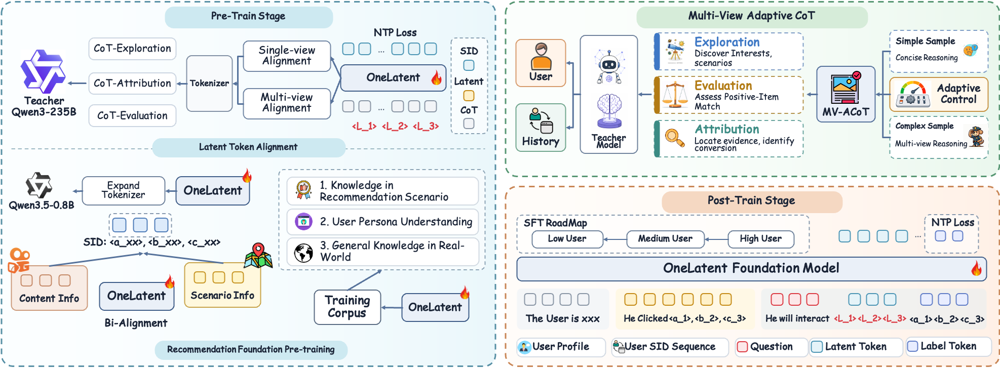

# OneLatent: Latent Reasoning for Efficient Foundation Recommendation Models

<!-- source-sha256: 11b3a11ab11574a335c70742cb762ea59f8cedd787c6ac0ffc96fe9fc6606488 -->

[简体中文](README.md)

> **Reference entry only.** No executable local model or diagnostic proxy. Full experiments not reproduced due to cost.

## Paper information

| Field | Details |
| --- | --- |
| Paper | [OneLatent: Latent Reasoning for Efficient Foundation Recommendation Models](https://arxiv.org/abs/2610.30675v1) |
| Affiliations | Co-first authors Hao Jiang, Peiru Du and Pengfei Yao: Kuaishou Technology. |
| First public release | 2026-10-22 03:39:38 UTC |
| Author code | No OneLatent-specific repository, revision or license verified. OpenOneRec data and the OneReason base are not its training implementation. |
| Local key | `onelatent`; no adapter |
| Local code | No executable local implementation. |
| Local evidence | No local experiment, metrics or GPU receipt. |

## What the paper changes

Explicit recommendation CoT adds latency and can overthink or inherit a rigid template. Use exploration, evaluation and attribution views to generate adaptive teacher supervision, learn three latent tokens, and serve three-level SIDs without long text. Alignment reconstructs single-view reasons, then multiple views, then predicts next SID from request context.

### Original paper figure

Original figure from the reviewed paper, reused without redrawing. See [figure provenance](assets/provenance.json).

### Core equations

$$
\mathcal L_{multi}=\mathbb E_u\frac1{|\mathcal V_u|}\sum_{v\in\mathcal V_u}
\left[-\frac1{|Y_u^v|}\sum_t\log p_\phi(y_{u,t}^v\mid P_u,H_u,\langle v\rangle,L,y_{u,<t}^v)\right].
$$

Average tokens inside each rationale and then available views equally. No separate encoder/projector/decoder or strict latent bottleneck: ordinary causal masking, all student weights trainable, outputs still see profile/history. Evaluation/attribution teachers may see the positive item; the student prefix excludes target SID and its description. Curriculum goes high to low user activity, then mixes with/without latent SFT 1:1. Behavior-triggered deduplication, rate limiting and async cache move inference off the request path; candidates merge with existing retrieval and share ranking.

### Results reported by the authors

Section 4.6/Table 9 reports seven days, Sep 3–10 2026, 5% per arm: impressions +2.566%, ad spend +5.157%. The 9.6% revenue gain is an estimate from a global posterior estimator, not observed A/B revenue. The paper reports full rollout afterward. 17.49× throughput is an 872-example comparison against explicit CoT, not local. Similarity of reconstructed reasons does not prove faithful reasoning.

## Local reproduction and limits

Literature, original figure and cost/production evidence only; no model, benchmark metrics, GPU receipt or Evolve mapping.

### Full experiment: not reproduced

Appendix A.1 uses seven nodes × eight GPUs, full-parameter BF16, 4,096 tokens and two effective epochs, Qwen3-235B-A22B teacher and industrial data. No weights, scaled-down proxy, full trial or retry.

### Additional references

[Full paper](https://arxiv.org/html/2610.30675v1) · [Paper Figure 2](https://arxiv.org/html/2610.30675v1#S3.F2)
