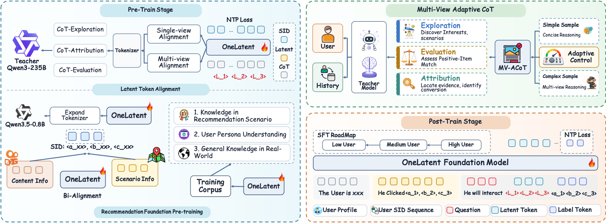

# OneLatent：把推荐推理压缩到潜在token接口

## 论文信息

| 字段 | 内容 |
| --- | --- |
| 论文链接 | [arXiv 2610.30675 v1](https://arxiv.org/abs/2610.30675v1)；[固定全文](https://arxiv.org/html/2610.30675v1) |
| 原文标题 | OneLatent: Latent Reasoning for Efficient Foundation Recommendation Models |
| 公司 / 机构 / 学校 | 一作 Hao Jiang，Kuaishou Technology；共同一作 Peiru Du、Pengfei Yao，同属快手 |
| 首次公开日期 | 2026-10-22 03:39:38 UTC（arXiv v1），10月23日公告 |
| 原作者代码 | **未找到OneLatent专属方法代码发布**；文中OpenOneRec数据/OneReason基座链接不是OneLatent训练实现；无可核固定代码revision/license |
| 本地 adapter / 稳定键 | `onelatent`；`adapter: null`，`deferred_high_cost` |
| 本地复现代码目录 | **无运行实现**；只收录本页、原图、单篇catalog、成本与生产证据 |
| 完整实验 | **成本过高，不复现（审查 DONE）**，不下载235B教师、不做56卡训练的缩小替身、不自动重试 |

## 原始论文总结

### 背景与主要改动

推荐FRM的显式CoT会增加生成时延，也可能过度思考或被固定推理模板带偏。OneLatent先用探索、评价、归因三视角生成自适应教师监督，再学习三个潜在token接口，最后只生成三层语义ID，避免在线输出长推理文本。

<!-- paper-figure:start -->
### 原论文关键图

论文原始图，[来源与SHA-256](assets/provenance.json)；未重绘、未修改科学内容。
<!-- paper-figure:end -->

三阶段分别是单视角理由重建、多视角理由重建、请求上下文上的下一SID预测。多视角对每条理由先按token数平均，再对可用视角平均，避免长理由天然占更大权重：

$$
\mathcal L_{multi}=\mathbb E_u\frac1{|\mathcal V_u|}\sum_{v\in\mathcal V_u}
\left[-\frac1{|Y_u^v|}\sum_t\log p_\phi(y_{u,t}^v\mid P_u,H_u,\langle v\rangle,L,y_{u,<t}^v)\right].
$$

原文没有额外encoder/projector/decoder，也没有把latent token作为严格attention瓶颈：**使用普通因果mask、更新全部学生参数，输出仍能读原始profile/history**。不能把方法简化成teacher/student latent MSE并宣称忠实复现。教师评价/归因可用正例item，但学生prefix明确不含目标SID和正例item描述。

后训练按高活跃→中活跃→低活跃用户做课程，再以1:1混合有/无latent token的推荐SFT。服务侧用行为触发、去重/限流和异步缓存，把FRM推理移出在线请求关键路径；生成候选与现有召回合并、共同精排，不是替换整个推荐系统。

### 生产证据与局限

§4.6/Table9明确报告2026-09-03至09-10、7天、实验/对照各5%流量：展现量+2.566%、广告消耗+5.157%。**9.6%是全局后验估计器给出的估算收入提升**，不能写成直接观测的收入A/B值。正文还称之后已全量部署。17.49×吞吐收益来自872条实例、相对显式CoT的指定推理比较，不是本地性能实测。

理由重建的向量相似度只能说明语义关联，不能证明latent存储全部推理或步骤忠实性；完整模型微调与服务调度也共同贡献效果。

## 成本判断与本地边界

Appendix A.1原配置为**7节点×每节点8GPU，即56GPU**、全参数BF16、4096tokens、两有效epochs；监督涉及Qwen3-235B-A22B教师及工业数据。单张A100/A30或Mac不适合照搬完整矩阵，本轮不先下载/试跑来验证它昂贵。

因此本项是资料与成本审查完成，**没有本地模型、诊断proxy、benchmark指标、GPU回执或evolve映射**。`review_done=true`与`not_reproduced_high_cost`明确表示不复现完整实验，不伪装成算法交付；`promotion_eligible=false`、`automatic_retry=false`。
