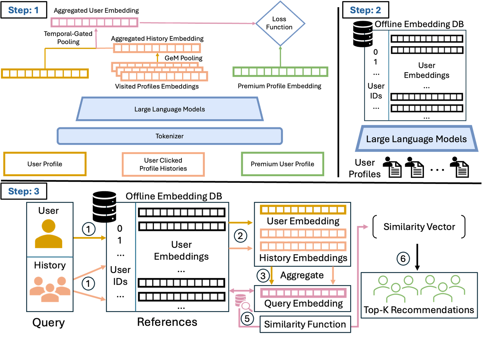

# PAIR: Preference-aligned retrieval for complementary professional intent

<!-- source-sha256: 6bde51d7b2d54959b9f6342f392e7538de835bf6fb6ee91b1666bc019391fba0 -->

[简体中文](README.md)

> **L1 component; diagnostic only.** Full Premium recommendation training and production evaluation not reproduced.

## Paper information

| Field | Details |
| --- | --- |
| Paper | [PAIR: Preference-Aligned Intent Retrieval for Premium People Recommendation at LinkedIn](https://arxiv.org/abs/2610.30941v1) |
| Affiliations | First author Zhongkai Shangguan; all authors list LinkedIn. |
| First public release | 2026-10-22 08:57:58 UTC |
| Author code | No PAIR code release or pinned source/license found in the paper or linked official sources. The paper's CC0 license does not release unpublished code. |
| Local key | `pair`; no adapter |
| Local code | `src/auto_research/recommendation_components/pair.py`; `tests/test_oct23_root_components.py` |
| Local evidence | [Local mechanism metrics](metrics/component-cuda-seeds42-44.json); [A100 validation receipt](../../gpu-validations/pair-a100-20261023.json) |

## What the paper changes

Professional intent can be complementary rather than similar: a job seeker may need a recruiter. Train a shared profile/document encoder and short-term history tower from clicks, unclicked candidates in the same exposure and random members. This is multi-negative contrastive learning with exposure-conditioned supervision, not token-level DPO; there is no reference model or KL.

### Original paper figure



Original figure from the reviewed paper, reused without redrawing. See [figure provenance](assets/provenance.json).

### Core equations

$$
\alpha_i=\operatorname{softmax}_i[w^\top(e_{h_i}+PE(i))],\quad e_H=\sum_i\alpha_i e_{h_i},
$$

$$
e_q^{final}=\operatorname{L2Norm}(\operatorname{L2Norm}(e_q)+\gamma\operatorname{L2Norm}(e_H)).
$$

$$
\mathcal L=\sum_{d\in\mathcal D}\left[-s_d(q,d^+)+\log\sum_{c\in\{d^+,D^-\}}\exp s_d(q,c)\right].
$$

Newest click is position one. Learned position embeddings and a global attention vector are independent of the current profile query. Score candidates by temperature-scaled cosine similarity with the positive in slot zero. Sum Matryoshka losses across prefixes rather than averaging them. Paper defaults are $K=10$, temperature 0.02 and dimensions 200/256/512/1024. History updates are $O(Kd)$ on a fixed window, not window-independent constant time.

### Results reported by the authors

Section 5.5/Table 4 reports a controlled production A/B: CTR +7.5%, Premium retention +2.1% and page latency change 0.1%; offline MAR@100 is 0.450. Exposure bias remains, and results apply to Premium Browsemaps with a fixed downstream ranker, not all recommendations.

## Local reproduction and limits

Learned positional attention, normalized fusion, exposure negatives prioritized with random fill, prefix loss and real small-tensor gradients are implemented. Tests compare scalar cosine/CE and gradients, run three updates and verify masks, chronology and exclusion of clicked positives from exposure negatives. These are not 0.6B semantic encoding, model accuracy, online gain or Evolve integration.

```bash
PYTHONPATH=src python -c 'from auto_research.recommendation_components.pair import diagnostic; print(diagnostic(42))'
PYTHONPATH=src python -m pytest tests/test_oct23_root_components.py
```

### Full experiment: not reproduced

Private data comprises 209K training instances and 4.4M profiles. The full training uses eight GPUs and production traffic. No data download, full recommender or automatic retry.

### Additional references

[Full paper](https://arxiv.org/html/2610.30941v1) · [Paper Figure 1](https://arxiv.org/html/2610.30941v1#S4.F1)
