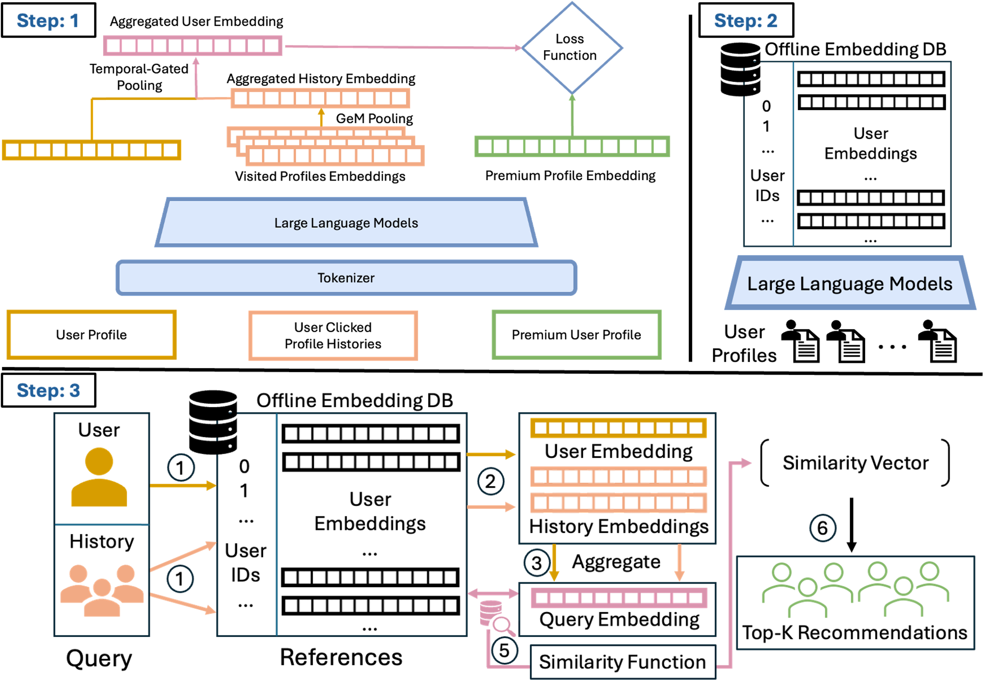

# PAIR：面向互补意图的偏好召回

## 论文信息

| 字段 | 内容 |
| --- | --- |
| 论文链接 | [arXiv 2610.30941 v1](https://arxiv.org/abs/2610.30941v1)；[固定全文](https://arxiv.org/html/2610.30941v1) |
| 原文标题 | PAIR: Preference-Aligned Intent Retrieval for Premium People Recommendation at LinkedIn |
| 公司 / 机构 / 学校 | 一作 Zhongkai Shangguan，LinkedIn；作者均为 LinkedIn |
| 首次公开日期 | 2026-10-22 08:57:58 UTC（arXiv v1）；10月23日公告，不是10月23日首次发布 |
| 原作者代码 | **未在论文及所链接官方来源中找到 PAIR 代码发布**；没有可固定的作者实现 revision/license。论文 CC0 不代表未发布的代码也已开源 |
| 本地 adapter / 稳定键 | `pair`；`adapter: null`，仅 `component_only` / L1 机制诊断 |
| 本地复现代码目录 | `src/auto_research/recommendation_components/`，文件 `pair.py`；测试 `tests/test_oct23_root_components.py` |
| 完整实验 | **成本过高，不复现（审查 DONE）**；8 GPU、私有会员资料/曝光数据和生产 A/B 均不启动，不自动重试 |

## 原始论文总结

### 背景与主要改动

职业社交中的相关性往往是互补而非相似：求职者可能需要招聘者，不是与自己背景最相近的人。PAIR 从被点击候选、同次曝光未点击候选和随机会员构造偏好，训练共享的 profile/document 编码器，并用历史塔刻画短期意图。论文明确说它**不是 token 级 DPO，也没有显式参考模型或 KL 项**；损失在计算形式上就是多负例对比学习，差别在曝光条件下的监督语义。

<!-- paper-figure:start -->
### 原论文关键图

[](https://arxiv.org/html/2610.30941v1#S4.F1)

原始架构图直接来自论文 HTML，未重绘科学内容；[来源与 SHA-256](assets/provenance.json)。图中的池化/服务示意不能替代 §4.3 明确给出的可学习 positional attention 公式。
<!-- paper-figure:end -->

### 核心公式与服务边界

最新点击位于位置1。位置向量与全局注意力向量都是训练参数，注意力不依赖当前 profile query：

$$
\alpha_i=\operatorname{softmax}_i[w^\top(e_{h_i}+PE(i))],\quad e_H=\sum_i\alpha_i e_{h_i},
$$

$$
e_q^{final}=\operatorname{L2Norm}(\operatorname{L2Norm}(e_q)+\gamma\operatorname{L2Norm}(e_H)).
$$

候选以余弦相似度除温度打分；正例为 slot0，其余是负例。Matryoshka 在不同前缀维度上**求和**损失，而不是取均值：

$$
\mathcal L=\sum_{d\in\mathcal D}\left[-s_d(q,d^+)+\log\sum_{c\in\{d^+,D^-\}}\exp s_d(q,c)\right].
$$

原文 $K=10$、温度0.02、维度集合200/256/512/1024；历史更新是固定窗口下 $O(Kd)$ 向量操作，**不是与窗口无关的 O(1)**。本地实现可学习位置注意力、归一化融合、曝光负例优先/随机补齐、前缀损失及真实梯度更新；不以随机小向量替代0.6B语义编码器。

### 原文效果（非本地指标）

§5.5/Table4 的受控生产 A/B 中，CTR提升7.5%、Premium retention提升2.1%，页面延迟变化0.1%；离线 MAR@100为0.450。数据为私有209K训练实例、4.4M会员资料，原训练使用8 GPU。曝光选择偏差依旧存在，且实验只在Premium Browsemaps、固定下游ranker下成立，不能泛化为所有推荐场景。

## 本地复现与边界

```bash
PYTHONPATH=src python -c 'from auto_research.recommendation_components.pair import diagnostic; print(diagnostic(42))'
PYTHONPATH=src python -m pytest tests/test_oct23_root_components.py
```

固定三种子证据见[组件指标](metrics/component-cuda-seeds42-44.json)，真实CUDA回执为 `docs/gpu-validations/pair-a100-20261023.json`。验证比较独立标量余弦/交叉熵公式与梯度，执行三次真实更新，检查掩码历史无影响、位置顺序有效、曝光负例不混入点击正例。**这些是公式与接口诊断，不是模型准确率、完整推荐能力或线上提升**。

`diagnostic_only=true`、`promotion_eligible=false`、`evolve_integrated=false`，没有凭 registry 标签假接入 evolve。完整模型与工业数据实验按成本和可得性终态不复现。
