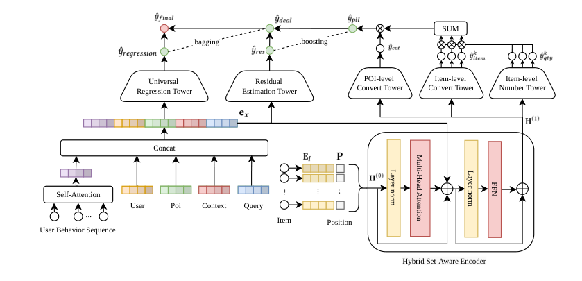
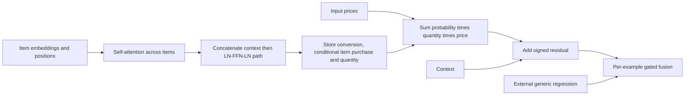

# HGE: From item-level purchases to store-level advertising value

<!-- source-sha256: 097d0e4bd298402af98e7bd61a3d7fb78a89a6a7dd6188184d0b3353f1e1f01d -->

[简体中文](README.md)

> Local status: **differentiable L1 HSAE, PLL and RCEF components; diagnostic only**. This is not a complete advertising model. Private-log training and online experiments are **not reproduced due to cost (review complete)**; no local online gains or Evolve integration are claimed.

## Paper information

| Field | Details |
| --- | --- |
| Paper | [Hierarchical GTV Estimation: Bridging the Gap between Container-Level Ranking and Item-Level Conversion](https://arxiv.org/abs/2610.32420v1); [reviewed v1 full text](https://arxiv.org/html/2610.32420v1) |
| Affiliations | First author Zerong Lan; all authors list Meituan. |
| First public release | 2026-10-23 09:50:06 UTC, arXiv v1; announced October 26. The paper also lists RecSys 2026, whose conference date is not a substitute for the first-release timestamp. |
| Author code | No author code link in v1 or on arXiv; title and identifier searches found no author implementation. Production data is private. |
| Local key | `hge`; standalone component, no reproduction adapter |
| Local code | `src/auto_research/reproductions/hge.py`; `tests/reproductions/test_hge.py` |
| Local evidence | [Three-seed mechanism metrics](metrics/component-cuda-seeds42-44.json); [A100 validation receipt](../../gpu-validations/hge-a100-20261026.json) |

## What the paper changes

Search advertising ranks containers such as stores and livestream rooms, but conversion occurs on the individual products inside. Transaction values are sparse and high-variance. Treating a store as one product can hide a mix of inexpensive, frequently purchased items and expensive, infrequently purchased items.

The **Hybrid Set-Aware Encoder (HSAE)** models interactions among the top-$K$ items before adding user, store, context and query features. **Proxy-Label Learning (PLL)** separately predicts whether the store converts, the probability of each item's purchase conditional on conversion, and quantity. **Residual Correction and Ensemble Fusion (RCEF)** accounts for value outside the top-$K$ and mixes the corrected estimate with generic store-level regression. A learned gate sets that mix from context per example, not by routing on observed conversion labels.

### Original paper figure

[](https://arxiv.org/html/2610.32420v1/pic_2.png)

Figure 2 shows the complete network, including the behavioral sequence and generic regression tower on the left. The local implementation covers the formula components and fusion on the right; the DIN/DCN path is external rather than approximated by a linear head. The original authors retain copyright; the paper uses CC BY 4.0.



### Core equations

For Equations 2–4, let $e_x$ be the concatenated context. The item self-attention does not read it in advance. After concatenation the width is `d_item+d_context`:

$$
H^0=E_I+P,\quad H'=\operatorname{LN}([H^0+\operatorname{MHSA}(H^0),e_x]),\quad
H^1=\operatorname{LN}(H'+\operatorname{FFN}(H')).
$$

Equations 5–8 use sigmoid for conditional purchase probabilities and softplus for quantities. Multiple items can be purchased, so a normalized softmax is not a substitute:

$$
\hat y_{pll}=\hat p_{cvt}\sum_k \hat p_{item,k}\hat q_k\operatorname{Price}_k.
$$

Equations 10–11 add a signed residual, without a final nonnegative clamp, and apply a context-dependent gate:

$$
\hat y_{deal}=\hat y_{pll}+\mathcal T_{res}(e_x),\qquad
\hat y_{final}=\alpha(e_x)\hat y_{deal}+[1-\alpha(e_x)]\hat y_{regression}.
$$

Equation 12 also specifies Huber regression, store/item BCE and quantity tasks. The local component does not invent masks or sampling details or implement the full multi-task training recipe. Differentiating a squared output in a diagnostic is not a reproduction of that training.

### Results reported by the authors

Sections 4.1–4.2 use Meituan's private industrial logs. Table 1 reports XAUC 0.8158 and PCOC 0.9858. After an A/A check, a 13-day production A/B test found RPS up 1.42% (95% CI: +0.80% to +2.05%). The paper reports deployment to main traffic. These are results of the complete model, not local mechanism checks. The paper lists 712M records, with 683M for training and 29M for testing, but also describes the test split as the final 5%. These figures do not fully agree; no substitute public split is asserted.

## Local reproduction and limits

```bash
PYTHONPATH=src python -c 'from auto_research.reproductions.hge import diagnostic; print(diagnostic(42))'
PYTHONPATH=src python -m pytest tests/reproductions/test_hge.py -q
```

`HierarchicalGTV` takes external item embeddings, positional vectors, context, prices and generic regression predictions, not answers or conversion labels. Small differentiable tests check an independent per-item reference for Equation 5, pre-concatenation MHSA invariance to context, negative controls that remove positions/prices/residuals, both fusion endpoints, item probabilities whose sum can exceed one, and finite nonzero gradients for all parameters and inputs. Seeds 42/43/44 measure synthetic mechanism errors and gradients, not recommendation accuracy, revenue or calibration.

The small module uses a GELU FFN and linear heads, not the full `[1024,512,256]` Dice prediction towers. It does not implement DIN/DCN, feature engineering, negative sampling, training on 712M log records or live traffic. It follows text Equations 2–11 instead of treating the schematic as a separate disclosed architecture.

### Full experiment: not reproduced

The paper's setup uses $K=10$, HSAE width 256, batches of 6,000, 683M private training records and a 13-day A/B test. Device details and total GPU hours were not reported. The full study exceeds the short-run single A100/A30 or Mac budget. No model/data download, automatic retry, capability ranking or Evolve entry is scheduled.
