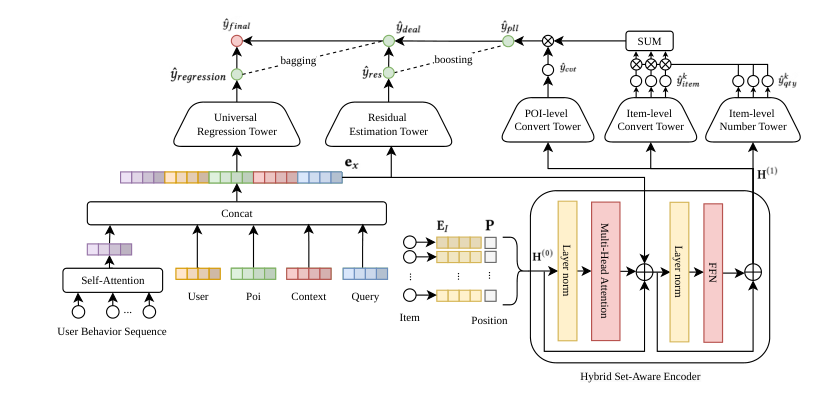
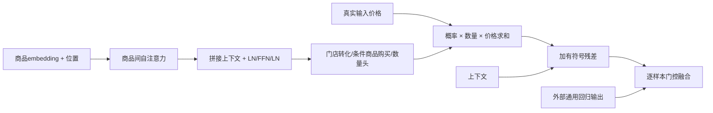

# HGE：从商品成交分解到门店广告价值预估

> 实现范围为 **HSAE、PLL、RCEF 的可微 L1 组件**，不是完整广告模型。论文私有日志训练和线上实验**成本过高，不复现（审查 DONE）**；不据此宣称本地获得线上收益或接入 Evolve。

## 论文信息

| 字段 | 内容 |
| --- | --- |
| 论文链接 | [arXiv v1](https://arxiv.org/abs/2610.32420v1)、[固定全文](https://arxiv.org/html/2610.32420v1) |
| 原文标题 | Hierarchical GTV Estimation: Bridging the Gap between Container-Level Ranking and Item-Level Conversion |
| 公司 / 机构 | 一作 Zerong Lan：美团；作者单位均为 Meituan |
| 首次公开日期 | 2026-10-23 09:50:06 UTC，arXiv v1；10月26日公告。论文另列 RecSys 2026 会议出版，会议时间不是精确首发时间的替代 |
| 原作者代码 | 固定 v1 与 arXiv 未提供作者代码链接；精确标题/编号检索未找到作者实现，生产数据不公开 |
| 本地 adapter / 稳定键 | `hge`；`adapter: null`，独立组件而非完整复现 adapter |
| 本地复现代码 | `src/auto_research/reproductions/hge.py`；`tests/reproductions/test_hge.py` |
| 本地证据 | [三种子机制指标](metrics/component-cuda-seeds42-44.json)、[脱敏 GPU 凭证](../../gpu-validations/hge-a100-20261026.json) |

## 原始论文总结

### 背景与主要改动

搜索广告排序的是门店、直播间等“容器”，成交却发生在内部商品上。单条成交金额既稀疏又高方差，简单把门店当成一个商品，容易忽略低价高频与高价低频商品的组合。

HGE 先用 **Hybrid Set-Aware Encoder** 编码 top-K 商品的竞争关系，再在自注意力之后拼入用户、门店、上下文与查询。**Proxy-Label Learning** 分开预测门店是否成交、成交后每个商品的购买概率和数量；**Residual Correction and Ensemble Fusion** 用残差补偿 top-K 未覆盖的成交，再与通用门店回归融合。融合权重由上下文门控逐样本学习，不是按事后真实成交标签切路。

<!-- paper-figure:start -->
### 原论文关键图

[](https://arxiv.org/html/2610.32420v1/pic_2.png)

> **原论文 Figure 2**：完整网络含左侧行为序列与通用回归塔。本地实现右侧公式组件及融合，左侧 DIN/DCN 等仍是外部输入，不拿一个线性回归头冒充完整工业网络。原图版权归作者，论文 CC BY 4.0。
<!-- paper-figure:end -->



### 核心公式

按正文 Eqs.2--4，令 `e_x` 为上下文拼接向量。商品注意力不预先读取上下文，拼接后的通道宽度是 `d_item+d_context`：

$$
H^0=E_I+P,\quad H'=\operatorname{LN}([H^0+\operatorname{MHSA}(H^0),e_x]),\quad H^1=\operatorname{LN}(H'+\operatorname{FFN}(H')).
$$

Eqs.5--8 使用 sigmoid 条件购买概率和 softplus 数量。商品购买不是互斥分类，不能把 sigmoid 换成归一化 softmax：

$$
\hat y_{pll}=\hat p_{cvt}\sum_k \hat p_{item,k}\hat q_k\operatorname{Price}_k.
$$

Eqs.10--11 的残差可正可负，原文没有输出非负截断。门控权重可逐样本变化：

$$
\hat y_{deal}=\hat y_{pll}+\mathcal T_{res}(e_x),\qquad
\hat y_{final}=\alpha(e_x)\hat y_{deal}+[1-\alpha(e_x)]\hat y_{regression}.
$$

论文 Eq.12 另有 Huber 回归、门店/商品 BCE 和数量任务。掩码与训练采样没有在本地替作者补造：本组件没有实现完整多任务训练配方，不把对输出平方求导的诊断称为训练复现。

### 论文离线与线上效果

正文 Sections4.1--4.2 使用美团私有工业日志；Table1 报告 HGE XAUC 0.8158、PCOC 0.9858。A/A核验后进行13天 A/B，RPS +1.42%（95%CI：+0.80%到+2.05%）；论文还称已部署至主流量，满足工业收录门槛。它们是完整模型的作者结果，不是本地机制检查结果。数据量文字为712M总记录、683M训练/29M测试；论文同时称最后5%测试，这些数字不完全一致，保留原文而不伪造公开划分。

## 本地复现与边界

```bash
PYTHONPATH=src python -c 'from auto_research.reproductions.hge import diagnostic; print(diagnostic(42))'
```

`HierarchicalGTV` 接受外部商品 embedding、位置向量、上下文、价格和通用回归输出，不收答案/成交标签。以小尺寸可微模块验证：独立逐商品 Eq.5 参考、上下文不影响前置 MHSA、位置/价格/残差移除负控、融合两端点、商品概率之和可大于1、所有参数和输入的有限非零梯度。种子为42/43/44；指标只是合成机制误差和梯度，不是推荐准确率、收入或校准效果。

小模块显式使用 GELU FFN、线性输出头，**不是**论文完整 `[1024,512,256]` Dice 预测塔；无 DIN/DCN、特征工程、负采样、712M日志训练或线上流量。本地遵循正文 Eqs.2--11，不把图中简化布局作为另一个未披露模型配置。

完整配置需要 K=10、HSAE256、batch6000 和683M私有记录训练，并做线上13天 A/B；论文未给具体设备/总GPU小时，本地不编造。相对单张 A100/A30 或 Mac 的短时预算，**成本过高，不复现（审查 DONE）**，不下载模型/数据、不自动重试，不加入能力排行榜或 Evolve。
