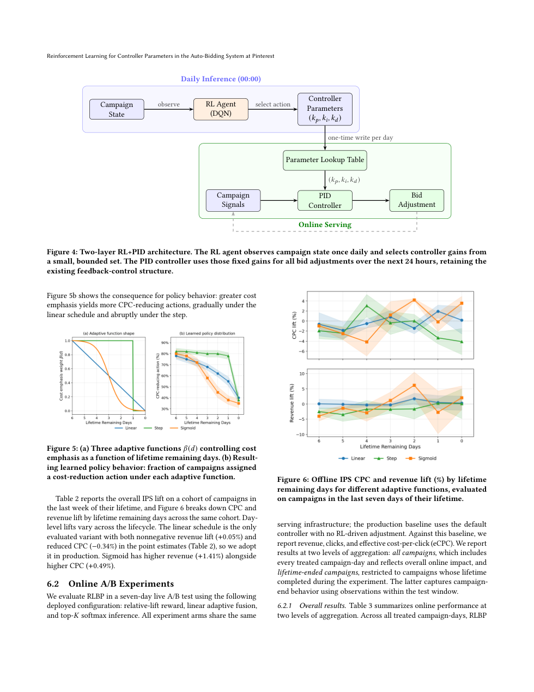
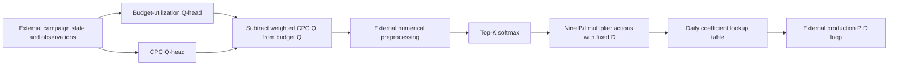

# Pinterest RLBP: Reinforcement learning tunes the PID controller, not bids

<!-- source-sha256: c60700a5cf962af1a65600d1eba677ee9cc17bb81bafcce4ccead6deb4436a62 -->

[简体中文](README.md)

> Local status: **L1 tensor formula component; diagnostic only**. It covers bounded actions, two-head targets, rewards, score fusion and IPS. It has no advertising logs, auction environment, production Q-network or live bidding. The complete experiment is **not reproduced due to cost (review complete)**, and is not integrated into Evolve.

## Paper information

| Field | Details |
| --- | --- |
| Paper | [Reinforcement Learning for Controller Parameters in the Auto-Bidding System at Pinterest](https://arxiv.org/abs/2610.33248v1); [reviewed v1 full text](https://arxiv.org/html/2610.33248v1) |
| Affiliations | Co-first author Yichu Zhou: Pinterest Inc.; Qinyi Chen is also co-first author. The collaboration includes UCLA. |
| First public release | 2026-10-23 19:52:02 UTC, arXiv v1. This entry backfills the overlap window; it was not first published on October 30. |
| Author code | The v1 paper and abstract did not provide an author repository for RLBP, and no release was verified. Referenced general-purpose RL projects are not RLBP source. |
| Local key | `pinterest-rlbp`; standalone formula component, no adapter |
| Local code | `src/auto_research/reproductions/pinterest_rlbp.py`; `tests/test_oct30_pinterest.py` |
| Validation | [Three-seed mechanism metrics](metrics/component-cuda-seeds42-44.json), [A100 receipt](../../gpu-validations/pinterest-rlbp-a100-20261030.json) |

## What the paper changes

Advertisers want to spend their budgets while keeping cost per click (CPC) low. The system keeps the high-frequency PID feedback loop. At the start of each day, RL chooses PID coefficient multipliers for each campaign and publishes a lookup table. The live bidder does not load the Q-network or have a neural network choose every auction bid directly.

Separate Q-heads learn relative budget-utilization and CPC outcomes. The system combines them according to the remaining campaign lifetime. Production uses $\gamma=0$, so it fits daily outcomes as a contextual bandit. The paper also presents Bellman backups for a multi-step extension, but the DQN terminology does not mean production bootstraps across days.

### Original paper figure



Page 7 of the [v1 PDF](https://arxiv.org/pdf/2610.33248v1) includes Figure 4 and the weighting and IPS comparisons in Figures 5 and 6. The page is not redrawn. Copyright belongs to the original authors; the paper uses CC BY 4.0. See [figure provenance](assets/provenance.json).



### Core equations

Equation 3 uses $k_j=m_jk_j^0$. Production tunes P and I, choosing each multiplier from $\{1-\alpha,1,1+\alpha\}$, while D stays at multiplier 1. This gives nine actions. The default $\alpha=0.2$ is an illustrative paper value, not a disclosed production setting.

Equation 9 supplies relative rewards, and Equations 4–6 give the separate head targets and squared-error loss:

$$
r^j=\frac{v^j-v^j_{prod}}{v^j_{prod}},\qquad
y^{bu}=r^{bu}+\gamma\max_aQ^{bu}(s',a),\quad
y^{cpc}=r^{cpc}+\gamma\min_aQ^{cpc}(s',a).
$$

$$
\mathcal L=\operatorname{mean}\!\left[(Q^{bu}(s,a)-y^{bu})^2\right]
+\operatorname{mean}\!\left[(Q^{cpc}(s,a)-y^{cpc})^2\right].
$$

A CPC reduction stays a negative relative change. Equation 7 scores actions as $\widehat Q=Q^{bu}-\beta(d)Q^{cpc}$, so lower costs improve the fused score. Equation 8 applies a temperature softmax to the top $K$ preprocessed scores; all other actions receive zero probability. The scale of $\beta$ and production preprocessing are not fully disclosed. The local component accepts explicit inputs/a callback instead of inventing a production calibration; identity preprocessing is just a reference default.

Equation 10 computes ordinary inverse propensity scoring (IPS), $N^{-1}\sum_i\pi(a_i\mid s_i)r_i/\widehat\pi(a_i\mid s_i)$, not a self-normalized estimator. Zero baselines and zero logging propensities are rejected instead of silently adding an epsilon.

### Results reported by the authors

Section 6.2 reports a seven-day production A/B test on the same serving infrastructure against default PID without RL adjustment. Across all treated campaign-days, eCPC decreased by **0.25%** ($p<0.05$) and revenue was roughly flat. For the separate lifetime-ended subgroup, revenue rose 0.43%, clicks rose 0.25%, and eCPC rose 0.18%. These are different aggregations; the study does not show improvement on every metric.

The holdout after a two-month rollout is directional only: traffic was unbalanced and the authors did not test significance. In the multi-step extension, separate greedy backups do not establish that the fused Q is optimal for the combined reward. No advertising outcomes were measured locally.

## Local reproduction and limits

```bash
PYTHONPATH=src python -c 'from auto_research.reproductions.pinterest_rlbp import diagnostic; print(diagnostic(42))'
PYTHONPATH=src python -m pytest tests/test_oct30_pinterest.py -q
```

Small-tensor checks cover the distinct backups, no future Q access at $\gamma=0$, frozen targets, actual parameter updates, negative CPC rewards, fusion direction, top-$K$ support, the P/I action table and ordinary IPS. External preprocessing runs once after fusion and must preserve shape, device, dtype and finiteness. Scaling can change probabilities, so temperature and production calibration are not assumed interchangeable.

The caller supplies Q-values and rewards. Campaign encoding, numerical BatchNorm, production training logs and propensity collection, daily serving jobs and conversion of PID error to bids are not implemented. Fitting synthetic rewards with randomly initialized Q parameters does not show that a production network learned to bid.

### Full experiment: not reproduced

A faithful run requires private logs (21 days for training and seven held out), real auctions and PID integration, comparisons over five seeds, live ad budgets and a two-month holdout. The authors do not disclose total GPU hours. Uncertainty about that cost is not grounds for an exploratory run. The end-to-end experiment is too expensive for one A100/A30 or a Mac, so review is complete without resource downloads, bidder calls or automatic retries.
