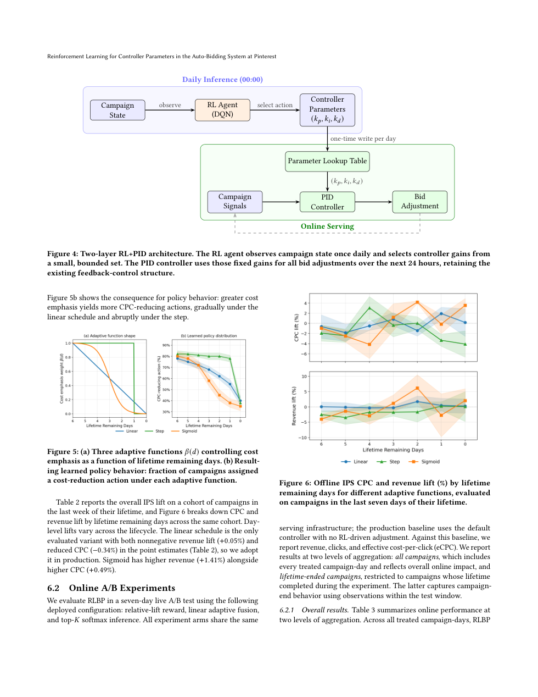
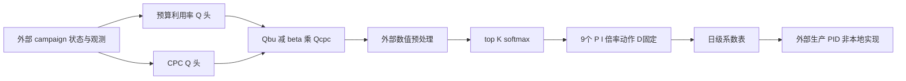

# RLBP：用强化学习调 PID，而不是直接出价

> 本地为 **L1 张量公式组件 / diagnostic only**，只覆盖有界动作、双头目标、奖励、融合与 IPS。没有真实广告数据、拍卖环境、生产 Q 网络或在线出价；完整实验**成本过高，不复现（审查 DONE）**，未接入 Evolve。

## 论文信息

| 字段 | 内容 |
| --- | --- |
| 论文链接 | [固定 v1](https://arxiv.org/abs/2610.33248v1)、[全文](https://arxiv.org/html/2610.33248v1) |
| 原始标题 | Reinforcement Learning for Controller Parameters in the Auto-Bidding System at Pinterest |
| 公司 / 作者机构 | 一作 Yichu Zhou：Pinterest Inc.；与 Qinyi Chen 共同一作，合作包含 UCLA |
| 首次公开日期 | 2026-10-23 19:52:02 UTC，arXiv v1；本轮为重叠窗口补漏，不是 10/30 新首发 |
| 原作者代码 | 固定 v1 正文与摘要未提供 RLBP 作者仓库，本轮未找到/未核验发布，不能将引用的通用 RL 实现当作源码 |
| 本地 adapter / 稳定键 | `pinterest-rlbp`；`adapter: null`，独立公式组件 |
| 本地代码位置 | `src/auto_research/reproductions/pinterest_rlbp.py`；`tests/test_oct30_pinterest.py` |
| 本地证据 | [三种子机制指标](metrics/component-cuda-seeds42-44.json)、[A100 回执](../../gpu-validations/pinterest-rlbp-a100-20261030.json) |

## 原始论文总结

### 背景与主要改动

广告主既希望预算顺利花完，也希望点击成本低。论文保留高频 PID 反馈，只在每天开始由 RL 为 campaign 选择 PID 系数倍率，产出查找表供当天服务；线上 bidder 不加载 Q 网络。它不是神经网络逐次直接决定拍卖出价。

两个 Q 头分别学习预算利用率和 CPC 的相对变化，再按剩余生命周期融合。实际生产配置 $\gamma=0$，是按日结果回归的 contextual bandit；文中多步 Bellman 公式是扩展，不可把“DQN”名称误当作生产已经进行了跨日 bootstrap。

<!-- paper-figure:start -->
### 原论文关键图



图片来自[原论文固定 v1 PDF](https://arxiv.org/pdf/2610.33248v1) 第 7 页；完整页同时保留 Figure 5/6 的权重与 IPS 对照，未重绘。版权归原作者所有，论文 CC BY 4.0；来源与哈希见 `assets/provenance.json`。
<!-- paper-figure:end -->



### 核心公式

Eq.3 中 $k_j=m_jk_j^0$。生产只调 P/I，各从 $\{1-\alpha,1,1+\alpha\}$ 选一个，D 的倍率恒为 1，共 9 个动作。默认 $\alpha=0.2$ 仅为论文例子，不代表公开了真实生产幅度。

Eq.9 相对奖励与 Eqs.4–6 的两头目标：

$$
r^j=\frac{v^j-v^j_{prod}}{v^j_{prod}},\qquad
y^{bu}=r^{bu}+\gamma\max_aQ^{bu}(s',a),\quad
y^{cpc}=r^{cpc}+\gamma\min_aQ^{cpc}(s',a).
$$

$$
\mathcal L=\operatorname{mean}(Q^{bu}(s,a)-y^{bu})^2+
\operatorname{mean}(Q^{cpc}(s,a)-y^{cpc})^2.
$$

CPC 降低保留为负 lift，随后 Eq.7 以 $\widehat Q=Q^{bu}-\beta(d)Q^{cpc}$ 奖励低成本。Eq.8 对经过数值预处理的最高 $K$ 个分数做温度 softmax，其他动作概率严格为零。$\beta$ 的数值尺度和生产预处理未完全公开，本地分别用显式输入/回调，不猜一条生产标定曲线；默认 identity 只是数值参考。

Eq.10 是普通 IPS 均值 $N^{-1}\sum_i\pi(a_i|s_i)r_i/\widehat\pi(a_i|s_i)$，不是自归一化权重估计。零基线或零 logging propensity 没有定义，本地拒绝而非暗加 epsilon。

### 论文离线与线上效果

Section 6.2 的七天真实 A/B 使用相同服务基建，对照是无 RL 调整的默认 PID。全部 treated campaign-days eCPC -0.25% 且 $p<0.05$，收入约持平；lifetime-ended 子群的收入 +0.43%、点击 +0.25%、eCPC +0.18% 是不同聚合口径，不能选报成全部指标都改善。

两个月 rollout 后 holdout 仅作方向参考：流量不均，作者明确未做显著性检验。多步扩展中两头各自的 greedy bootstrap 也不保证融合 Q 是组合奖励的最优 Q。本地没有测得任何广告收益。

## 本地复现与边界

```bash
PYTHONPATH=src python -c 'from auto_research.reproductions.pinterest_rlbp import diagnostic; print(diagnostic(42))'
```

小张量验证两头不同 backup、默认 $\gamma=0$ 不读取未来 Q、冻结目标、真实参数梯度下降、负 CPC 奖励、融合方向、top-K 支持、P/I 动作表及普通 IPS。外部预处理必须在融合后执行一次，并保持形状、device、dtype 和有限值；缩放可改变概率，不能据此假定温度和生产标定可互换。

Q 值/奖励由调用者提供；本地未实现 campaign 类别编码、数值特征 BatchNorm、训练日志生成、生产 propensity 采集、日级任务或 PID 误差到 bid 的函数。随机 Q 参数拟合奖励不等于真实 Q 网络学会了出价。

### 高成本完整实验

完整闭环需要私有 21 天训练日志与 7 天留出日志、真实拍卖和 PID 集成、五种子配置比较、线上广告预算及两个月 holdout。作者未披露总 GPU 小时，不能把完整成本不确定解释为适合试跑。对单卡 A100/A30 或 Mac，本轮**成本过高，不复现（审查 DONE）**；仅保留公式子组件，不下载、不调用 bidder、不自动重试。
