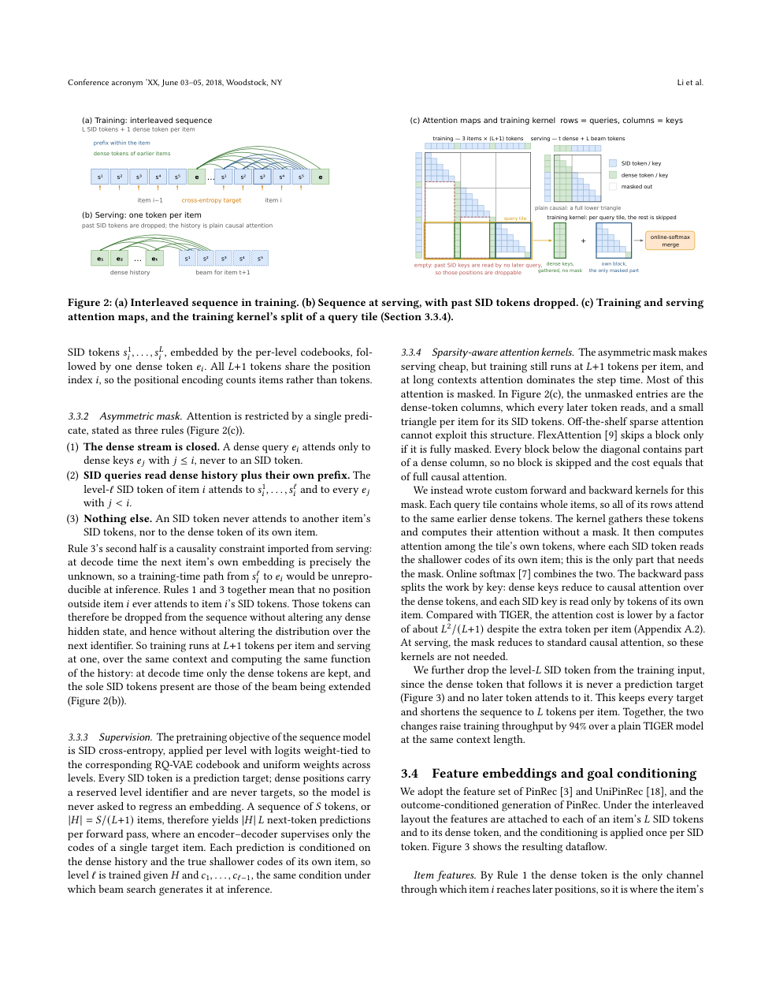
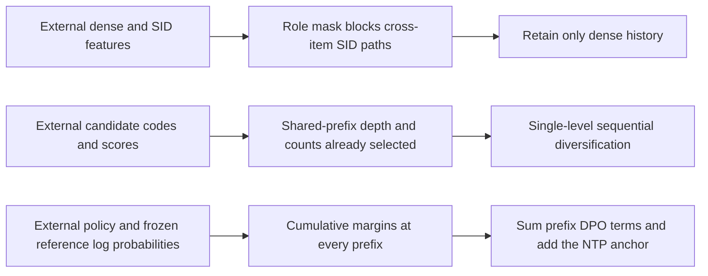

# PinGER: Decoupling history compression from semantic-ID supervision

<!-- source-sha256: 419faa2749922aada03375d430278072c04fe17082af0d6a975dc36832be8571 -->

[简体中文](README.md)

> Local status: **L1 numerical mechanism component; diagnostic only**. This covers role-asymmetric masking, single-level prefix diversification, all-prefix DPO and a next-token prediction anchor. It is not a full recommender, custom CUDA kernel or production service. The complete experiment is **not reproduced due to cost (review complete)**; there is no Evolve integration.

## Paper information

| Field | Details |
| --- | --- |
| Paper | [PinGER: Token-Efficient Generative Retrieval with Semantic IDs](https://arxiv.org/abs/2610.33435v1); [reviewed v1 full text](https://arxiv.org/html/2610.33435v1) |
| Affiliations | First author Xinyi Li; all authors list Pinterest. |
| First public release | 2026-10-24 04:24:45 UTC, arXiv v1. This entry backfills a recent announcement; it was not first published on October 30. |
| Author code | The v1 paper and abstract did not link to an author repository for PinGER, and no release was verified. Referenced projects such as STATIC and FlashAttention are not PinGER source. |
| Local key | `pinger`; standalone numerical component, no adapter |
| Local code | `src/auto_research/reproductions/pinger_components.py`; `tests/test_oct30_pinterest.py` |
| Validation | [Three-seed mechanism metrics](metrics/component-cuda-seeds42-44.json), [A100 receipt](../../gpu-validations/pinger-a100-20261030.json) |

## What the paper changes

Semantic-ID (SID) retrieval represents an item with a hierarchy of discrete codes. It makes candidates generatable, but the sequence grows with the number of code levels. PinGER interleaves SID tokens with a dense token per item during training. A role-specific attention mask lets later items see only the dense tokens of earlier items. The model still receives supervision at each SID level, but serving can drop historical SID tokens. A retained dense token may fuse content and SID features; “dense-only” does not mean it contains no discrete information.

Beam diversification penalizes repeated subtrees in proportion to shared prefix depth rather than changing only sampling temperature. Post-training derives high/low-utility preference pairs from ranker logs for the same exposed slate, applies DPO at every SID prefix, and retains a next-identifier anchor. Production also uses shared-history cascade attention, a valid-SID trie and a host-side resolution index.

### Original paper figure



Original Figure 2 and its caption, from page 4 of the [v1 PDF](https://arxiv.org/pdf/2610.33435v1), without redrawing. Copyright belongs to the original authors; the paper uses CC BY-NC-ND 4.0. See [figure provenance](assets/provenance.json).



### Core equations

The conceptual token layout for item \(i\) is \([s_i^1,\ldots,s_i^L,e_i]\). Under the Section 3.3 mask, a dense query can read \(e_j\) for \(j\le i\). An SID query \(s_i^\ell\) can read earlier items' dense tokens and its own \(s_i^1,\ldots,s_i^\ell\), but not its own \(e_i\) or another item's SID tokens. Visibility of the current input position does not expose a future label; next-token targets still need to be shifted correctly.

Equation 5 selects \(W\) candidates sequentially at one level. Let \(n_w\) be the number of selections already assigned to parent beam \(w\), and \(m(w,w')\) the longest common prefix length of two parents:

$$
\arg\max_w\left[s(w,v_w^{n_w+1})-\lambda\sum_{w'}m(w,w')n_{w'}\right].
$$

A parent contributes to its own depth penalty. With \(\lambda=0\), this becomes ordinary top-\(W\) selection. The local implementation returns the single-level selection with original scores and the penalized scores at selection time; it does not guess production bookkeeping across levels or implement the fused GPU loop.

With \(s_\theta(c_{1:\ell})\) denoting cumulative prefix log probability, Equation 6 is

$$
\mathcal L=\mathcal L_{NTP}
+w\sum_{\ell=1}^{L}-\log\sigma\left(\beta[(s_\theta^+-s_\theta^-)-(s_{ref}^+-s_{ref}^-)]_{1:\ell}\right).
$$

Sum over all prefixes for each pair, then average across the batch. The reference is detached. A finite reference margin does not impose a hard stop when the reference already ranks the pair correctly; the sigmoid still gives a gradient. A local negative control guards against substituting that hard stop for the equation.

### Results reported by the authors

Section 5.3 reports a two-week production Related Pins A/B test against PinRec with a fixed candidate budget. Table 4 reports **+0.62% saves** and **+3.60% fresh-Pins saves**, significant at the reported two-sided 5% level. Production used beam width 60 and \(\lambda=3\), not the offline beam-100 setting.

Table 3 shows the diversity trade-off: \(\lambda=3\) raises distinct@1 from 11.9 to 93.6 while reducing R@100 from 4.00% to 1.42%. The production gains belong to the complete tokenizer, features, model and serving stack. They are not local measurements of the mask or loss.

## Local reproduction and limits

```bash
PYTHONPATH=src python -c 'from auto_research.reproductions.pinger_components import diagnostic; print(diagnostic(42))'
PYTHONPATH=src python -m pytest tests/test_oct30_pinterest.py -q
```

Two layers of small-tensor attention check that retained dense outputs are unchanged after removing SID history; a standard causal mask serves as a counterexample. Equivalence assumes the retained inputs and position features are unchanged. Actual item-shared position IDs, timestamp-gap copying and SID fusion remain external. The component does not implement RoPE, dropping the final SID level during training or a sparse kernel.

Other checks cover validity masking, longest-common-prefix penalties, the zero-penalty case, stable ties, all-prefix DPO, gradients from the NTP anchor and actual updates to small parameter tensors. This is a dense reference attention calculation and a sequential Python selector. It establishes neither production speed, memory savings, SID resolution nor retrieval quality.

### Full experiment: not reproduced

The paper depends on private PinCLIP/OmniSage features and engagement data, a billion-scale item catalog, RQ-VAE, a four-layer 768-dimensional model, training sequences up to 6,144 tokens, multi-beam serving and production A/B. No full GPU-hour total is disclosed. A faithful end-to-end run is not affordable on one A100/A30 or a Mac, so review is complete without large downloads, simulated business gains or automatic retries.
