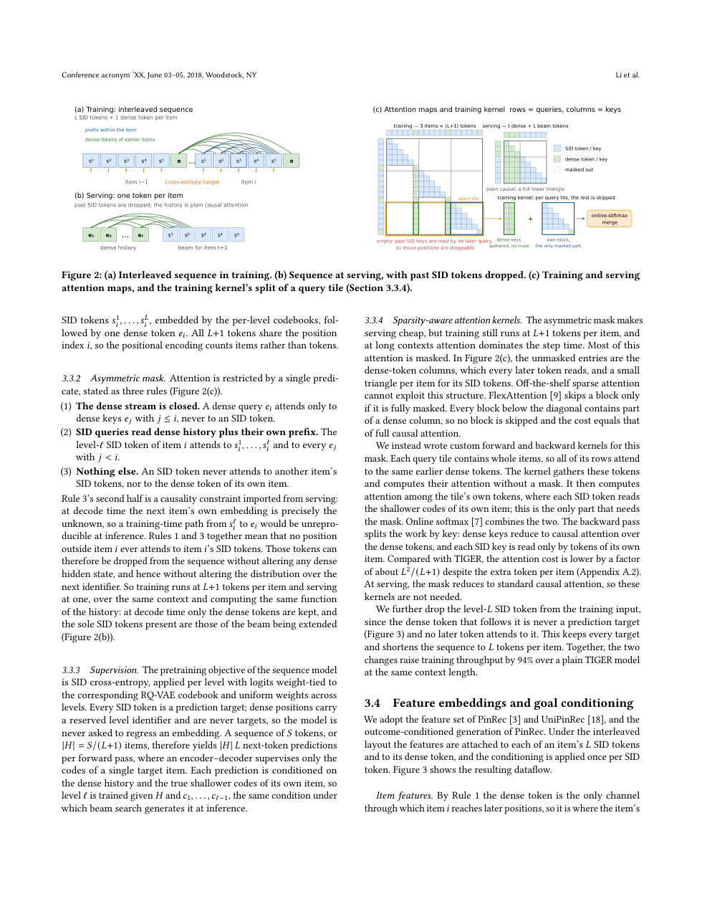
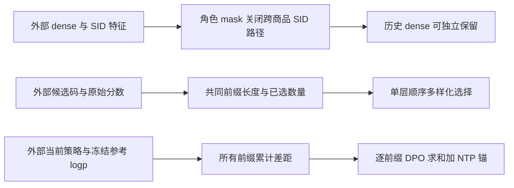

# PinGER：输入压缩与 SID 监督解耦

> 本地为 **L1 数值机制组件 / diagnostic only**：角色非对称 mask、单层前缀多样化选择、分层 DPO 与 NTP 锚。不实现完整推荐器、自定义 CUDA kernel 或生产服务；完整实验**成本过高，不复现（审查 DONE）**，未接入 Evolve。

## 论文信息

| 字段 | 内容 |
| --- | --- |
| 论文链接 | [固定 v1](https://arxiv.org/abs/2610.33435v1)、[全文](https://arxiv.org/html/2610.33435v1) |
| 原始标题 | PinGER: Token-Efficient Generative Retrieval with Semantic IDs |
| 公司 / 作者机构 | 一作 Xinyi Li：Pinterest；作者均署名 Pinterest |
| 首次公开日期 | 2026-10-24 04:24:45 UTC，arXiv v1；本轮为近期公告补漏，不是 10/30 新首发 |
| 原作者代码 | 固定 v1 正文与摘要未提供 PinGER 作者仓库，本轮未找到/未核验发布；STATIC、FlashAttention 等引用不等于 PinGER 源码 |
| 本地 adapter / 稳定键 | `pinger`；`adapter: null`，独立数值组件 |
| 本地代码位置 | `src/auto_research/reproductions/pinger_components.py`；`tests/test_oct30_pinterest.py` |
| 本地证据 | [三种子机制指标](metrics/component-cuda-seeds42-44.json)、[A100 回执](../../gpu-validations/pinger-a100-20261030.json) |

## 原始论文总结

### 背景与主要改动

SID 检索把一个商品分成多级离散码，便于生成候选，却让历史输入随码层数膨胀。PinGER 在训练中交替摆放每件商品的 SID 和 dense token，通过角色相关 mask 让后续商品只能读取历史 dense；保留各级 SID 监督，服务时则删除历史 SID。dense 本身仍可由内容和 SID fusion 组成，不能误解为它完全不含离散信息。

另一条改动是按共同前缀深度惩罚重复子树，而非只调采样温度。后训练从同一曝光 slate 的排序器日志取高/低效用偏好对，对所有 SID 前缀做 DPO，并保留 next-identifier 锚。生产侧另有共享历史 cascade attention、有效 SID trie 和主机内解析索引。

<!-- paper-figure:start -->
### 原论文关键图



图片来自[原论文固定 v1 PDF](https://arxiv.org/pdf/2610.33435v1) 第 4 页，保留完整原图及图注，未重绘；版权归原作者所有，论文 CC BY-NC-ND 4.0。页码、来源和哈希见 `assets/provenance.json`。
<!-- paper-figure:end -->



### 核心公式

概念布局每件商品为 $[s_i^1,\ldots,s_i^L,e_i]$。Section 3.3 的 dense 查询只读 $e_j,j\le i$；$s_i^\ell$ 只读更早商品的 dense 和本商品 $s_i^1,\ldots,s_i^\ell$，不能读自己的 $e_i$ 或别的商品 SID。自注意力包含当前位置不意味着标签可提前输入；真实 NTP 仍需正确移位。

Eq.5 在一层内依次选 $W$ 个候选。$n_w$ 是父 beam 已获名额，$m(w,w')$ 是两个父前缀的最长公共前缀长度：

$$
\arg\max_w\left[s(w,v_w^{n_w+1})-\lambda\sum_{w'}m(w,w')n_{w'}\right].
$$

同一父 beam 自身也产生深度惩罚；$\lambda=0$ 恢复普通 top-$W$。本地只返回单层选择及原始/当时罚后分数，不猜测原服务跨层 bookkeeping，也不是原文 fused GPU loop。

令 $s_\theta(c_{1:\ell})$ 为前缀 logp 累积，Eq.6 为：

$$
\mathcal L=\mathcal L_{NTP}+w\sum_{\ell=1}^{L}-\log\sigma\left(\beta[(s_\theta^+-s_\theta^-)-(s_{ref}^+-s_{ref}^-)]_{1:\ell}\right).
$$

对每对样本先求所有前缀损失之和，再取 batch 均值；参考分支停止梯度。参考 margin 不是“已正确排序即梯度为零”的硬门槛，有限 margin 下仍有 sigmoid 梯度；本地负控防止把正文直觉解释误写成条件停止。

### 论文离线与线上效果

Section 5.3 是真实生产 A/B，不只摘要部署描述：Related Pins 两周对照 PinRec、固定候选预算，表 4 saves +0.62%、fresh Pins saves +3.60%；论文说明报告提升按双侧 5% 水平显著。线上部署使用 beam 60、$\lambda=3$，不能把它与离线 beam 100 表格混为同一配置。

Table 3 的多样性有代价：$\lambda=3$ 将 distinct@1 从 11.9 提到 93.6，但 R@100 从 4.00% 降到 1.42%；这不是“多样化必然提高离线召回”。生产收益来自完整 tokenizer、特征、模型和服务栈，不能归因于本地 mask 或损失单核。

## 本地复现与边界

```bash
PYTHONPATH=src python -c 'from auto_research.reproductions.pinger_components import diagnostic; print(diagnostic(42))'
```

两层真实小张量 attention 验证 dense 删 SID 后不变，并以普通 causal mask 作反例；等价测试假设保留 token 的输入/位置特征相同。实际 item 共享 position ID、timestamp gap 拷贝及 SID fusion 均在外部，未实现 RoPE、训练中删除末级 SID 或稀疏 kernel。

另验证有效码屏蔽、最长共同前缀惩罚、$\lambda=0$、稳定平局、所有前缀 DPO、NTP 锚梯度与真实小参数更新。这里用 dense attention 参考式和 Python 顺序选择，不宣称生产速度、显存节省、有效 SID 解析或召回效果。

### 高成本完整实验

原文依赖私有 PinCLIP/OmniSage 和参与度数据、十亿量级商品库、RQ-VAE、4 层 768 维模型、最长 6144 训练 token，以及多 beam 服务/生产 A/B。作者未披露完整 GPU 小时；单卡 A100/A30 或 Mac 无法低成本忠实执行该完整闭环：**成本过高，不复现（审查 DONE）**。不下载大资源、不模拟业务收益、不自动重试。
