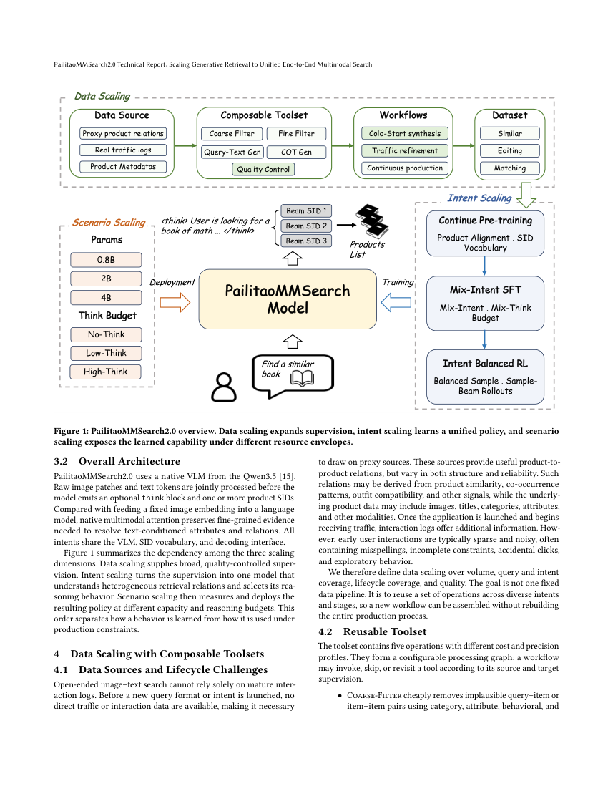
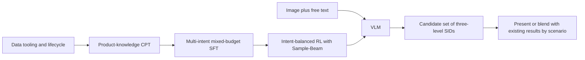

# PailitaoMMSearch2.0: Unified end-to-end multimodal generative search

<!-- source-sha256: a2a62e7242409056fe721d34b5ac7f68b2766ef7df81fd9ebf56e0df85948b89 -->

[简体中文](README.md)

> **Reference entry only; full experiments not reproduced due to cost (review complete).** There is no executable local model, training, benchmark or GPU result, and no adapter or Evolve registration.

## Paper information

| Field | Details |
| --- | --- |
| Paper | [PailitaoMMSearch2.0 Technical Report: Scaling Generative Retrieval to Unified End-to-End Multimodal Search](https://arxiv.org/abs/2610.36958v1); [reviewed v1 full text](https://arxiv.org/html/2610.36958v1) |
| Affiliations | First author Xiaohan Ye: Taobao & Tmall Group of Alibaba |
| First public release | 2026-10-27 10:17:33 UTC, arXiv v1; announced October 28 |
| Author code | Neither the reviewed full text nor its abstract provided an author repository, and no public implementation was found in this review. This does not preclude a future release. |
| Local key | `pailitao-mmsearch2`; no adapter |
| Local code and evidence | None. This directory records the method, original figure and cost decision, not model code or metrics. |

## What the paper changes

A shopper can submit a picture and ask for a variant with different attributes or for matching accessories. The retrieval relationship and compute budget are not fixed. PailitaoMMSearch2.0 feeds the image, free text and optional context directly to a vision-language model (VLM) that emits a list of product semantic IDs (SIDs). It does not first classify the intent to route the request to separate experts.

The data process combines cold start, quality calibration and feedback from real traffic. Training proceeds through product-knowledge continued pretraining (CPT), supervised fine-tuning (SFT) with mixed reasoning budgets, and intent-balanced reinforcement learning (RL). Sample–Beam separates sampling the reasoning portion from beam decoding of SID candidates, so training sees sets of candidates closer to the multiple results served online. It is not just single-response GRPO under another name.

### Original paper figure

Unredrawn page from the [v1 PDF](https://arxiv.org/pdf/2610.36958v1); see [figure provenance](assets/provenance.json). The original authors retain copyright; the paper uses CC BY 4.0.

### Core formulation

Equations 1–2 define the request $x=(I,Q,C)$ and candidate set $\mathcal Y=\operatorname{Decode}_B(\pi_\theta(\cdot|x))$. A product SID has three levels, each with an 8,192-entry codebook. Decoding is itself candidate generation. Intent slices support data preparation and evaluation; an intent label is not a required serving input.

Training needs real multi-intent rewards, within-group comparisons and Sample–Beam rollout trajectories. A normalization function or ordinary beam search in isolation would not represent this method, so this repository does not register a placeholder operator under its name.

### Results reported by the authors

In Table 8, at the same initialization, macro ER is 49.03% for SFT, 52.70% for standard RL and 55.00% for Sample–Beam RL; gains differ across intents. Table 9 shows that more reasoning is not always better: the 0.8B model's highest macro ER is in the No-think setting.

Section 7.6 reports a controlled production A/B test lasting about 14 days, with about 10% of traffic in the treatment bucket. Product page views increased 17.90%, transactions 27.04%, and GMV 8.94%. CTR increased **0.58 percentage points** and CVR **0.37 percentage points**; the paper reports $p<0.05$ for the gains. The results are for the complete deployment, not isolated modules. The paper separately reports 100% rollout for the relevant scenarios.

## Local scope and cost decision

No local training or inference was run; there are no metric or GPU artifacts. The paper covers 0.8B/2B/4B models, multiple budgets, large-scale multimodal production data, CPT/SFT/RL and multiple online scenarios. Some data is private and a complete, transferable GPU-hour budget is not reported. The full study is **not reproduced due to cost** on one A100/A30 or a Mac. No large download, trial or automatic retry is scheduled.
