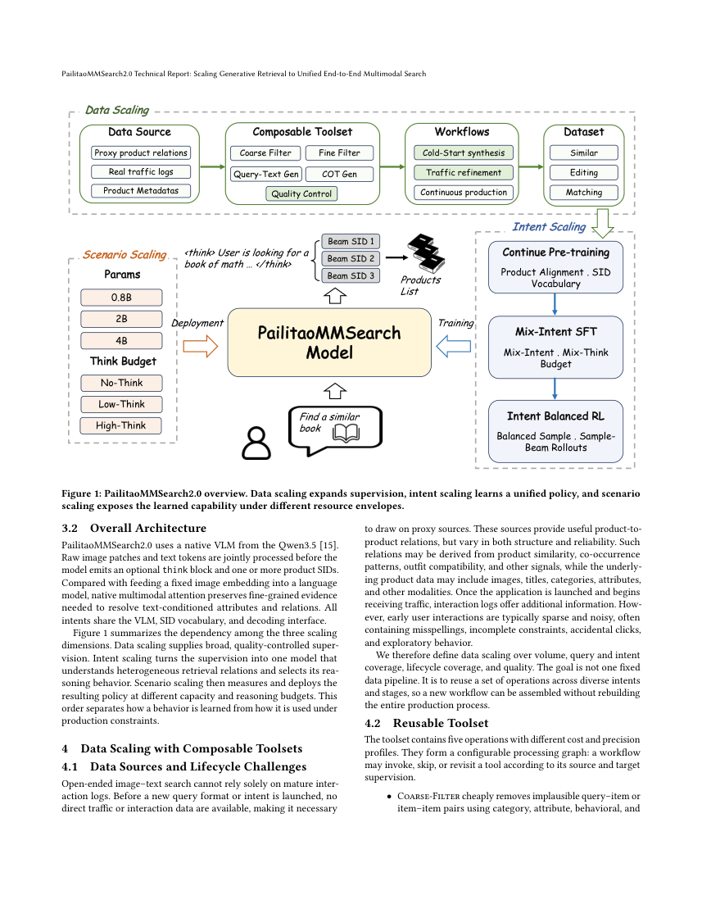

# PailitaoMMSearch2.0：统一端到端多模态生成式搜索

> **资料收录，完整实验成本过高，不复现（审查 DONE）**。没有本地可执行模型、训练、benchmark或GPU结果，不注册adapter/Evolve。

## 论文信息

| 字段 | 内容 |
| --- | --- |
| 论文链接 | [固定v1](https://arxiv.org/abs/2610.36958v1)、[全文](https://arxiv.org/html/2610.36958v1) |
| 原始标题 | PailitaoMMSearch2.0 Technical Report: Scaling Generative Retrieval to Unified End-to-End Multimodal Search |
| 公司 / 作者机构 | 一作Xiaohan Ye：Taobao & Tmall Group of Alibaba |
| 首次公开日期 | 2026-10-27 10:17:33 UTC，arXiv v1；10月28日公告 |
| 原作者代码 | 固定全文与摘要未提供作者开源仓库，本轮未找到；不等于认定永久不会开放 |
| 本地 adapter / 稳定键 | `pailitao-mmsearch2`；`adapter: null` |
| 本地代码位置 | 无可执行复现；本目录仅保存方法、原图与成本判断，不存在模型代码或指标 |

## 原始论文总结

### 背景与主要改动

用户上传图片并要求“同款换属性”或“找搭配”，检索关系与计算预算都不固定。PailitaoMMSearch2.0把原图、自由文本和可选上下文直接送入VLM，生成商品SID列表，不依赖一个先判意图再切多专家的路由器。

数据工具按冷启动、质量校准和真实流量反馈组合；模型依次做商品知识CPT、混合推理预算SFT与意图均衡RL。Sample–Beam把推理部分采样和SID候选束生成分开，让训练的候选集合更接近线上多结果服务，而不是普通单响应GRPO换个名字。

<!-- paper-figure:start -->
### 原论文关键图

原始PDF整页截图，未重绘，来源与哈希见 `assets/provenance.json`。论文CC BY 4.0，版权归作者。
<!-- paper-figure:end -->

### 核心公式

Eqs.1–2定义 $x=(I,Q,C)$ 与 $\mathcal Y=\operatorname{Decode}_B(\pi_\theta(\cdot|x))$。商品三层SID各层码本8192，解码本身就是候选生成；意图slice用于数据/评测，不作为线上必填标签。

训练需要真实多意图奖励、组内比较和Sample–Beam rollout轨迹。只实现一个归一化函数或普通beam search不能代表这套方法，因此本地不放一个同名占位算子。

### 论文离线与线上效果

Table8在相同初始化下，SFT macro ER49.03%，标准RL52.70%，Sample–Beam RL55.00%；不同意图增益并不一致。Table9还显示更大推理预算并非总更好，例如0.8B模型No-think最高macro ER，不能笼统宣传思考越久越好。

Section7.6披露约14天、实验桶约10%流量的受控线上A/B。商品PV+17.90%、成交笔数+27.04%、GMV+8.94%；CTR是**+0.58个百分点**、CVR **+0.37个百分点**，均 $p<0.05$。效果属于完整部署配置，不能归因到某个孤立模块。论文另称相关场景已100%全量。

## 本地复现与边界

未执行训练或推理，不产生metrics/GPU凭证。论文涉及0.8B/2B/4B多模型、多预算、大规模多模态生产数据、CPT/SFT/RL与多场景线上实验；部分依赖私有数据，作者未给可据以重跑的完整GPU小时预算。相对单卡A100/A30或Mac，**成本过高，不复现（审查 DONE）**；不下载大资源、不运行试验、不自动重试。
