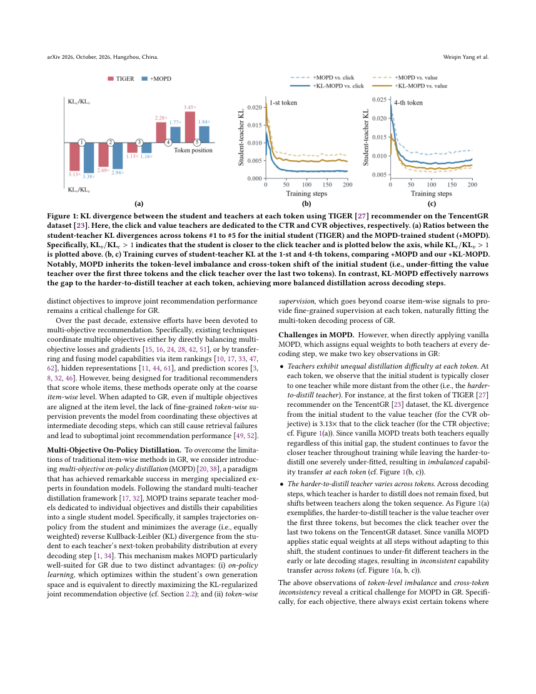
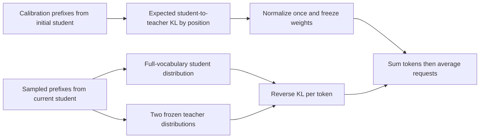

# KL-MOPD: Calibrating multi-objective on-policy distillation by initial discrepancy

<!-- source-sha256: 32d21d9bb6b5b4edd04ddc4866523e424f3a1b27fe9d109d610240bf4da3c672 -->

[简体中文](README.md)

> Local status: **L1 differentiable loss component; diagnostic only**. This is not a full recommender or online sampler. Full training and production experiments are **not reproduced due to cost (review complete)**. There is no Evolve integration.

## Paper information

| Field | Details |
| --- | --- |
| Paper | [KL-MOPD: Discrepancy-Aware Multi-Objective On-Policy Distillation for Generative Recommendation](https://arxiv.org/abs/2610.36973v1); [reviewed v1 full text](https://arxiv.org/html/2610.36973v1) |
| Affiliations | First author Weiqin Yang: Zhejiang University; collaboration with Alibaba Group |
| First public release | 2026-10-27 10:28:05 UTC, arXiv v1; announced October 28 |
| Author code | [Yandorn/KL-MOPD](https://github.com/Yandorn/KL-MOPD), pinned to `28d9bcbd8fc9f5ccaa52def5db77d4c34bade965`, MIT. The local component does not copy the authors' implementation. |
| Local key | `kl-mopd`; standalone component, no adapter |
| Local code | `src/auto_research/reproductions/kl_mopd.py`; `tests/test_oct29_root_components.py` |
| Local evidence | [Three-seed mechanism metrics](metrics/component-cuda-seeds42-44.json); [A100 validation receipt](../../gpu-validations/kl-mopd-a100-20261029.json) |

## What the paper changes

A generative recommender emits multiple semantic tokens per item. Missing a conversion teacher's preference at one position can prevent retrieval of the whole item. Weighting click and value teachers equally at every step ignores that each can be harder for the student to match at different positions.

KL-MOPD first estimates per-position reverse KL to each teacher on prefixes generated by the **frozen initial student**. The discrepancies are normalized once and then held fixed as teacher weights. Training evaluates the weighted reverse KL on prefixes generated by the **current student**. It neither recalibrates those weights at every step nor distills from a pre-averaged teacher distribution.

### Original paper figure



Unredrawn page from the [v1 PDF](https://arxiv.org/pdf/2610.36973v1); see [figure provenance](assets/provenance.json) for the page, source and checksum. The original authors retain copyright; the paper uses CC BY-NC-ND 4.0.



### Core equations

Equations 3.1–3.3 use initial student $p_0$, current student $p_\theta$ and teachers $q_j$:

$$
d_{j,t}=\mathbb E_{x,y\sim p_0}D_{KL}(p_0(\cdot|x,y_{<t})\|q_j(\cdot|x,y_{<t})),\quad
\alpha_{j,t}=\frac{d_{j,t}}{d_{c,t}+d_{v,t}}.
$$

$$
\mathcal L=\mathbb E_{x,y\sim p_\theta}\sum_t\sum_{j\in\{c,v\}}\alpha_{j,t}
D_{KL}(p_\theta(\cdot|x,y_{<t})\|q_j(\cdot|x,y_{<t})).
$$

The local calibration weights valid prefixes equally at each position. The loss **sums** token terms within each request, then averages requests; it does not normalize by request length. The paper assumes strictly positive discrepancy for each teacher. Missing positions and zero discrepancies are rejected rather than covered by an epsilon or a uniform fallback. Both teacher distributions and the weights are detached.

### Results reported by the authors

Table 5 reports a 3.19% average relative improvement over MOPD on the industrial-data joint objective. Section 4 reports a five-day production A/B test with 10% of real traffic in each of the control and treatment groups. Table 6 reports advertising revenue up 1.63% and GMV up 2.20%, both $p<0.05$. These are the authors' full-system results, not outcomes from local synthetic tensors.

## Local reproduction and limits

```bash
PYTHONPATH=src python -c 'from auto_research.reproductions.kl_mopd import diagnostic; print(diagnostic(42))'
PYTHONPATH=src python -m pytest tests/test_oct29_root_components.py -q
```

`calibrate_weights` and `kl_mopd_loss` preserve full-vocabulary KL direction, fixed position-specific weights, frozen teachers and the two-stage reduction. Checks use an independent probability-domain reference, distinguish reverse from forward KL and fixed from dynamic recalibration, require zero gradient on padding, and verify a real student update.

Callers must ensure the calibration and training prefixes come from the initial and current students, respectively. The component cannot prove that its input is on-policy. It does not implement semantic IDs, two-tower/RQ-kmeans stages, TIGER/REG4Rec, real rollouts or recommendation evaluation. An SGD loss decrease on random logits does not establish business impact.

### Full experiment: not reproduced

The paper uses three large public datasets and billion-scale private advertising logs, with initial student pretraining, two teacher fine-tunes, distillation, baseline tuning and live traffic. The industrial decoder has five layers of width 1024; each final-day split exceeds 11M requests. The authors do not provide total GPU hours. The complete multi-stage study is not affordable on one A100/A30 or a Mac; no large download or automatic retry is scheduled.
